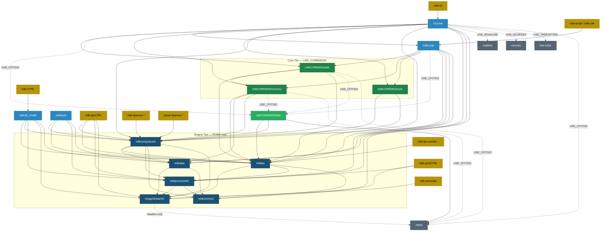
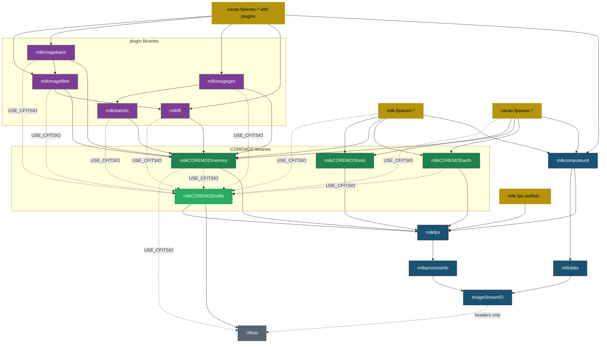

# Dependency Graph

<!-- prettier-ignore -->
!!! note
    Generated from CMakeLists.txt. See [Build Tiers](../quickstart/build_tiers.md) for cmake
    commands.

## Legend

| Color               | Meaning                         |
| ------------------- | ------------------------------- |
| ⚫ Grey             | External library                |
| 🔵 Dark blue        | Engine tier                     |
| 🔵 Light blue       | Framework                       |
| 🟢 Green            | Core modules                    |
| 🟢 Green dashed     | cfitsio-dependent (USE_CFITSIO) |
| 🟣 Purple           | Plugins                         |
| 🟠 Orange           | Cacao modules                   |
| 🟡 Gold             | Executables                     |
| `-.->` dashed arrow | Conditional link                |

---

## 1. Core Stack



---

## 2. Plugins & Cacao

> Built whenever `USE_COREMODS=ON`. Every plugin and cacao module is compiled with `-DMILK_NO_CLI`
> (`milk_add_runnable_module()`) and links the runnable base libraries (`milkfps`, `milkcomputeunit`,
> `milkprocessinfo`, `ImageStreamIO`, `milkdata`, `milkCOREMOD*`) — **never** `CLIcore`.

```mermaid
graph TD
    RUNNABLE["Runnable Base<br/>(milkcomputeunit + milkCOREMOD*)"]:::coremod
    OPENBLAS["OpenBLAS / MKL"]:::ext
    LAPACKE["LAPACKE"]:::ext
    FFTW["FFTW"]:::ext
    NCURSES["ncurses"]:::ext

    subgraph milkplugins ["milk-extra plugins"]
        FFT["milkfft"]:::plugin
        LINALG["milklinalgebra"]:::plugin
        LINOPT["milklinoptimtools"]:::plugin
        STAT["milkstatistic"]:::plugin
        IMGGEN["milkimagegen"]:::plugin
        IMGBASIC["milkimagebasic"]:::plugin
        IMGFILT["milkimagefilter"]:::plugin
        IMGFMT["milkimageformat"]:::plugin
        INFO["milkinfo"]:::plugin
        ZERNIKE["milkZernikePolyn"]:::plugin
        LINARPRED["milklinARfilterPred"]:::plugin
        KDTREE["milkkdtree"]:::plugin
        IMREDUCE["milkimgreduce"]:::plugin
        PSF["milkpsf"]:::plugin
        CLUSTER["milkclustering"]:::plugin
    end

    subgraph cacaomods ["cacao modules"]
        AOLOOP["cacaoAOloopControl"]:::cacao
        AODM["cacaoAOloopControlDM"]:::cacao
        AOIO["cacaoAOloopControlIOtools"]:::cacao
        AOACQ["cacaoAOloopControlacquireCalib"]:::cacao
        AOPC["cacaoAOloopControlPredictiveControl"]:::cacao
        AOCT["cacaoAOloopControlcompTools"]:::cacao
        AOPT["cacaoAOloopControlperfTest"]:::cacao
        COMPCALIB["cacaocomputeCalib"]:::cacao
        PYRWFS["cacaopyramidWFStools"]:::cacao
    end

    FFT --> RUNNABLE
    FFT --> FFTW
    LINALG --> RUNNABLE
    LINALG --> OPENBLAS
    LINALG -.-> LAPACKE
    LINOPT --> RUNNABLE
    LINOPT --> OPENBLAS
    LINOPT --> LAPACKE
    STAT --> RUNNABLE
    IMGGEN --> RUNNABLE
    IMGGEN --> STAT
    IMGBASIC --> RUNNABLE
    IMGBASIC --> IMGFILT
    IMGFILT --> RUNNABLE
    IMGFILT --> FFT
    IMGFMT --> RUNNABLE
    IMGFMT -.-> IMGFILT
    INFO --> RUNNABLE
    INFO -.-> NCURSES
    ZERNIKE --> RUNNABLE
    ZERNIKE --> IMGGEN
    LINARPRED --> RUNNABLE
    LINARPRED --> LINALG
    LINARPRED --> OPENBLAS
    KDTREE --> RUNNABLE
    IMREDUCE --> RUNNABLE
    PSF --> RUNNABLE
    CLUSTER --> RUNNABLE

    AOLOOP --> RUNNABLE
    AOLOOP --> LINOPT
    AODM --> RUNNABLE
    AODM --> FFT
    AODM --> IMGGEN
    AODM --> IMGFILT
    AODM --> STAT
    AODM --> AOLOOP
    AOIO --> RUNNABLE
    AOIO --> INFO
    AOIO --> STAT
    AOIO --> AOLOOP
    AOACQ --> RUNNABLE
    AOACQ --> INFO
    AOACQ --> AOLOOP
    AOPC --> RUNNABLE
    AOPC --> LINOPT
    AOPC --> AOLOOP
    AOCT --> RUNNABLE
    AOCT --> AOLOOP
    AOPT --> RUNNABLE
    AOPT --> STAT
    AOPT --> AOLOOP
    COMPCALIB --> RUNNABLE
    COMPCALIB --> INFO
    COMPCALIB --> LINOPT
    COMPCALIB --> STAT
    COMPCALIB --> ZERNIKE
    COMPCALIB --> AOLOOP
    COMPCALIB --> OPENBLAS
    PYRWFS --> RUNNABLE
    PYRWFS --> INFO
    PYRWFS --> AOLOOP

    classDef ext fill:#566573,stroke:#333,color:#fff
    classDef coremod fill:#1e8449,stroke:#145,color:#fff
    classDef plugin fill:#7d3c98,stroke:#5a2,color:#fff
    classDef cacao fill:#d35400,stroke:#a00,color:#fff
```



---

## 3. Standalone Executables (`fpsexec`)

> Generated `milk-fpsexec-*` and `cacao-fpsexec-*` binaries never link `CLIcore`; they link their
> module library and the runnable base libraries directly.



---

## 4. Build Tiers at a Glance

| Tier            | CMake flags                        | What is built                                                                                                |
| --------------- | ---------------------------------- | ------------------------------------------------------------------------------------------------------------ |
| **Engine**      | `-DUSE_COREMODS=OFF -DUSE_CLI=OFF` | ImageStreamIO, milkcommon, milkprocessinfo, milkfps, milkcomputeunit, milkdata, `milk-fpsCTRL`, `milk-procCTRL` |
| **Core**        | `-DUSE_CLI=OFF`                    | Engine + COREMODs (arith, memory, tools, iofits) + plugins + `fpsexec` binaries                              |
| **Core − FITS** | `-DUSE_CLI=OFF -DUSE_CFITSIO=OFF`  | Engine + COREMODs (arith, memory, tools) + non-FITS plugins + `fpsexec` binaries                             |
| **Full**        | _(defaults)_                       | Core + CLI (`milk-cli`, `milk-script`, `milk.bash`, `milk-CTRL`, `milk-termview`)                            |

```text
cfitsio (headers only, optional)
  ╌╌ ImageStreamIO                    ← Engine
       ├─ milkdata      (+ milkcommon)
       └─ milkprocessinfo (+ milkcommon)
            └─ milkfps
                 └─ milkcomputeunit    (standalone runtime)
                      └─ CLIcore / milkscript (full CLI)

milkCOREMODarith  ─┐
milkCOREMODmemory ─┼─ Core             ← USE_COREMODS (+ plugins & fpsexecs)
milkCOREMODtools  ─┘
milkCOREMODiofits ─── Core (USE_CFITSIO)
```

---

## 5. Detailed Dependency Tables

<details markdown="1">
<summary><b>Engine Tier — Core Libraries</b></summary>

| Target          | Links to                                                       | Optional                |
| --------------- | -------------------------------------------------------------- | ----------------------- |
| ImageStreamIO   | _(none at link time)_                                          | cfitsio (headers), CUDA |
| milkcommon      | pthread                                                        |                         |
| milkprocessinfo | ImageStreamIO, milkcommon                                      |                         |
| milkfps         | ImageStreamIO, milkprocessinfo, milkcommon                     |                         |
| milkdata        | ImageStreamIO, milkcommon                                      |                         |
| milkcomputeunit | milkfps, milkdata, milkprocessinfo, milkcommon, ImageStreamIO  |                         |

</details>

<details markdown="1">
<summary><b>Framework Libraries</b></summary>

| Target     | Links to                                                                                                                               | Optional                                                                                  |
| ---------- | -------------------------------------------------------------------------------------------------------------------------------------- | ----------------------------------------------------------------------------------------- |
| milkscript | milkCOREMODarith, milkCOREMODmemory, milkCOREMODtools, milkfps, milkcomputeunit, milkdata, milkprocessinfo                             | milkCOREMODiofits (USE_CFITSIO), cfitsio (USE_CFITSIO), OpenMP, OpenBLAS, MKL, lapacke    |
| milkbash   | milkfps, milkcomputeunit, milkprocessinfo, milkdata                                                                                    |                                                                                           |
| CLIcore    | milkscript, milkCOREMODarith, milkCOREMODmemory, milkCOREMODtools, milkfps, milkcomputeunit, milkdata, milkprocessinfo, milkcommon     | milkCOREMODiofits (USE_CFITSIO), cfitsio, readline, ncurses, tree-sitter, OpenMP          |

</details>

<details markdown="1">
<summary><b>Core Tier — COREMOD Libraries</b></summary>

| Target            | Links to                                                                                      | Conditional                                                  |
| ----------------- | --------------------------------------------------------------------------------------------- | ------------------------------------------------------------ |
| milkCOREMODtools  | milkfps, milkcomputeunit, milkprocessinfo, ImageStreamIO, milkdata                            |                                                              |
| milkCOREMODmemory | milkfps, milkcomputeunit, milkprocessinfo, ImageStreamIO, milkdata                            | milkCOREMODiofits, cfitsio (USE_CFITSIO)                     |
| milkCOREMODarith  | milkCOREMODmemory, milkfps, milkcomputeunit, milkprocessinfo, ImageStreamIO, milkdata         | milkCOREMODiofits, cfitsio (USE_CFITSIO), OpenMP, OpenBLAS/MKL |
| milkCOREMODiofits | milkfps, milkcomputeunit, milkprocessinfo, ImageStreamIO, milkdata, cfitsio                   | _only built with USE_CFITSIO_                                |

</details>

<details markdown="1">
<summary><b>Plugins — milk-extra</b></summary>

All plugins link the runnable base set (`milkfps`, `milkcomputeunit`, `milkprocessinfo`,
`ImageStreamIO`, `milkdata`, `milkCOREMODmemory`, `milkCOREMODtools`, `milkCOREMODarith`, and
`milkCOREMODiofits` when `USE_CFITSIO=ON`). Additional links per plugin:

| Target              | Additional Links                 | Optional                            |
| ------------------- | -------------------------------- | ----------------------------------- |
| milkfft             | fftw3, fftw3f                    |                                     |
| milklinalgebra      | OpenBLAS                         | CUDA, MAGMA, MKL, lapacke           |
| milklinoptimtools   | OpenBLAS, lapacke                | MAGMA, MKL                          |
| milkimagegen        | milkstatistic                    |                                     |
| milkstatistic       | _(runnable base)_                |                                     |
| milkimagebasic      | milkimagefilter                  | cfitsio                             |
| milkimagefilter     | milkfft                          | cfitsio                             |
| milkimageformat     | _(runnable base)_                | milkimagefilter, cfitsio            |
| milkinfo            | _(runnable base)_                | ncurses (USE_NCURSES)               |
| milkZernikePolyn    | milkimagegen                     | cfitsio                             |
| milklinARfilterPred | milklinalgebra, OpenBLAS         | CUDA, MAGMA, MKL, lapacke, cfitsio  |
| milkkdtree          | _(runnable base)_                |                                     |
| milkimgreduce       | _(runnable base)_                | CUDA, MAGMA                         |
| milkpsf             | _(runnable base)_                | cfitsio                             |
| milkclustering      | _(runnable base)_                |                                     |

</details>

<details markdown="1">
<summary><b>Plugins — Cacao Modules</b></summary>

All cacao modules link the runnable base set. Additional links per module:

| Target                              | Additional Links                                                                 | Optional                            |
| ----------------------------------- | -------------------------------------------------------------------------------- | ----------------------------------- |
| cacaoAOloopControl                  | milklinoptimtools                                                                |                                     |
| cacaoAOloopControlDM                | milkfft, milkimagegen, milkimagefilter, milkstatistic, cacaoAOloopControl        |                                     |
| cacaoAOloopControlIOtools           | milkinfo, milkstatistic, cacaoAOloopControl                                      |                                     |
| cacaoAOloopControlacquireCalib      | milkinfo, cacaoAOloopControl, milkCOREMODiofits                                  |                                     |
| cacaoAOloopControlPredictiveControl | milklinoptimtools, cacaoAOloopControl                                            |                                     |
| cacaoAOloopControlcompTools         | cacaoAOloopControl                                                               |                                     |
| cacaoAOloopControlperfTest          | milkstatistic, cacaoAOloopControl                                                |                                     |
| cacaocomputeCalib                   | milkinfo, milklinoptimtools, milkstatistic, milkZernikePolyn, cacaoAOloopControl | CUDA, MAGMA, OpenBLAS, MKL, lapacke |
| cacaopyramidWFStools                | milkinfo, cacaoAOloopControl                                                     |                                     |

</details>

<details markdown="1">
<summary><b>Executables</b></summary>

| Target                            | Links to                                                                          |
| --------------------------------- | --------------------------------------------------------------------------------- |
| milk-cli                          | CLIcore                                                                           |
| milk-script, milk-call            | milkscript, milkprocessinfo, milkdata                                             |
| milk-fpsexec-milk-calc/script     | milkscript + fpsexec base                                                         |
| milk-termview                     | ImageStreamIO                                                                     |
| milk-fpsCTRL                      | milkcomputeunit, milkfps, milkprocessinfo, ImageStreamIO                          |
| milk-procCTRL                     | milkprocessinfo, ImageStreamIO                                                    |
| milk-streamCTRL                   | a link to milk-CTRL (opens its streams view)                                      |
| milk-CTRL                         | milkctrl_model (milkfps, milkcomputeunit, milkprocessinfo, milkdata, ImageStreamIO) |
| milk-fps-list/search/set/track/log| milkfps                                                                           |
| milk-fps-info                     | milkfps, ImageStreamIO, milkprocessinfo, milkdata                                 |
| milk-fps-rm/conf*/run*            | milkcomputeunit                                                                   |

</details>

<details markdown="1">
<summary><b>fpsexec CMake Functions</b></summary>

Module `CMakeLists.txt` layout: [Programmer's Guide](programmers_guide.md#6-cmakeliststxt-conventions).

`milk_add_fpsexec_stubs()` (`cmake/milk_runnable.cmake`) generates one `<prefix>-fpsexec-<id>` per
`EXPORT_FPSEXEC` line of the module sources, linked to the module library and to the base link set:
`milkfps`, `milkcomputeunit`, `milkdata`, `milkprocessinfo`, `ImageStreamIO`, `milkCOREMODmemory`,
`milkCOREMODtools`, `milkCOREMODarith`, `milkCOREMODiofits` (`USE_CFITSIO`). Plugin libraries needed
by a unit are linked by the module itself.

When `USE_STATIC_LTO=ON`, `_static`-suffixed static archives (e.g. `milkCOREMODmemory_static`) of
these libraries are linked instead, enabling cross-module Link-Time Optimization. See
[PGO & LTO](../operations/pgo.md).

</details>

---

← [Documentation Index](../index.md)
