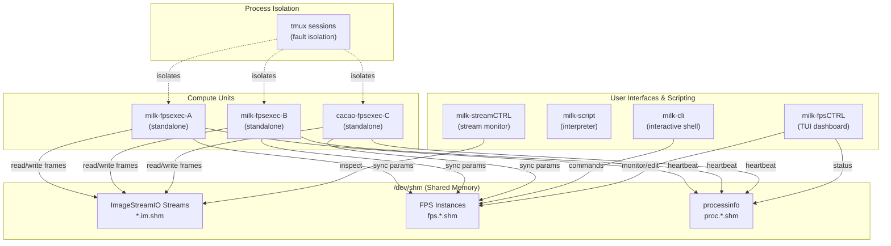

---
tags:
  - developer-guide
  - architecture
  - c-api
render_macros: true
---

# Programmer's Guide to `milk`

Welcome to `milk`. This document serves as an overview of its core architecture and programming
model. If you are reading this while setting up a new module, debugging, or wanting to write a
custom module, this guide will orient you on the core concepts.

## 1. Core Architecture

`milk` is structured around decoupled, high-performance computing components. Instead of monolithic
structures, it relies on small modular units ("compute units") talking to each other via standard
inter-process communication mechanisms.

The architecture orbits around two primary concepts:

1. **ImageStreamIO (Streams):**
   - The primary data layer. Shared memory images/data cubes are passed around with near-zero copy
     overhead. Stream metadata holds dimensions, data format, keywords, and synchronization
     semaphores that trigger downstream processes.

2. **Function Processing System (FPS):**
   - The control and parameter layer. FPS manages configuration parameters, state, and commands for
     compute units. FPS instances reside in shared memory (`/dev/shm/fps.*`), allowing for real-time
     adjustments via the CLI, GUI, or other automated processes without restarting the compute
     module itself.



## 2. Process Management

`milk` isolates its execution environments utilizing `tmux` and its own framework:

- **Isolated Execution:** When an FPS script is launched via a standalone program (e.g.,
  `milk-fps-deploy` or via the `milk-fpsexec-<name>` executables), `milk` places these instances
  inside dedicated `tmux` sessions. This ensures that failures in one component do not drag down the
  whole system, while maintaining accessibility for debugging standard error/output.
- **Processinfo (`procinfo`):** Every FPS instance tracks its heartbeat, state (idle, computing,
  waiting), loops per second, and error conditions in the system. The `milk-procinfo-list` command
  depends on these heartbeat counters properly updating.

## 3. Writing a Compute Unit

A compute unit is a `MILK_RUNNABLE` descriptor (`src/engine/libcomputeunit/milk_runnable.h`). The
canonical template is `src/milk_module_example/examplefunc_fps_cli_poc.c`:

| Template file                    | Purpose                                                      |
| -------------------------------- | ------------------------------------------------------------ |
| `examplefunc_fps_cli_poc.c`      | **FPS unit**: CLI command and `milk-fpsexec-clitest`         |
| `examplefunc1.c/h`               | CLI-only command, no FPS                                     |
| `examplefunc2_FPS.c/h`           | FPS unit with processinfo and `milk-fpsexec-imsum2`          |
| `examplefunc4_streamprocess.c/h` | Stream processing loop and `milk-fpsexec-streamprocess`      |
| `milk_module_example.c/h`        | Module registry (`MILK_MODULE_RUNNABLES`)                    |

Working example with several units per file: `plugins/test-src/runnabletest`.

### Step-by-Step

1. **Copy the template**: use `examplefunc_fps_cli_poc.c` as your starting point.

2. **Update identity** (the `.app` field of the `MILK_RUNNABLE` descriptor):
   - `.fps_name` — SHM name on disk (no spaces)
   - `.cmdkey` — CLI keyword
   - `.description` — one-line summary (shown by `-h1`)

3. **Define parameters**:
   - Add static C variables with their default values
   - Map them in an X-macro table `X(keyword, ptr, type, is_primary, flag, descr)` and expand it with
     `MILK_PARAMS_DEFINE(name, TABLE)`
   - Use `char var[FUNCTION_PARAMETER_STRMAXLEN]` for string-type params; pass `var` directly
   - Use `&variable` for scalars

4. **Implement the compute function** `<stem>_compute(const MILK_RUNNABLE *self)`: parameters are
   already synced; the processinfo loop is `MILK_PROCINFO_INIT/LOOPSTART/END(self)`.

5. **Register and build**: list the unit in the module registry, add the source to the module's
   `CMakeLists.txt` (see [§6](#6-cmakeliststxt-conventions)).

### `MILK_RUNNABLE` units

- A unit is one exported `const MILK_RUNNABLE`: a `MILK_RUNNABLE_FPS` unit is a CLI command and/or
  fpsexec, a `MILK_RUNNABLE_CLI` unit is a CLI-only command with its own `cli_func`. Several units, each
  with its own `X(...)` parameter table (`MILK_PARAMS_DEFINE(name, PARAMS)`), statics and
  `compute(const MILK_RUNNABLE *self)`, may share a file; nothing is named implicitly.
- **CLI:** list the unit in the array given to `MILK_MODULE_RUNNABLES(name, deps, array)`. The CLI core
  registers it after `dlopen()`; module code never calls `RegisterCLIcmd`.
- **fpsexec:** `EXPORT_FPSEXEC(milk, "id", unit);` on its own line. CMake scans the module sources and
  generates a minimal `main()` per id (`milk_runnable_main()`), built as `<prefix>-fpsexec-<id>`
  (prefix `milk` or `cacao`).
- **CMake:** `milk_add_runnable_module()` compiles the sources once (`-DMILK_NO_CLI`, PIC) into an object
  library feeding the shared library (and `_static` under `USE_STATIC_LTO`); `milk_add_fpsexec_stubs()`
  creates the executables. PGO/LTO are therefore per module. See `cmake/milk_runnable.cmake`.
- Processinfo loops use `MILK_PROCINFO_INIT/LOOPSTART/END(self)`.
- **Optional dependencies:** a file with an unmet `MILK_CMAKE_MANDATE_X` is dropped; see
  [Managing Dependencies](../developer/dependency_system.md) for the registry rules.

## 4. Directory Map

- `src/engine/`: Core daemon logic, including `ImageStreamIO` (shared-memory data), `libfps` (FPS
  core library: struct, parameters, shared memory), `libcomputeunit` (FPS runtime: standalone
  `main`, tmux, conf/run processes, bindings and standalone macros; depends on `libfps`, never the
  reverse), `libfpsseq` (FPS sequencer), `libmilkcommon` (common utilities, debug tools),
  `libprocessinfo`, and `libmilkdata`.
- `src/tui/`: Engine-tier terminal UIs (`fpsCTRL`, `procCTRL`) and the shared `milkTUI_compat.h`.
- `src/cli/`: User interfaces and scripting layer, including `libmilkscript` (core interpreter),
  `CLIcore` (interactive shell), `overview` (system overview TUI), and `streamCTRL`.
- `src/milk_module_example`: Compute unit templates (start here!).
- `src/coremods/COREMOD_*/`: Core computation libraries (tools, iofits, arith, memory).
- `plugins/milk-extra-src/`: General plugin modules (fft, linalgebra, image processing...).
- `plugins/cacao-src/`: Cacao AO loop modules (user-created symlink to `~/src/cacao`; not present on
  a fresh clone).
- `docs/`: Documentation.

### Standalone Executables vs Core Modules

`milk` provides both an interactive prompt (`milk-cli`) and independent executable programs known as standalone executables (`milk-fpsexec-*` and `cacao-fpsexec-*`).
Standalones are specifically designed to execute one compute unit in isolation without relying on the broader CLI environment. They act as native Linux processes managed via `tmux` and `fpsCTRL`.

!!! tip
    **Writing a custom plugin?** See [plugins.md](../developer/plugins.md) for a complete guide on how to
    integrate custom plugins into the build system.

## 5. Dependency Architecture

### Header Hierarchy

Runnable sources include `milk_runnable.h` first; they never include `CLIcore.h` directly. The module
objects are compiled once with `-DMILK_NO_CLI`, which redirects the full-CLI headers to a
lightweight stub header (`CLIcore_standalone.h`).

| Header                   | Provides                                              | When to use                                  |
| ------------------------ | ----------------------------------------------------- | -------------------------------------------- |
| `milk_runnable.h`        | `MILK_RUNNABLE`, `MILK_PARAMS_DEFINE`, `EXPORT_FPSEXEC`, `MILK_PROCINFO_*`, FPS and processinfo APIs | First include of every runnable source |
| `CLIcore.h`              | Full CLI types and API                                | CLI core and CLI-tier modules only           |
| `libfps/IMGID.h`         | IMGID struct, imgid_make\*, imgid_connect             | Compute-only files that work with images     |
| `libmilkdata/milkdata.h` | MILK_DATA struct, milk_data_init                      | Core data arrays, RNG, global state          |
| `milkDebugTools.h`       | imageID typedef, PRINT_ERROR, DEBUG_TRACE\*           | Compute-only files that use debug macros     |

### Library Link Patterns

Each module builds a single regular library, shared by `milk-cli` and the fpsexecs generated for it.

??? note "Details"
    For CLI execution of a unit:
    ```text
    milk-cli / milk-script
        └-> load_module_shared(): dlopen() of <module>.so
            └-> reads __milk_module_info (MILK_MODULE_RUNNABLES)
                └-> for each runnable: milk_runnable_prepare() + RegisterCLIcmd()
                    └-> command run: fps_generic_CLIfunction() [libmilkscript]
                        └-> prepares the calling context
                        └-> compute() of the runnable, via milk_runnable_compute_thunk()
    ```
    And for `fpsexec` execution:
    ```text
    milk-fpsexec-<id>
        └-> links <module>.so as a regular dependency (no CLIcore)
        └-> main() [generated stub]
            └-> milk_runnable_main()
                └-> fpsexec_main_function() (milkcomputeunit, libcomputeunit/core/fps_standalone_main.c)
                    └-> prepares a statically defined calling context
                    └-> compute() of the runnable, via milk_runnable_compute_thunk()
    ```

When `USE_STATIC_LTO=ON`, fpsexecs instead link `_static`-suffixed static archives (e.g. `milkCOREMODmemory_static`) of the same libraries, letting GCC's LTO inline and optimize across library boundaries. See [PGO & LTO](../operations/pgo.md) for details.

**CMake helpers** (`cmake/milk_runnable.cmake`):

| CMake function                  | Does                                                                        |
| ------------------------------- | --------------------------------------------------------------------------- |
| `milk_add_runnable_module()`    | Compiles the module sources once; builds the shared library (+ `_static`)   |
| `milk_runnable_module_usage()`  | Public compile definitions / includes / link dirs of the module             |
| `milk_add_fpsexec_stubs()`      | Generates one `<prefix>-fpsexec-<id>` per `EXPORT_FPSEXEC` line             |

The generated executables link the common framework library set automatically; add a library
explicitly only if the unit needs a module-specific one.

<details markdown="1">
<summary><b>Compile-Time Guards</b></summary>

| Macro         | Set by                  | Effect                                                      |
| ------------- | ----------------------- | ----------------------------------------------------------- |
| `MILK_NO_CLI` | CMake (`-DMILK_NO_CLI`) | Excludes CLI code, uses `CLIcore_standalone.h`              |
| `USE_CLI`     | CMake option            | Controls whether CLI targets are built                      |

</details>

### Verifying Dependencies

To verify no standalone accidentally links CLIcore (and that each runs with `-h`), run
`pytest tests/trivial/build_sanity_test.py` from `python/` with `MILK_INSTALLDIR` set. Known
exceptions are listed in that file.

## 6. CMakeLists.txt Conventions

`src/milk_module_example/CMakeLists.txt` is the reference for every module under
`src/coremods/`, `src/milk_module_example/` and `plugins/`. Copy it and rename.

<details markdown="1">
<summary><b>Standard CMakeLists.txt skeleton</b></summary>

```cmake
set(LIBNAME "mymodule") # lib${LIBNAME}.so
set(SRCNAME "mymodule") # main module source: ${SRCNAME}.c

# Sources are globbed; keep auxiliaries in an internal/ subfolder.
file(GLOB SOURCEFILES "*.c" "*.cpp")
file(GLOB INCLUDEFILES "*.h" "*.hpp")
file(GLOB SCRIPTS "scripts/*") # installed to bin/

project(lib_${LIBNAME}_project)

include_directories("${PROJECT_SOURCE_DIR}/src")
include_directories("${PROJECT_SOURCE_DIR}/..")

# Compiles the sources once into the shared library (+ _static for USE_STATIC_LTO) and resolves
# MILK_CMAKE_REQUEST / MILK_CMAKE_MANDATE.
milk_add_runnable_module(${LIBNAME} SOURCES ${SOURCEFILES})

install(FILES ${INCLUDEFILES} DESTINATION include/${SRCNAME})
install(PROGRAMS ${SCRIPTS} DESTINATION bin)

# One milk-fpsexec-<id> per EXPORT_FPSEXEC(milk, "<id>", unit) line in the sources.
milk_add_fpsexec_stubs(${LIBNAME})

add_test(NAME mymodule-myfunc-h1 COMMAND milk-fpsexec-myfunc -h1)
```

**Key rules:**

- Plugins under `plugins/` are discovered automatically; no parent `CMakeLists.txt` edit is needed.
- Module-specific logic goes in the `# CUSTOM ===` blocks of the template (before the glob, after `milk_add_runnable_module`, and in the executables section).
- Extra executables with their own `main()` live in a `bin/` subfolder (not globbed) and are declared in the last `# CUSTOM` block.
- Coremods cannot reference the `CLIcore` target (it links them); they use `$<TARGET_PROPERTY:milkfps,INCLUDE_DIRECTORIES>` instead.
- `milk_add_runnable_module()` also builds the `_static` archive used by `USE_STATIC_LTO` (`cmake/milk_static_lto.cmake`).
- Express optional dependencies with the `MILK_CMAKE_REQUEST_<X>` / `MILK_CMAKE_MANDATE_<X>` tags (see [Managing Dependencies](../developer/dependency_system.md)); do not hand-write include or link rules.
- Each module installs only its own headers.
- Keep lines ≤ 80 characters.

</details>

## 7. C Source File Conventions

<details markdown="1">
<summary><b>File header template</b></summary>

Every `.c` file should start with a kernel-doc header:

```c
/**
 * @file    filename.c
 * @brief   One-line description
 *
 * Longer description of algorithm, approach,
 * and key design choices.
 */
```

</details>

<details markdown="1">
<summary><b>Function documentation</b></summary>

Document functions with kernel-doc style above the function body in `.c` files:

```c
/**
 * compute_response_matrix() - Build response matrix
 * @n_modes:   Number of modes to probe
 * @amp:       Probe amplitude [DM units]
 *
 * Measures WFS response to each DM mode by applying
 * positive and negative pokes and averaging.
 *
 * Return: 0 on success, -1 on error
 */
```

</details>

<details markdown="1">
<summary><b>Module README</b></summary>

Each module directory should have a `README.md` with:

- One-line purpose
- Table of source files with descriptions
- Table of fpsexec executables (if any)
- External dependencies

</details>

---

← [Documentation Index](../index.md)
