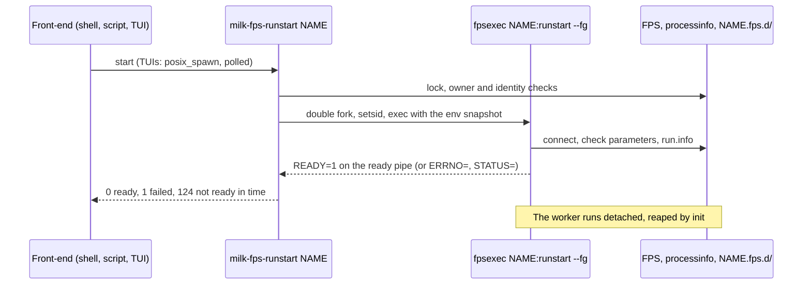

---
tags:
  - fps
  - architecture
  - units
---

# Unit Lifecycle

How milk starts, stops and observes compute units without tmux: the decisions U1–U19, as built on
`feat/unit-lifecycle` (2026-10). For using units, see [FPS](../guide/fps.md); for the shell side,
[Scripting](../guide/scripting.md).

A **unit** is an fpsexec binary (`<prefix>-fpsexec-<id>`) and its FPS. Its conf and run processes
are *workers*: started detached by whoever asks, observed through the FPS, processinfo and the unit
directory. No daemon is involved.

## Decisions

| Id  | Decision | Why |
| --- | --- | --- |
| U1  | No per-unit daemon or socket: callers start and stop workers directly; FPS, processinfo and the unit directory are the only state. | Nothing can crash and take control away; units no longer die with a tmux server. |
| U2  | Only an FPS whose `execfullpath` names an fpsexec binary can be started. FPS made by milk-cli (`mod.cmd :name`) are parameter sets; `runstart` refuses them with a hint. | One launch format, no command line assembled from shared memory. |
| U3  | A start execs `execfullpath NAME:<role>start --fg` after a double fork (`setsid`, `_Fork`, own process group, `close_range`, stdin from `/dev/null`, output to a file). The worker runs as the FPS owner (root drops to it); a group- or world-writable FPS is refused. Long-lived callers `posix_spawn` the `milk-fps-<op>` tool instead (`fps_unit_spawn()`). | Never fork a running loop; no inherited FPS or stream descriptors; TUIs never block. |
| U4  | Readiness: `KEY=VALUE` lines on a pipe (`MILK_UNIT_NOTIFY_FD`). `READY=1` where `STATUS_RUNLOOP` is set (conf: after the first step); `ERRNO=` and `STATUS=` on failure. Timeout 10 s (`--timeout`, `MILK_UNIT_START_TIMEOUT`): status 124, the unit keeps starting. | "Running" means the loop runs, not that a process exists. |
| U5  | Parameter checks run in the worker; a failure prints the messages and exits 1. | `CHECKOK` is only fresh while a conf process runs. |
| U6  | Stop: `CTRLval=3` in the worker's processinfo and a post on its trigger semaphore, then SIGINT, SIGTERM and SIGKILL to the process group through a pidfd (`MILK_UNIT_STOP_TIMEOUTS=T2,T3`). Returns once the process is gone. | The clean path takes milliseconds; signals stay as the fallback. |
| U7  | Unit directory `<MILK_UNIT_DIR or MILK_SHM_DIR>/NAME.fps.d/`: `env`, `conf.out`/`run.out` (rotated to `.1` at start and above `MILK_UNIT_OUT_MAX`, 1 MiB), `conf.info`/`run.info` (identity: pid, start ticks, boot id; exit line), `exec.out`. Output is line-buffered with `===` marker lines; a dead worker's processinfo file moves to `run.procinfo.1`. A warning when the directory is not on tmpfs. | A file never blocks the loop; the last lines before a crash are kept. |
| U8  | `fpsinit` saves its environment to `NAME.fps.d/env` (terminal and session variables left out); every start builds the worker's environment from it (`milk-fps-info --env`). | The environment is configuration: identical whoever starts the unit. |
| U9  | Start, stop, remove and `fpsinit` hold an OFD lock on `NAME.fps.shm`. A start of a running role returns 0; `fpsinit` refuses a running unit. | Classic `fcntl` locks drop when any descriptor of the file closes. |
| U10 | One state definition, `fps_unit_status()`: `stopped` `starting` `running` `stopping` `exited` `failed`, read by `f.X.status`, `@waitfor`, milk-CTRL, fpsCTRL, `milk-fps-list` and Python. | There were four definitions, two of them tmux sessions. |
| U11 | Verbs: `confstart`/`runstart` in the background, `confstop`/`runstop` synchronous, `run`/`exec` in the foreground (`--fg`, `MILK_UNIT_FG=1`); processinfo on by default (`--no-procinfo`). Tools `milk-fps-{conf,run}{start,stop}`, `milk-fps-log`, `milk-fps-rm`; `@set f.X.{conf,run}={start,stop}`, `f.X.run.out`, `f.X.conf.out`, `f.X.session`; parameter scripts run through `fps_unit_script()` (`exec.out`). `-tmux` fails with status 2. | Start and stop return once the state changed. |
| U12 | The fpsCTRL command FIFO is gone: its code, the `fpsCTRLfifo*` fields and the task types; fpsCTRL `-f`/`-s` exit with status 2. | One way to command units, with exit statuses. |
| U13 | No `system()`, `popen()` or tmux in the engine libraries; Linux-only calls live in `milk_os_linux.c` behind `milk_os.h`. Checked by the `engine_guards` CTest and a strict POSIX build (`-D_XOPEN_SOURCE=800`). | Units start without a shell; portability is explicit. |
| U14 | processinfo: the loop macros install the signal handlers; SIGTERM ends a loop; fatal signals record `CRASHED`, then re-raise; a stop request is re-checked after the trigger wait; every exit clears the run flags. | U6 and U10 depend on it; a segfault no longer spins. |
| U15 | Accepted losses: the exact status after SIGKILL or the OOM killer (`failed`, no exit record); a shell in the unit's window (`run` or `--fg` instead); tmux tooling outside milk (cacao, pyMilk: brought to compliance in their own repositories). | |
| U16 | Dropped (2026-10-25): milk-cli no longer runs a module command in its own process on a shared FPS, so it needs no lock of its own. | Nothing used it; the CLI unit arguments are gone. |
| U17 | Optional systemd integration: a unit tells `$NOTIFY_SOCKET` `READY=1`, `STATUS=` (loop rate), `WATCHDOG=1` and `STOPPING=1` without libsystemd; `milk-fps-run` is the `ExecStart=` of the `milk-unit@.service` template; the env file is in `EnvironmentFile=` format; a unit systemd runs records its service (`NAME.fps.d/systemd`) and milk's start and stop go through `systemctl` until `milk-fps-run --release`; `.procinfo.cset` is skipped under systemd. See [systemd Services](../operations/systemd.md). | Supervision where systemd exists, the plain path elsewhere. |
| U18 | One detached-process layer, `milk_detach` in libmilkcommon (fork, ready pipe, identity, output rotation, signal ladder), knows nothing about FPS; `fps_unit_*` adds the FPS parts. milk-cli servers start on it too: `READY=1` or `ERRNO=` with the reason, their output in `milk-srv.<uid>.<name>.out` next to their log, a private server's owner pipe passed as fd 4; `@session end` sends the shutdown command, then signals the identity the server recorded; a server tells `$NOTIFY_SOCKET` it is ready. | The delicate part is implemented and tested once. |
| U19 | milk-seq removed (libfpsseq, `milk-seq`, `seq.*`, `q.`): queued workflows are milk scripts. | No users; several documented features did not work. |

## Removed, with a hint

| Removed | Use instead |
| --- | --- |
| `-tmux`, tmux sessions per unit | `runstart` (background), `run` or `--fg` (foreground), `milk-fps-log NAME` |
| `_CONFSTART_` … `_TMUXSTOP_` CLI arguments | the unit's fpsexec: `<fpsexec> -n NAME fpsinit`, `runstart`, `runstop` |
| `milk-fpsinit`, `milk-fpsmkcmd`, `milk-fpslist-addentry`, `fpslist.txt` | a milk script running each unit's fpsexec |
| `tmuxsessionname`, `tmuxkillall` | `$MILK_UNIT_NAME` in a unit's process; `milk-fps-runstop`, `milk-fps-rm -f` |
| `@server start NAME --tmux` | `@session new NAME`: a detached server (`@session status` names its output file), or a systemd service |
| fpsCTRL `-f`/`-s`, keys `T`/`Ctrl+t` | `milk-fps-set`, `milk-fps-{conf,run}{start,stop}`; `Ctrl+a` (output view) |
| `p.X.tmux`, processinfo `tmuxname` | `p.X.unit`, `unitname` |
| `functionparameter_FPS_tmux_*`, FPS `STATUS_TMUX*` bits | `fps_unit_start()`, `fps_unit_stop()`, `fps_unit_status()` |

## Where It Lives

| Part | Files |
| --- | --- |
| Detached processes, ready pipe, identity, rotation | `src/engine/libmilkcommon/milk_detach.{c,h}`, `milk_spawn.{c,h}`, `milk_os.h`, `milk_os_linux.c` |
| Service manager messages | `src/engine/libmilkcommon/milk_notify.{c,h}` |
| Unit directory and state | `src/engine/libfps/core/fps_unit_state.c`, `fps_unit_state.h` |
| Start, stop, spawn, env snapshot, lock | `src/engine/libcomputeunit/core/fps_unit.c`, `fps_unit.h` |
| Verbs | `src/engine/libcomputeunit/core/fps_standalone_main.c` |
| Tools | `milk-fps-log.c`, `milk-fps-rm.c`, `milk-fps-cmd.c` (`milk-fps-run` too; libcomputeunit), `milk-fps-list.c`, `milk-fps-info.c` (libfps) |
| systemd examples | `scripts/systemd/` (`milk-unit@.service.in`, `milk-unit-rt.conf`, `milk-loop.target`), installed to `share/milk/systemd/` |
| Signals | `src/engine/libprocessinfo/processinfo_signals.c` |
| Guards | `cmake/milk_engine_guards.cmake` |
| milk-cli servers | `src/cli/libmilkscript/ipc/milk_ipc_common.c` (start), `milk_srv_manager.c` (stop), `server/milk_server.c` (readiness) |
| Tests | `python/tests/cli/unit_lifecycle_test.py`, `unit_removal_test.py`, `unit_systemd_test.py`, `server_lifecycle_test.py`, `python/tests/tui/unit_tui_test.py`, `test_milk_detach.c`, `test_milk_notify.c`, `test_processinfo_signals.c` |
