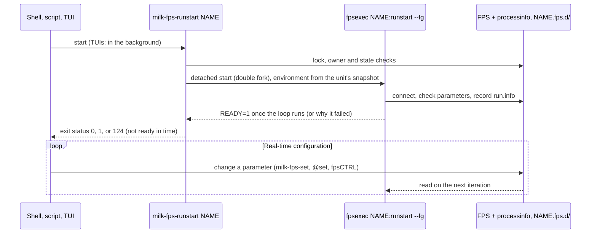

---
tags:
  - fps
  - configuration
  - parameters
  - shared-memory
---

# Function Processing System (FPS)

The Function Processing System (FPS) is `milk`'s core framework for managing configuration
parameters, states, and commands for compute units. FPS instances provide a high-performance
standardized interface directly in shared memory.

See also: [Streams](streams.md) · [Process Info](procinfo.md) ·
[Programmer's Guide](../arch/programmers_guide.md)

## 1. Architecture and Location

An FPS instance resides in shared memory under `$MILK_SHM_DIR/<fps_name>.fps.shm` (typically
`/dev/shm/<fps_name>.fps.shm`), with its unit state and log directory at
`$MILK_SHM_DIR/<fps_name>.fps.d/`. On disk, auxiliary configuration and output directories
`fps.<fps_name>.datadir/` and `fps.<fps_name>.confdir/` are created in the working directory when
used by the module. This shared-memory layout allows multiple independent processes, CLIs, and TUIs
to read and modify a running module's parameters simultaneously without overhead.

## 2. Key Features

1. **Parameter Management:** FPS maps standard C variables (like strings, integers, and floats)
   directly into shared memory. When a user updates a parameter via the CLI (e.g., `milk-fpsCTRL` or
   the module's script), the compute loop instantly sees the change without needing a restart.

2. **Process State Control:** FPS inherently tracks compute unit states such as `run`, `stop`,
   `step`, and `conf`. This allows standard utilities to instruct a running process to pause, take a
   single execution step, or gracefully shut down.

3. **CLI & TUI Integration:** Standard utilities like `milk-fpsCTRL` provide a Text User Interface
   (TUI) to interact with FPS instances in real-time. This provides an instant "dashboard" for any
   correctly built compute module.

4. **Units:** an FPS made by an fpsexec binary is a *unit*. Its conf and run processes run detached
   from whoever started them, each in its own session and process group, and write their output to
   files. A crash takes down that process only, and its last output is kept.



## 3. Running Units

Units are started and stopped by their fpsexec binary, by the `milk-fps-*` tools, by `@set` in
milk scripts, or by the TUIs; all of them do the same thing.

```bash
milk-fpsexec-milk-calc -n dsub -t cam -e "out = cam - dark" fpsinit   # make the unit's FPS
milk-fps-runstart dsub              # start its loop in the background; returns once it runs
milk-fps-list                       # the units and their states
milk-fps-log -f dsub                # follow what it prints
milk-fps-runstop dsub               # stop it: a request, then signals if needed
milk-fps-rm -f dsub                 # stop it and remove its FPS
```

- **Start**: `runstart` (and `confstart`) returns once the loop runs (exit status 0), with the
  worker's messages when it fails (1: a parameter check, a missing stream, a crash at start), or
  with status 124 when it is not ready within 10 s (`--timeout S`, `MILK_UNIT_START_TIMEOUT`); the
  unit then keeps starting. A unit that already runs is left alone (status 0).
- **Stop**: `runstop` asks the loop to exit (and wakes it), then sends SIGINT, SIGTERM and SIGKILL
  if it does not; `MILK_UNIT_STOP_TIMEOUTS=T2,T3` sets the waits. It returns once the process is gone.
- **State**: each role of a unit is `stopped`, `starting`, `running`, `stopping`, `exited` or
  `failed`. `milk-fps-list`, `milk-fps-info`, `@get f.NAME.status`, `@waitfor f.NAME running` and
  the TUIs all read the same state.
- **Unit directory**: `<MILK_SHM_DIR>/NAME.fps.d/` (or under `MILK_UNIT_DIR`) holds `run.out` and
  `conf.out` (the output, rotated to `.1` at each start and above `MILK_UNIT_OUT_MAX`, 1 MiB by
  default), `run.info` and `conf.info` (the process, how it started and ended), `env` and
  `exec.out`. Removing the FPS removes it.
- **Environment**: `fpsinit` saves the environment of the shell that runs it in `NAME.fps.d/env`;
  every start uses it, whoever starts the unit (`milk-fps-info --env NAME` shows it).
- **Foreground**: `run` (or `--fg`, or `MILK_UNIT_FG=1`) runs the loop in the calling terminal, for
  gdb or valgrind.
- **Owner**: a unit runs as the owner of its FPS file; root may start and stop any unit.
- **systemd**: a unit can also run as a systemd service (`milk-unit@NAME`); milk's tools then start
  and stop it through `systemctl`. See [systemd Services](../operations/systemd.md).

Only an FPS made by an fpsexec binary is a unit: an FPS that milk-cli creates for its own commands
is a parameter set, which `runstart` refuses.

### `milk-fpsCTRL`

The primary TUI control tool is `milk-fpsCTRL`: it shows the FPS, their parameters and the states
of their units, and starts and stops units in the background.

For complete keyboard shortcuts and display modes, see [fpsCTRL Reference](fpsCTRL_reference.md).

## 4. Parameter Data Types and Flags

=== ":material-format-list-bulleted: Data Types"

    FPS natively supports the following parameter types. Use these `FPTYPE_*` constants in
    `FPS_PARAMS` X-macro entries:

    | Constant                   | C Variable Type                      | Description                 |
    | -------------------------- | ------------------------------------ | --------------------------- |
    | `FPTYPE_INT32`             | `int32_t`                            | 32-bit signed integer       |
    | `FPTYPE_UINT32`            | `uint32_t`                           | 32-bit unsigned integer     |
    | `FPTYPE_INT64`             | `int64_t`                            | 64-bit signed integer       |
    | `FPTYPE_UINT64`            | `uint64_t`                           | 64-bit unsigned integer     |
    | `FPTYPE_FLOAT32`           | `float`                              | 32-bit float                |
    | `FPTYPE_FLOAT64`           | `double`                             | 64-bit double               |
    | `FPTYPE_ONOFF`             | `int32_t`                            | Boolean (0=OFF, nonzero=ON) |
    | `FPTYPE_STRING`            | `char[FUNCTION_PARAMETER_STRMAXLEN]` | Generic text string         |
    | `FPTYPE_STREAMNAME`        | `char[FUNCTION_PARAMETER_STRMAXLEN]` | SHM stream name             |
    | `FPTYPE_FILENAME`          | `char[FUNCTION_PARAMETER_STRMAXLEN]` | File path                   |
    | `FPTYPE_FITSFILENAME`      | `char[FUNCTION_PARAMETER_STRMAXLEN]` | FITS file path              |
    | `FPTYPE_EXECFILENAME`      | `char[FUNCTION_PARAMETER_STRMAXLEN]` | Executable path             |
    | `FPTYPE_DIRNAME`           | `char[FUNCTION_PARAMETER_STRMAXLEN]` | Directory path              |
    | `FPTYPE_FPSNAME`           | `char[FUNCTION_PARAMETER_STRMAXLEN]` | Another FPS name            |
    | `FPTYPE_PID`               | `pid_t`                              | Process ID                  |
    | `FPTYPE_TIMESPEC`          | `struct timespec`                    | Timestamp                   |
    | `FPTYPE_PROCESS`           | `char[FUNCTION_PARAMETER_STRMAXLEN]` | Process name                |
    | `FPTYPE_STRING_NOT_STREAM` | `char[FUNCTION_PARAMETER_STRMAXLEN]` | String (not a stream)       |

    For string-type parameters, pass the buffer name directly (it decays to `char*`). For scalar
    types, pass `&variable`.

=== ":material-flag: Flags"

    Flags control parameter behavior and TUI visibility. Combine with bitwise OR (`|`):

    **Input/Output presets:**

    | Flag                            | Effect                                            |
    | ------------------------------- | ------------------------------------------------- |
    | `FPFLAG_DEFAULT_INPUT`          | Active, used, visible, writable, writeconf,       |
    |                                 | saveonchange, feedback, writestatus                |
    | `FPFLAG_DEFAULT_OUTPUT`         | Active, used, visible (read-only)                  |
    | `FPFLAG_DEFAULT_INPUT_STREAM`   | `DEFAULT_INPUT` + run-required + stream-check      |
    | `FPFLAG_DEFAULT_TRIGGER_STREAM` | `DEFAULT_INPUT_STREAM` + trigger                   |
    | `FPFLAG_DEFAULT_OUTPUT_STREAM`  | `DEFAULT_INPUT` + stream-check (writable, saveable)|
    | `FPFLAG_DEFAULT_STATUS`         | Active, used, visible (read-only status display)   |

    **Modifiers (combine with presets):**

    | Flag                             | Effect                           |
    | -------------------------------- | -------------------------------- |
    | `FPFLAG_MINLIMIT`                | Enforce minimum value            |
    | `FPFLAG_MAXLIMIT`                | Enforce maximum value            |
    | `FPFLAG_WRITERUN`                | Allow modification while running |
    | `FPFLAG_WRITECONF`               | Allow modification during config |
    | `FPFLAG_STREAM_ENFORCE_DATATYPE` | Validate stream datatype         |

=== ":material-code-tags: Developer Integration"

    Parameters are defined **once**, in an X-macro table of a `MILK_RUNNABLE` unit, and generate the
    FPS entries, the CLI arguments and the help text.

    **X-macro field order:** `X(keyword, ptr, type, is_primary, flag, descr)`

    ```c
    static char in_name[FUNCTION_PARAMETER_STRMAXLEN];
    static double gain = 0.5;

    #define MYPARAMS(X)                          \
        X(".in_name", in_name,                   \
          FPTYPE_STREAMNAME, 1,                  \
          FPFLAG_DEFAULT_TRIGGER_STREAM,         \
          "Input stream")                        \
        X(".gain", &gain,                        \
          FPTYPE_FLOAT64, 0,                     \
          FPFLAG_DEFAULT_INPUT | FPFLAG_WRITERUN,\
          "Loop gain")

    MILK_PARAMS_DEFINE(my, MYPARAMS);
    ```

    See the [Programmer's Guide](../arch/programmers_guide.md#3-writing-a-compute-unit) and
    `src/milk_module_example/examplefunc_fps_cli_poc.c` for a complete unit.

## 5. Standalone Executables (`fpsexec`)

A compute unit marked with `EXPORT_FPSEXEC` is built as `milk-fpsexec-<id>` (or `cacao-fpsexec-<id>`).
It takes native `argv`, and drives the FPS lifecycle of its shared-memory FPS. Command-line options
go before the command, the command goes last.

<details markdown="1">
<summary><b>Options and commands</b></summary>

- **Options**:
  - `-h`, `--help`: detailed parameter bindings and command help.
  - `-h1`, `--help-oneline`: one-line description and exit.
  - `-h2`, `--help-description`: verbose description only (no color) and exit.
  - `-hm`, `--help-mono`: full help, forced monochrome.
  - `-n`, `--name <fpsname>`: override the default FPS shared memory name.
  - `--fg`: `confstart`/`runstart` in the foreground (also `MILK_UNIT_FG=1`).
  - `--timeout S`: readiness timeout of `confstart`/`runstart` (default 10 s).
  - `--no-procinfo`: a one-shot unit, without processinfo entries (`fpsinit`, `exec`); processinfo
    is on by default.
  - `-loops`: infinite loop with stream semaphore trigger.
  - `-loopd <sec>`: infinite loop with delay trigger (seconds).
  - `-tmux` is gone (status 2): units start in the background.
- **Commands**:
  - `fpsinit [values]`: create the FPS shared memory segment, then set values.
  - `confstart`, `confstep`, `confstop`: manage the configuration loop.
  - `runstart [values]`, `runstop`: start the execution loop in the background, stop it.
  - `run [values]`: run the loop in the foreground.
  - `set [values]`: set values in the existing FPS.
  - `fps`: print the content of the FPS.
  - `fpslist`: list all FPS instances matching this executable.
  - `exec [values]`: auto-init, set values and run in the foreground.

</details>

The words after the command set FPS parameters, as the arguments of module commands do:

| Value | Sets |
| --- | --- |
| `value` | the next parameter that has an index (`Idx`) in `-h`, in index order |
| `.name=value` | any parameter, by its keyword, in any order |
| `.` | nothing: the parameter keeps its value (also `.name=.`) |

Positional values fill the indexed parameters that are not set by name. Negative numbers (`-0.5`)
are values, and options such as `-loopd 0.5` may also come after the command. An unknown parameter,
a value that does not parse for its type (number, integer, `on`/`off`), or one value too many is a
usage error (exit status 2) and changes nothing:

```bash
milk-fpsexec-clitest -n f00 fpsinit 42 .p_float64=-1.5   # p_int32=42, p_float64=-1.5
milk-fpsexec-clitest -n f00 set . cam02                    # p_streamname=cam02, p_int32 unchanged
```

Units whose parameters are declared at run time (`milk-fpsexec-milk-calc`, `milk-fpsexec-milk-script`,
see [Scripting](scripting.md#compute-units-without-c)) take their program as unit options, listed
under **Unit Options** in their `-h`; the values then set the declared parameters.

---

← [Documentation Index](../index.md)
