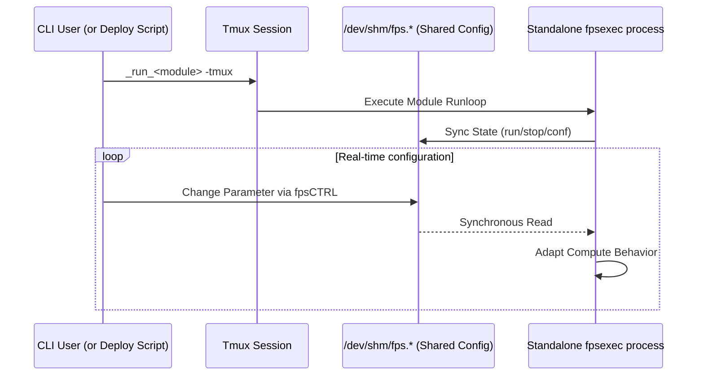

---
tags:
  - fps
  - configuration
  - parameters
  - shared-memory
---

# Function Processing System (FPS)

The Function Processing System (FPS) is `milk`'s core framework for managing configuration
parameters, states, and commands for compute units. FPS instances provide a high-performance
standardized interface directly in shared memory.

See also: [Streams](streams.md) · [Process Info](procinfo.md) ·
[Programmer's Guide](../arch/programmers_guide.md) ·
[FPS Sequencer](sequencer.md)

## 1. Architecture and Location

An FPS instance creates a shared memory directory structure typically residing under
`/dev/shm/fps.<fps_name>.datadir/` and `/dev/shm/fps.<fps_name>.confdir/`. This allows multiple
independent processes, CLIs, and GUIs to read and modify a running module's behavior simultaneously
without overhead.

## 2. Key Features

1. **Parameter Management:** FPS maps standard C variables (like strings, integers, and floats)
   directly into shared memory. When a user updates a parameter via the CLI (e.g., `milk-fpsCTRL` or
   the module's script), the compute loop instantly sees the change without needing a restart.

2. **Process State Control:** FPS inherently tracks compute unit states such as `run`, `stop`,
   `step`, and `conf`. This allows standard utilities to instruct a running process to pause, take a
   single execution step, or gracefully shut down.

3. **CLI & TUI Integration:** Standard utilities like `milk-fpsCTRL` provide a Text User Interface
   (TUI) to interact with FPS instances in real-time. This provides an instant "dashboard" for any
   correctly built compute module.

4. **Tmux Dispatch and Isolation:** When an FPS process is launched standalone (usually using
   `milk-fpsexec-<name>`, `cacao-fps-deploy`, or with the `-tmux` flag), the command is wrapped and
   dispatched into its own `tmux` session. This provides complete fault isolation. If one component
   segmentation faults, it does not bring down the entire pipeline, and its terminal output can be
   easily examined for debugging.



## 3. Usage Utilities

To use FPS-enabled functions from the command line efficiently, the typical workflow is:

1. Define functions and their requested FPS names in `fpslist.txt`.
2. Generate command scripts using `milk-fpsmkcmd`.
3. Launch and manage them via `milk-fpsCTRL`.

### The `fpslist.txt` and `fpsmkcmd` workflow

Create a space-delimited text file named `fpslist.txt` in your working directory. Lines starting
with `#` are comments. Each non-comment line has the format:

```text
fpsrootname  CLIcommand  [optarg0 ...]
```

Example:

```text
# FPS root name   CLI command   Optional arguments
fpsrootname0       CLIcommand0
fpsrootname1       CLIcommand1   optarg00 optarg01
```

Then run `milk-fpsmkcmd`, which reads `fpslist.txt` from the current directory and generates
per-function scripts in the `fpscmd/` subdirectory: `<fpsrootname>-fpsinit`,
`<fpsrootname>-confstart`, `<fpsrootname>-confstop`, `<fpsrootname>-runstart`,
`<fpsrootname>-runstop`. It also writes the resolved FPS names to `fpscmd/fpslist.txt`, which is the
file `milk-fpsCTRL` reads when scanning with `-m _ALL`.

### `milk-fpsCTRL`

The primary TUI control tool is `milk-fpsCTRL`. For example, `milk-fpsCTRL -m _ALL` scans and
manages all FPS instances listed in `fpscmd/fpslist.txt`.

For complete keyboard shortcuts and display modes, see [fpsCTRL Reference](fpsCTRL_reference.md).

## 4. Parameter Data Types and Flags

=== ":material-format-list-bulleted: Data Types"

    FPS natively supports the following parameter types. Use these `FPTYPE_*` constants in
    `FPS_PARAMS` X-macro entries:

    | Constant                   | C Variable Type                      | Description                 |
    | -------------------------- | ------------------------------------ | --------------------------- |
    | `FPTYPE_INT32`             | `int32_t`                            | 32-bit signed integer       |
    | `FPTYPE_UINT32`            | `uint32_t`                           | 32-bit unsigned integer     |
    | `FPTYPE_INT64`             | `int64_t`                            | 64-bit signed integer       |
    | `FPTYPE_UINT64`            | `uint64_t`                           | 64-bit unsigned integer     |
    | `FPTYPE_FLOAT32`           | `float`                              | 32-bit float                |
    | `FPTYPE_FLOAT64`           | `double`                             | 64-bit double               |
    | `FPTYPE_ONOFF`             | `int32_t`                            | Boolean (0=OFF, nonzero=ON) |
    | `FPTYPE_STRING`            | `char[FUNCTION_PARAMETER_STRMAXLEN]` | Generic text string         |
    | `FPTYPE_STREAMNAME`        | `char[FUNCTION_PARAMETER_STRMAXLEN]` | SHM stream name             |
    | `FPTYPE_FILENAME`          | `char[FUNCTION_PARAMETER_STRMAXLEN]` | File path                   |
    | `FPTYPE_FITSFILENAME`      | `char[FUNCTION_PARAMETER_STRMAXLEN]` | FITS file path              |
    | `FPTYPE_EXECFILENAME`      | `char[FUNCTION_PARAMETER_STRMAXLEN]` | Executable path             |
    | `FPTYPE_DIRNAME`           | `char[FUNCTION_PARAMETER_STRMAXLEN]` | Directory path              |
    | `FPTYPE_FPSNAME`           | `char[FUNCTION_PARAMETER_STRMAXLEN]` | Another FPS name            |
    | `FPTYPE_PID`               | `pid_t`                              | Process ID                  |
    | `FPTYPE_TIMESPEC`          | `struct timespec`                    | Timestamp                   |
    | `FPTYPE_PROCESS`           | `char[FUNCTION_PARAMETER_STRMAXLEN]` | Process name                |
    | `FPTYPE_STRING_NOT_STREAM` | `char[FUNCTION_PARAMETER_STRMAXLEN]` | String (not a stream)       |

    For string-type parameters, pass the buffer name directly (it decays to `char*`). For scalar
    types, pass `&variable`.

=== ":material-flag: Flags"

    Flags control parameter behavior and TUI visibility. Combine with bitwise OR (`|`):

    **Input/Output presets:**

    | Flag                            | Effect                                            |
    | ------------------------------- | ------------------------------------------------- |
    | `FPFLAG_DEFAULT_INPUT`          | Active, used, visible, writable, writeconf,       |
    |                                 | saveonchange, feedback, writestatus                |
    | `FPFLAG_DEFAULT_OUTPUT`         | Active, used, visible (read-only)                  |
    | `FPFLAG_DEFAULT_INPUT_STREAM`   | `DEFAULT_INPUT` + run-required + stream-check      |
    | `FPFLAG_DEFAULT_TRIGGER_STREAM` | `DEFAULT_INPUT_STREAM` + trigger                   |
    | `FPFLAG_DEFAULT_OUTPUT_STREAM`  | `DEFAULT_INPUT` + stream-check (writable, saveable)|
    | `FPFLAG_DEFAULT_STATUS`         | Active, used, visible (read-only status display)   |

    **Modifiers (combine with presets):**

    | Flag                             | Effect                           |
    | -------------------------------- | -------------------------------- |
    | `FPFLAG_MINLIMIT`                | Enforce minimum value            |
    | `FPFLAG_MAXLIMIT`                | Enforce maximum value            |
    | `FPFLAG_WRITERUN`                | Allow modification while running |
    | `FPFLAG_WRITECONF`               | Allow modification during config |
    | `FPFLAG_STREAM_ENFORCE_DATATYPE` | Validate stream datatype         |

=== ":material-code-tags: Developer Integration"

    Parameters are defined **once**, in an X-macro table of a `MILK_RUNNABLE` unit, and generate the
    FPS entries, the CLI arguments and the help text.

    **X-macro field order:** `X(keyword, ptr, type, is_primary, flag, descr)`

    ```c
    static char in_name[FUNCTION_PARAMETER_STRMAXLEN];
    static double gain = 0.5;

    #define MYPARAMS(X)                          \
        X(".in_name", in_name,                   \
          FPTYPE_STREAMNAME, 1,                  \
          FPFLAG_DEFAULT_TRIGGER_STREAM,         \
          "Input stream")                        \
        X(".gain", &gain,                        \
          FPTYPE_FLOAT64, 0,                     \
          FPFLAG_DEFAULT_INPUT | FPFLAG_WRITERUN,\
          "Loop gain")

    MILK_PARAMS_DEFINE(my, MYPARAMS);
    ```

    See the [Programmer's Guide](../arch/programmers_guide.md#3-writing-a-compute-unit) and
    `src/milk_module_example/examplefunc_fps_cli_poc.c` for a complete unit.

### 5. Sequencer Integration

FPS instances can be highly coordinated via the `milk-seq` standalone sequencer, which provides
cross-process synchronization (`wait_fps`), robust error handling, loops, and condition-based
execution.

See the dedicated **[FPS Sequencer Documentation](sequencer.md)** for details on the `milk-seq`
daemon, script syntax, and integrating `seq.*` commands from within `milk-cli`.

## 6. Standalone Executables (`fpsexec`)

A compute unit marked with `EXPORT_FPSEXEC` is built as `milk-fpsexec-<id>` (or `cacao-fpsexec-<id>`).
It takes native `argv`, and drives the FPS lifecycle of its shared-memory FPS. Command-line options
go before the command, the command goes last.

<details markdown="1">
<summary><b>Options and commands</b></summary>

- **Options**:
    - `-h`, `--help`: detailed parameter bindings and command help.
    - `-h1`, `--help-oneline`: one-line description and exit.
    - `-h2`, `--help-description`: verbose description only (no color) and exit.
    - `-hm`, `--help-mono`: full help, forced monochrome.
    - `-tmux`: create a `tmux` session and dispatch the commands isolated from the main terminal.
    - `-n`, `--name <fpsname>`: override the default FPS shared memory name.
    - `-procinfo`: enable processinfo entries at `fpsinit`.
    - `-loops`: infinite loop with stream semaphore trigger.
    - `-loopd <sec>`: infinite loop with delay trigger (seconds).
- **Commands**:
    - `fpsinit [values]`: create the FPS shared memory segment, then set values.
    - `confstart`, `confstep`, `confstop`: manage the configuration loop.
    - `runstart [values]`, `runstop`: manage the execution loop (`run` is an alias of `runstart`).
    - `set [values]`: set values in the existing FPS.
    - `fps`: print the content of the FPS.
    - `fpslist`: list all FPS instances matching this executable.
    - `exec [values]`: auto-init, set values and run (one-shot).

</details>

The words after the command set FPS parameters, as the arguments of module commands do:

| Value | Sets |
| --- | --- |
| `value` | the next parameter that has an index (`Idx`) in `-h`, in index order |
| `.name=value` | any parameter, by its keyword, in any order |
| `.` | nothing: the parameter keeps its value (also `.name=.`) |

Positional values fill the indexed parameters that are not set by name. Negative numbers (`-0.5`)
are values, and options such as `-loopd 0.5` may also come after the command. An unknown parameter,
a value that does not parse for its type (number, integer, `on`/`off`), or one value too many is a
usage error (exit status 2) and changes nothing:

```bash
milk-fpsexec-clitest -n f00 fpsinit 42 .p_float64=-1.5   # p_int32=42, p_float64=-1.5
milk-fpsexec-clitest -n f00 set . cam02                    # p_streamname=cam02, p_int32 unchanged
```

Units whose parameters are declared at run time (`milk-fpsexec-milk-calc`, `milk-fpsexec-milk-script`,
see [Scripting](scripting.md#compute-units-without-c)) take their program as unit options, listed
under **Unit Options** in their `-h`; the values then set the declared parameters.

---

← [Documentation Index](../index.md)
