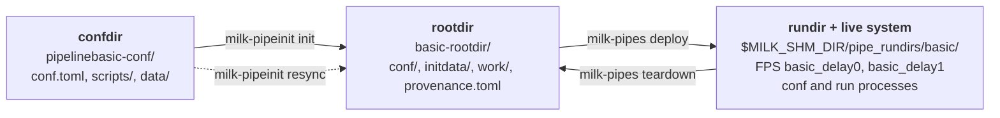

# Pipelines

Pipelines are sets of milk compute units that are declared, deployed and operated together by the
`milk` Python package.

**Audience:** Operator · See also: [Tour](pipelines_tour.md) · [Configuration](pipelines_conf.md) ·
[Operating](pipelines_operate.md) · [Glossary](pipelines_glossary.md)

!!! note "Status"
    The deploy lifecycle (provision, deploy, start, stop, teardown, linkages) is implemented.
    Pipeline kinds other than `generic`, calibration store/load and the port of the cacao `aorun`
    operations are not.

## 1. What the package does

The `milk` package (`python/milk` in the milk repository) starts, connects and stops a pipeline's
compute units together. It replaces the shell-script loop management of milk v1 and cacao. The
package is the API; the `milk-pipeinit` and `milk-pipes` commands are thin wrappers over it.

## 2. Key concepts

A pipeline lives in three places: the confdir you edit, the rootdir built from it, and the rundir
plus live system created by a deploy.



**Pipeline.** A named set of **compute units** (CompUs). Each CompU is one milk `fpsexec`
executable with its FPS and its conf and run processes. A pipeline has a
`long_name` (`pipelinebasic`), a short `name` (`basic`) and a `loop_number`; these three identity
keys fix every path and FPS name (`<name>_<cu>`, e.g. `basic_delay0`).

**Confdir** (`<long_name>-conf/`). The editable source of a pipeline: a `conf.toml`, optional
included TOML files, a `scripts/` folder, and `data/` where **conf hooks** put the large files
they fetch or generate. A confdir is what you keep in git and share.

**Rootdir** (`<name>-rootdir/`). The long-lived home of one pipeline instance, built from a
confdir by `init`. It holds its own copy of the conf files (`conf/`), of the hook products
(`initdata/`), the FPS work folder (`work/`) and a `provenance.toml` that records where it came
from. After init, only the rootdir matters: the live system never reads the confdir. Confdir
changes reach the rootdir only through an explicit `resync`.

**Rundir** (`$MILK_SHM_DIR/pipe_rundirs/<name>/`). The claim that `deploy` writes for the current
boot. It is what makes the pipeline **state** computable: `cold`, `deployed`, `configured`,
`running`, `mixed` or `inconsistent` (see [Operating: lifecycle](pipelines_operate.md#1-lifecycle)).

**Plans and tasks.** Everything that touches the live system is a **task** (`InitFPS`,
`ConfStart`, `RunStart`, ...), idempotent and restricted to any subset of CompUs. A **plan** is an
ordered list of tasks with a failure policy (see [Plans and tasks](pipelines_plans.md)).

## 3. Where to go

<div class="grid cards" markdown>

- **Operate**

    ***

    Deploy, link, run and tear down a pipeline; read its state; handle failures.

    [⮕ Tour](pipelines_tour.md) · [⮕ Operating](pipelines_operate.md)

- **Integrate**

    ***

    Write a confdir, keep a rootdir in sync, write your own plans.

    [⮕ Configuration](pipelines_conf.md) · [⮕ Drift and resync](pipelines_provision.md) ·
    [⮕ Plans and tasks](pipelines_plans.md)

- **Internals**

    ***

    Package layout, objects, state computation, task contract, normative terms.

    [⮕ Internals](pipelines_internals.md)

</div>

## 4. Installing

```bash
pip install -e python/  # (1)!
```

1. Run from the milk repository root.

The package needs [pyMilk](https://github.com/milk-org/pyMilk) for SHM and FPS access, and
`MILK_ROOT`, `MILK_INSTALLDIR` and `MILK_SHM_DIR` set in the environment of anything that touches
the live system. `import milk` itself works without a milk environment.

For plain stream access from Python (`SHM`, numpy), see [pyMilk](pyMilk.md).
