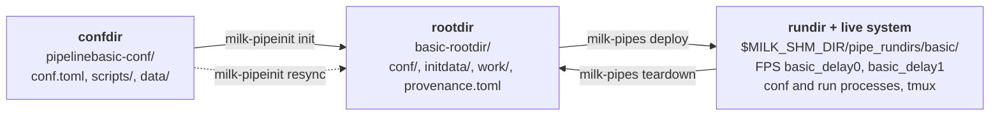

# Pipelines: the `milk` Python package

The `milk` Python package (`python/milk` in the milk repository) declares, deploys and operates
**pipelines**: sets of milk compute units that are started, connected and stopped together. It
replaces the shell-script loop management of milk v1 and cacao. The package is the API; the
`milk-pipeinit` and `milk-pipes` commands are thin wrappers over it.

This page is the entry point. The other pages are:

- [Configuration files](pipelines_conf.md): the `conf.toml` syntax, substitutions, includes,
  data loads, hooks, and how changes reach a deployed pipeline (drift and resync).
- [API concepts](pipelines_api.md): the Python objects and how they fit together.
- [Provisioning: `milk-pipeinit`](pipelines_provision.md) and
  [Operating: `milk-pipes`](pipelines_operate.md): the command references.
- [Glossary](pipelines_glossary.md): the normative definitions of every term used here.

Status: the deploy lifecycle (provision, deploy, start, stop, teardown, linkages) is
implemented. Pipeline *kinds*, calibration store/load and the port of the cacao `aorun`
operations are not yet.

## Key concepts



**Pipeline.** A named set of **compute units** (CompUs). Each CompU is one milk `fpsexec`
executable with its FPS, its conf and run processes and its tmux session. A pipeline has a
`long_name` (`pipelinebasic`), a short `name` (`basic`) and a `loop_number`; these three identity
keys fix every path and FPS name (`<name>_<cu>`, e.g. `basic_delay0`).

**Confdir** (`<long_name>-conf/`). The editable source of a pipeline: a `conf.toml`, optional
included TOML files, a `scripts/` folder, and `data/` where **conf hooks** put the large files
they fetch or generate. A confdir is what you keep in git and share.

**Rootdir** (`<name>-rootdir/`). The long-lived home of one pipeline instance, built from a
confdir by `init`. It holds its own copy of the conf files (`conf/`), of the hook products
(`initdata/`), the FPS work folder (`work/`) and a `provenance.toml` that records where it came
from. After init, only the rootdir matters: the live system never reads the confdir. Confdir
changes reach the rootdir only through an explicit `resync`.

**Rundir** (`$MILK_SHM_DIR/pipe_rundirs/<name>/`). The claim that `deploy` writes for the current
boot. It is what makes the pipeline **state** computable: `cold` (nothing deployed),
`deployed`, `configured` (conf processes up), `running`, `mixed`, or `inconsistent` (the rundir
and the live FPSs disagree; `teardown` fixes it).

**Plans and tasks.** Everything that touches the live system is a **task** (`InitFPS`,
`ConfStart`, `RunStart`, ...), idempotent and restricted to any subset of CompUs. A **plan** is an
ordered list of tasks with a failure policy. The built-in plans are `deploy` and `teardown`;
starting the run processes is done from Python with `RunStart`, or with a plan of your own.

## A minimal `conf.toml`

```toml
long_name   = "pipelinebasic"
name        = "basic"
loop_number = 0
teardown_kill_tmux = true

[compute_units.delay0]
exec = "milk-fpsexec-mem-streamdelay"

[compute_units.delay0.fps]              # written to the FPS at deploy
naive_mode = true
delaysec   = 0.01
in_name    = "input"
out_name   = "middle"
procinfo.enabled      = true
procinfo.triggermode  = 3
procinfo.triggersname = "{compute_units.delay0.fps.in_name}"   # substitution

[compute_units.delay1]
exec = "milk-fpsexec-mem-streamdelay"

[compute_units.delay1.fps]
naive_mode = true
delaysec   = 0.01
in_name    = "{compute_units.delay0.fps.out_name}"
out_name   = "output"
procinfo.enabled      = true
procinfo.triggermode  = 3
procinfo.triggersname = "{compute_units.delay0.fps.out_name}"

[systemlinkage.loopback]                # local stream -> remote stream, applied by `link`
input  = "source_point"
output = "source_point"
```

A pipeline that needs files adds `[[hooks]]` to fetch or generate them into `data/` and
`[[dataloads]]` to load them into streams at deploy:

```toml
[[hooks]]
id      = "dm"
type    = "command"                     # run in data/; must create <product>
command = ["python3", "../scripts/mkdm.py", "dm.fits"]
product = "dm.fits"

[[dataloads]]
source = "dm.fits"                      # a hook product, from rootdir/initdata/
target = "mlatsim_dm"                   # the stream to create
```

Every key is explained in [Configuration files](pipelines_conf.md). Example confdirs live in
`milk-examples/pipelines/` and in `python/tests/resources/` (`pipelinebasic-conf`,
`mlatsim-conf`).

## From a confdir to a running pipeline

```console
$ milk-pipeinit clone $MILK_ROOT/python/tests/resources/pipelinebasic-conf ~/pipes
$ cd ~/pipes
$ milk-pipeinit resolve pipelinebasic-conf      # print the resolved config; catches errors early
$ milk-pipeinit init pipelinebasic-conf         # runs the hooks, builds ~/pipes/basic-rootdir
$ milk-pipes state -p basic
rootdir: /home/vdeo/pipes/basic-rootdir
basic: cold
drift: none
$ milk-pipes deploy -p basic                    # ClaimRundir → InitFPS → LoadData → ConfStart
$ milk-pipes link loopback -p basic             # apply a [systemlinkage]
$ milk-pipes state -p basic
basic: configured
```

Then from Python, start and stop the run processes:

```python
from milk.operate.pipeline import Pipeline
from milk.operate.tasks import RunStart, RunStop

pp = Pipeline("basic")                  # <cwd>/basic-rootdir, or a rootdir path
pp.task_do(RunStart)                    # all CompUs
pp.task_do(RunStop(pp, ["delay1"]))     # a subset
```

And when done:

```console
$ milk-pipes teardown -p basic                  # back to cold; keeps the rootdir and work/
$ milk-pipes nuke -p basic                      # teardown, then delete the rootdir
```

`-p/--pipe` takes a rootdir path or a short name (`<cwd>/<name>-rootdir`); without it the
current directory must be a rootdir.

## Changing a deployed pipeline

Edit the confdir, then:

```console
$ milk-pipes state -p basic
basic: configured
drift: 1 artifact(s); run `milk-pipeinit drift /home/vdeo/pipes/basic-rootdir`
$ milk-pipeinit drift basic-rootdir             # what changed, and whether it is structural
$ milk-pipes teardown -p basic
$ milk-pipeinit resync basic-rootdir            # copy the changes into the rootdir
$ milk-pipes deploy -p basic
```

Nothing is automatic: `resync` is refused while a run process is active and never deploys, and
hand edits under `rootdir/conf/` are live immediately. The rules are in
[Configuration files: drift and resync](pipelines_conf.md#keeping-a-rootdir-in-sync-drift-and-resync).

## Installing

The package is `python/` in the milk repository (`pip install -e python/`). It needs
[pyMilk](https://github.com/milk-org/pyMilk) for SHM and FPS access, and `MILK_ROOT`,
`MILK_INSTALLDIR` and `MILK_SHM_DIR` set in the environment of anything that touches the live
system. `import milk` itself works without a milk environment.

For plain stream access from Python (`SHM`, numpy), see the [pyMilk](pyMilk.md) page.
