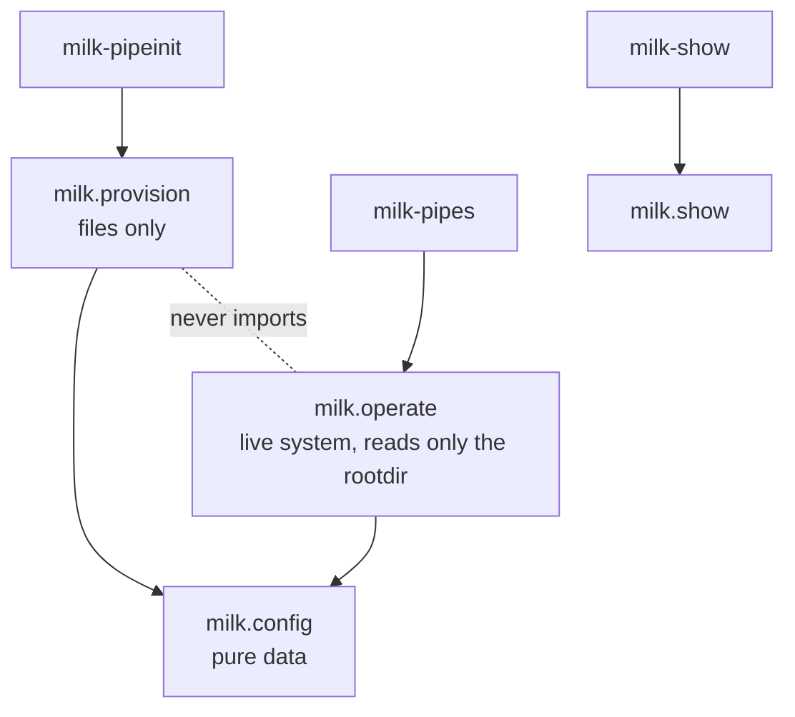
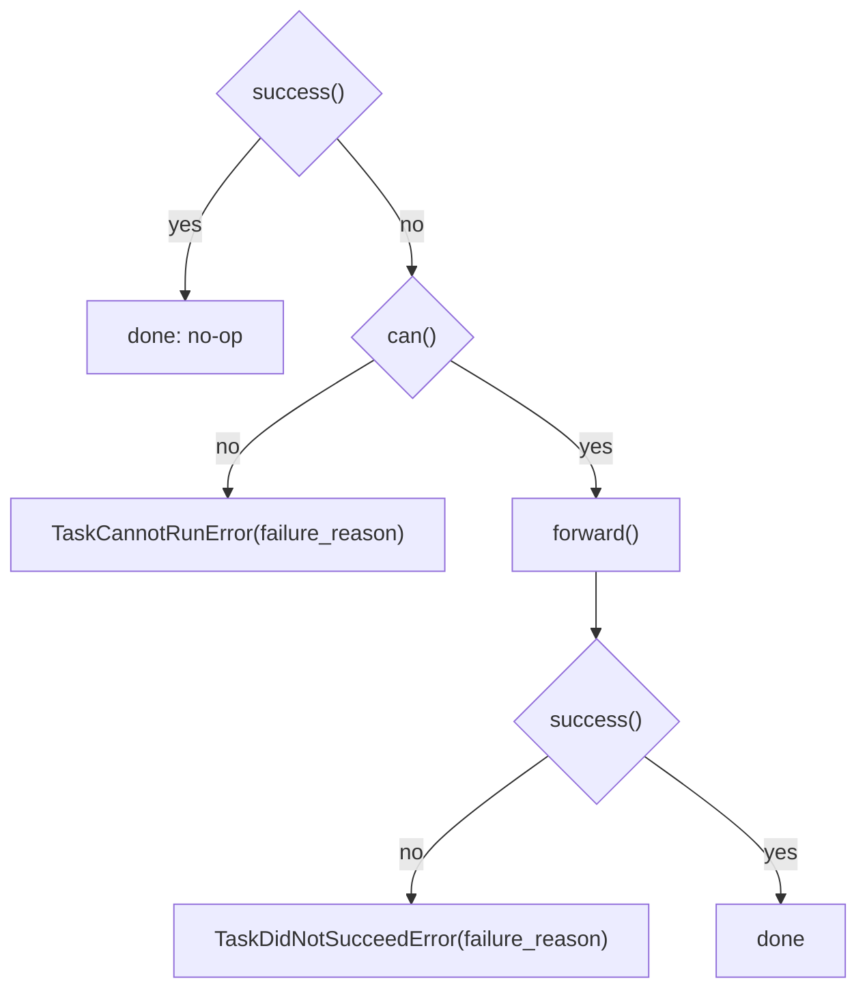

# Pipelines: internals

How the `milk` package is built: its layout and layering, the objects behind the commands, how
the state is computed, the task contract, the errors, and the normative terms.

**Audience:** Internals · See also: [Pipelines](pipelines.md) · [Plans and tasks](pipelines_plans.md) ·
[Configuration](pipelines_conf.md) · [Glossary](pipelines_glossary.md)

## 1. Package layout and layering

```text
milk/
  config/      what a pipeline is: the model, {var} substitution, confresolve. Pure data.
  provision/   confdirs and rootdirs: clone, consolidate, init, drift, resync. Files only.
  operate/     the live pipeline: Pipeline, ComputeUnit, tasks, plans, state, rundir.
  show/        milk-show: displays (matplotlib) of pipeline results.
  errors.py    every exception of the package
  env.py       the only reader of the MILK_* environment variables
```

The CLIs only parse arguments and call the API; `provision` and `operate` both build on `config`
and never import each other.



Provisioning is file operations and never touches SHM, FPS or processes; its only contact
with the live system is the "is a run process active?" callable that `resync` receives
([Drift and resync](pipelines_provision.md#3-resync)). Operating reads only the rootdir.

## 2. Configuration: `PipelineConfig`

`confresolve` is the only way to obtain a configuration ([Configuration:
resolving](pipelines_conf.md#4-resolving-includes-overrides-substitution)). It merges the layers,
expands the substitutions and validates, every time it is called, with no side effects. The
result is a frozen `PipelineConfig` (a pydantic model): `long_name`, `name`, `loop_number`,
`kind`, `compute_units` (a dict of `ComputeUnitSpec`: `exec`, `fps`), `dataloads`, `hooks`,
`systemlinkage`, `plans`. `fps_name(cu)` is the one place where FPS names
are made.

## 3. Operating: `Pipeline` and `ComputeUnit`

```python
from milk.operate.pipeline import Pipeline

pp = Pipeline("basic")                 # <cwd>/basic-rootdir
pp = Pipeline("/elsewhere/basic-rootdir")
pp.config                              # the resolved PipelineConfig
pp.root_folder, pp.work_folder         # the rootdir, and rootdir/work (the FPS work folder)
pp.compute_units                       # {'delay0': ComputeUnit, 'delay1': ComputeUnit}
pp.compute_units["delay0"].fps         # the pyMilk FPS, or None while it does not exist
pp.any_run_active()
pp.link("loopback"); pp.linked(); pp.unlink("all")
```

A `Pipeline` is a view on one rootdir: it resolves the configuration once, at construction, and
derives everything else from the live system when asked. `compute_units` builds fresh
`ComputeUnit` views on each access; a `ComputeUnit` wraps one `fpsexec` executable and its FPS
(`fpsinit`, `confstart`, `confstop`, `runstart`, `runstop` run the executable's commands;
the starts return once the loop runs). You seldom call these yourself: tasks do.

## 4. State

```python
from milk.operate.state import state

st = state(pp)            # PipelineState(state=<State.CONFIGURED>, reasons=())
st.state.value            # 'cold' | 'inconsistent' | 'deployed' | 'configured' | 'running' | 'mixed'
```

The state is never stored. It is computed from the rundir claim (`$MILK_SHM_DIR/pipe_rundirs/
<name>/`: boot id, rootdir, loop number) and from the existence and the conf/run status of each
CompU's FPS. `cold` means nothing is deployed; `inconsistent` means the rundir and the FPSs
disagree (a stale rundir from a previous boot, an FPS destroyed by hand, a failed deploy), and only
`teardown` is accepted from there. Operations that need a given state raise a `StateError`
(`ColdSystemError`, `InconsistentStateError`) that names the command to run. The diagrams are in
[Operating: lifecycle](pipelines_operate.md#1-lifecycle).

## 5. Errors and environment

Every exception of the package lives in `milk.errors`, under `MilkError`: `EnvError`,
`ConfigError`, `ProvisionError`, `TaskError` (`TaskCannotRunError`, `TaskDidNotSucceedError`),
`ComputeUnitError`, `LinkageError`, `StateError` (`ColdSystemError`, `InconsistentStateError`)
and `BestEffortError` (the aggregate of a best-effort plan, with `.failures`). An error carries
context when it has some (`pipeline`, `compu`, `task`, `path`, `cmd`, `stderr`), appended to its
message one per line. Library code never prints or exits; pyMilk exceptions propagate as they
are. How the CLIs print errors is in [Operating: errors](pipelines_operate.md#3-errors).

`milk.env` reads `MILK_ROOT`, `MILK_INSTALLDIR` and `MILK_SHM_DIR` when a function is called, not
at import, and raises `EnvError` naming what is missing. `import milk` and `confresolve` work
without a milk environment; anything that touches SHM or runs an executable needs one.

## 6. Task contract

A task subclasses `milk.operate.tasks.Task` and implements three methods. `pipeline.task_do`
calls them in this order:



The no-op on an already reached goal is what makes plans idempotent.

- **`success()`** checks whether the goal already holds, and must not have side effects.
- **`can()`** checks the task's preconditions. Before returning `False`, it sets
  `self.failure_reason`.
- **`forward()`** does the work. For asynchronous effects (processes), it waits with
  `wait_until(self.success, self.TIMEOUT)` (from `milk.wait`); `TIMEOUT` defaults to 10 s.
- **`self.compute_units`** is the step's CompU subset, as `{name: ComputeUnit}`.
  `self._existing()` is the part of that subset whose FPS exists, as `(ComputeUnit, FPS)` pairs.
- Tasks act on the live pipeline (SHM, FPS, processes) and never modify `rootdir/conf/`.

Direct subclasses of `Task` in `milk/operate/tasks.py` are registered under their class name
automatically. A task defined anywhere else needs `TASKS.register("MyTask", MyTask)`; it can then
be named in a `Step` ([Plans and tasks](pipelines_plans.md#4-custom-plans)).

## 7. Normative glossary

Published copy of the normative terms of the pipelines design (design-v7 §0). Specs and docs use
these words only in these senses. Short definitions for users are in the
[Glossary](pipelines_glossary.md).

| Term | Definition |
|------|-----------|
| <a id="term-confdir"></a>**confdir** | `<long>-conf/`. The editable configuration source of a pipeline: TOML files, `scripts/`, conf-hook declarations, and `data/` (conf-hook products plus tagfiles, git-ignored). No rootdir operation ever reads it. |
| <a id="term-clone"></a>**clone** | A one-time, plain copy of a confdir's TOML files, `scripts/` and hook declarations to a new location. It excludes `data/`, writes a `.gitignore` containing `data/`, runs no conf hooks, makes no git commit, and refuses if the target exists. It leaves no ongoing link to the source. |
| <a id="term-conf-hook"></a>**conf hook** | A declared, idempotent provisioning action whose product lands in `confdir/data/` with a tagfile, for example fetching large files. Conf hooks never touch SHM, FPS, processes or machine configuration. |
| <a id="term-conf-artifact"></a>**conf artifact** | A file-level unit of configuration whose fingerprint is tracked. There are two types: **conf file artifacts** (each TOML file of the conf set and each file under `scripts/`) and **hook artifacts** (each conf-hook product). Fetching produces hook artifacts; drift is computed per artifact. |
| <a id="term-fingerprint"></a>**fingerprint** | A small record that identifies an artifact's content and origin without storing the content: `content_hash` (sha256 of the file bytes; for a directory product, a hash over the sorted (relpath, hash) list, with empty directories included as `(relpath/, "")`), `size`, and for hook artifacts also `decl_digest` (a hash of the hook's TOML declaration) plus informational `source` and `time`. Equality is decided **only** by `content_hash` and `decl_digest`. Modes and mtime are ignored. Symlinks inside products are refused. The `.tag` suffix is reserved. |
| <a id="term-tagfile"></a>**tagfile** | The recorded fingerprint of a hook artifact, stored next to it as `<product>.tag`. |
| <a id="term-consolidate"></a>**consolidate** | Run the pending conf hooks of a confdir. Local to the confdir. It can be re-run at any time without affecting any rootdir. |
| <a id="term-confresolve"></a>**confresolve** | API call: a TOML set (from a confdir or a rootdir) plus overrides → one validated `PipelineConfig`. Layers are merged and substitutions resolved. It always re-resolves (there is no cache this round) and has no side effects. |
| <a id="term-identity-keys"></a>**identity keys** | `long_name`, `name` (the short name) and `loop_number`. Paths, FPS names and the uniqueness rule derive from them. They are never overridable, and resync refuses to change them. |
| <a id="term-init"></a>**init** | Create a rootdir from a confdir: consolidate if needed, copy the conf file artifacts to `rootdir/conf/`, copy data and tagfiles to `rootdir/initdata/`, write `provenance.toml` (including the overrides used), and confresolve successfully. Refuses if the rootdir exists (use resync). Not atomic this round: on failure it reports and leaves what it wrote. |
| <a id="term-rootdir"></a>**rootdir** | `<short>-rootdir/`. The authoritative, long-lived home of one pipeline instance after init. Hand edits of `rootdir/conf/` take effect at the next deploy and are reported as drift. |
| <a id="term-drift"></a>**drift** | A change between a conf artifact's recorded fingerprint and its current one, in the confdir or in the rootdir. It is reported **per artifact**, plus a **key-level resolved diff** (a difference in the confresolve output). Artifact drift is reported even when the resolved config is unchanged. Drift is only ever reported; resync is the only way to apply confdir changes to a rootdir. |
| <a id="term-resync"></a>**resync** | Explicit propagation of selected drifted conf artifacts from the confdir into an existing rootdir. Records new fingerprints in provenance and returns a `ResyncReport`. Refused while the pipeline is running, refused for identity-key changes, and refuses to overwrite a locally modified rootdir artifact unless `--overwrite-local` is given. |
| <a id="term-provisioning"></a>**provisioning** | Umbrella term for clone, consolidate, confresolve, init, drift and resync. File operations only; API `milk.provision`, CLI `milk-pipeinit`. The only contact with the live system: resync reads `any_run_active()` (§4.0 rule 5). Provisioning never writes to the rundir. |
| <a id="term-rundir"></a>**rundir** | `$MILK_SHM_DIR/pipe_rundirs/<short>/`. Ephemeral. It holds only non-derivable runtime facts: boot_id, the claim (short name, loop_number, **the deployed FPS names**), and the **applied linkage pairs**. `deploy` creates it and `teardown` removes it. Teardown, unlink and the consistency check read what was deployed from here, not from the current config. |
| <a id="term-cold"></a>**cold** | No rundir and no FPS for this pipeline. `deploy` is the only plan that leaves cold; `teardown`, `state` and `nuke` are always accepted. Other operations raise `ColdSystemError` ("not deployed on this boot; run deploy"). |
| <a id="term-inconsistent"></a>**inconsistent** | Any mismatch between the rundir and the live FPS set: a stale rundir (boot_id mismatch), a valid rundir with some **recorded** FPS missing (for example after a failed deploy), or pipeline FPS present without a valid rundir. Every operation except `teardown` raises `InconsistentStateError`, with guidance to run teardown. |
| <a id="term-compute-unit"></a>**compute unit (CompU)** | One running instance of a milk compute unit within a pipeline, identified by (executable, FPS name): its FPS and its conf/run processes. "Session" is **not** used for this concept; it only ever means a milk-cli session. Code: `ComputeUnit`, `compute_units`, `ComputeUnitSpec`. |
| <a id="term-task"></a>**task** | A unit of operation on a rootdir's live pipeline with `can()` / `forward()` / `success()`. It is idempotent and may touch SHM, FPS and processes. It never modifies `rootdir/conf/`. It acts on all CompUs by default, or on an optional CompU subset. |
| <a id="term-plan"></a>**plan** | Data, not code: a name, an ordered list of steps (task name plus an optional CompU subset), and a failure policy `on_failure: abort \| best_effort`. Defined in the generic registry or by a kind. Plans are what operators invoke. |
| <a id="term-kind"></a>**kind** | A protocol that a pipeline declares (`kind = "…"`). It contributes required CompUs, live defaults from the installed package, allowed plans, and extra validation. |
| <a id="term-state"></a>**state** | The lifecycle status of a pipeline (`cold`, `inconsistent`, `deployed`, `configured`, `running`, or mixed), derived from rootdir + rundir + the live system. It is never stored. |
