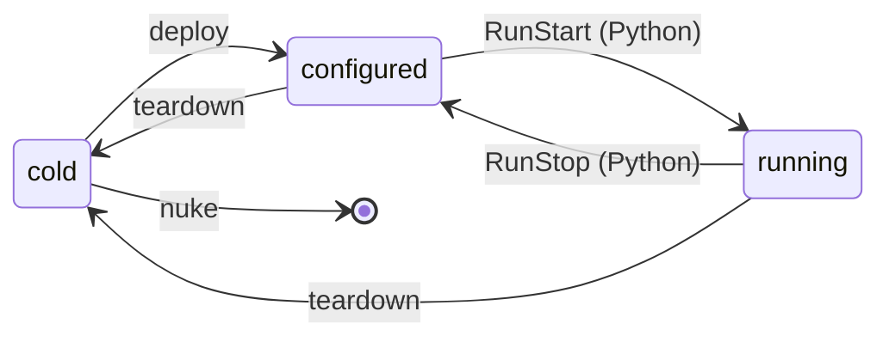
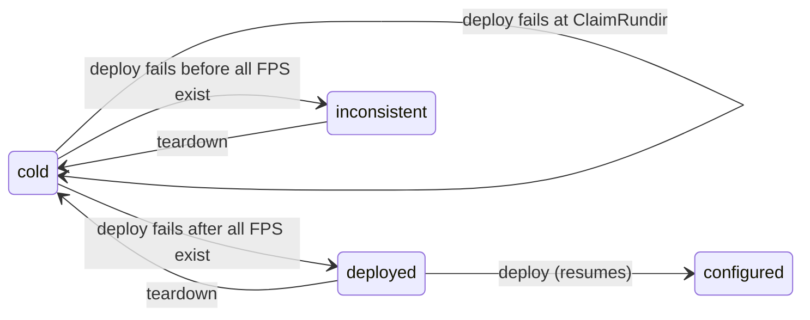

# Operating a pipeline: `milk-pipes`

The states of a deployed pipeline, the `milk-pipes` commands that move between them, and what
happens when they fail.

**Audience:** Operator · See also: [Tour](pipelines_tour.md) · [Plans and tasks](pipelines_plans.md) ·
[Drift and resync](pipelines_provision.md) · [Glossary](pipelines_glossary.md)

## 1. Lifecycle

The states are those printed by `milk-pipes state`; the arrows are commands and tasks.



| State | Rundir | FPS | Processes |
|---|---|---|---|
| `cold` | absent | none | none |
| `deployed` | claimed | all | conf stopped |
| `configured` | claimed | all | conf running |
| `running` | claimed | all | run running |
| `mixed` | claimed | all | some CompUs running, others not |
| `inconsistent` | stale, or claimed with an FPS missing, or absent with FPS present | | |

The rundir is the deploy's claim for this boot, `$MILK_SHM_DIR/pipe_rundirs/<name>/`. Only
`deploy` and `teardown` are plans; running is reached through the Python API
([Tour: run processes](pipelines_tour.md#4-start-and-stop-the-run-processes)). `nuke` is a
teardown followed by `rm -rf` of the rootdir.

### 1.1. Failures and recovery

A failed deploy leaves the pipeline in a state that tells what to do next.



- A reboot wipes the rundir and the FPSs: the pipeline is `cold` again. A rundir left from a
  previous boot (boot id mismatch) is `inconsistent`.
- From `inconsistent`, only `teardown` is accepted. Teardown is accepted from every state.
- `mixed` counts as consistent (for a plan's `accepts`).
- A rundir claimed by another rootdir adds a reason to the state, not a new state.

## 2. Commands

```text
milk-pipes <plan>  [-p PIPE]          run plan <plan>: deploy, teardown, ...
milk-pipes state   [-p PIPE]          state, reasons, drift summary, milk version change
milk-pipes link    [LINKAGE] [-p PIPE]  apply [systemlinkage.<LINKAGE>]; none: list them
milk-pipes unlink  LINKAGE [-p PIPE]  remove its symlinks; `all`: of every linkage
milk-pipes nuke    [-p PIPE] [--yes]  teardown, then rm -rf the rootdir
```

- **`-p/--pipe PIPE`** is a rootdir path, or a short name meaning `<cwd>/<PIPE>-rootdir`.
  Without `-p`, the current directory must be a rootdir. Every command first prints
  `rootdir: <path>`, the rootdir it acts on. In Python: `Pipeline(pipe)`.
- **Plan commands** are one per registered plan (`milk-pipes --help` lists them). `deploy` is
  idempotent: run again on a configured pipeline, every step already succeeded. `teardown` is
  best effort and keeps the rootdir and `work/`. Their steps are in
  [Plans and tasks: built-in plans](pipelines_plans.md#1-built-in-plans).
- **`link`** is allowed only in `deployed` and `configured`. `teardown` removes every linkage.
- **`nuke`** asks you to type the short name; `--yes` skips that. It deletes the rootdir even if
  teardown fails.

### 2.1. `state`

`state` never fails because of the pipeline's state. It prints the state with its reasons, then
the drift summary, then the milk version if it changed since `init`:

```bash
milk-pipes state -p basic
```

```text title="Output"
rootdir: /home/vdeo/pipes/basic-rootdir
basic: configured
drift: 1 artifact(s); run `milk-pipeinit drift /home/vdeo/pipes/basic-rootdir`
```

The drift line is `drift: none`, `drift: <n> artifact(s); run ...` or
`drift: unavailable (<why>)`, for example when the source confdir is gone. What the drift means
is in [Drift and resync](pipelines_provision.md#2-drift).

## 3. Errors

`milk-pipes` and `milk-pipeinit` print any error as `Error: <message>`, without a stack trace,
and exit 1. A message carries its context lines when it has some:

```text title="Output"
Error: Invalid config:
  compute_units.delay0.fps.procinfo: procinfo: 1 validation error ...
path: aoloop-conf/conf.toml
```

`--errstack`, placed before the command (`milk-pipeinit --errstack resolve aoloop-conf`), lets
the exception propagate with its stack trace. Log records of the package print to stderr as
`LEVEL: message`.

A command refused because of the state names the command to run:

```text title="Output"
Error: Pipeline basic is cold; run deploy.
Error: Pipeline basic is inconsistent (FPS missing: basic_delay1); run teardown.
```

A best-effort plan (`teardown`) runs every step, then prints one `warning: <step>: <error>` line
per failed step and exits 1:

```text title="Output"
warning: ConfStop: <error>
```

Anything that touches the live system needs `MILK_ROOT`, `MILK_INSTALLDIR` and `MILK_SHM_DIR` in
the environment. `milk-pipeinit` itself does not, except `resync`, which checks that no run
process is active.

## 4. Displays: `milk-show`

`milk-show mlat -p PIPE` plots the latency measurement (`hardwlatency.dat`) of a pipeline's `mlat`
CompU from its datadir under `rootdir/work/`; `r` in the window re-reads the file.
`milk.show.cli.mlat_figure(datadir)` returns the figure for use in a script or a notebook.
