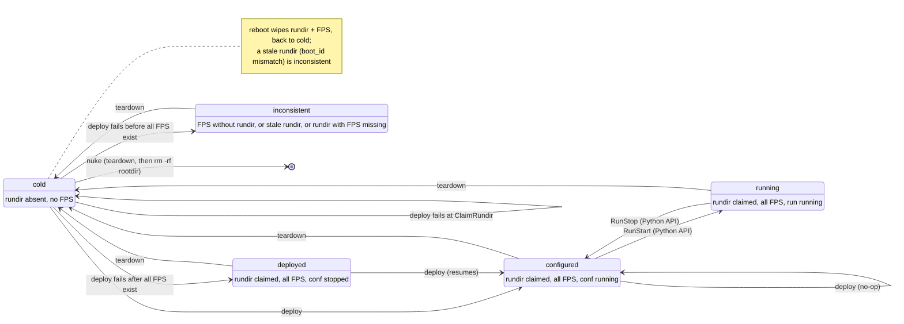

# Operating a pipeline: `milk-pipes`

`milk-pipes` operates an initialized pipeline from its rootdir: it deploys, links and tears
down. To build or update a rootdir, use [`milk-pipeinit`](pipelines_provision.md). Terms
are defined in the [pipelines glossary](pipelines_glossary.md).

## Lifecycle

The states are those printed by `milk-pipes state`; the arrows are commands and plans. The rundir
is the deploy's claim for this boot, `$MILK_SHM_DIR/pipe_rundirs/<name>/`.



Only `deploy` and `teardown` are plans; running is reached through the Python API. Some CompUs
running and others not is `mixed`. A rundir claimed by another rootdir adds a reason, not a state.
`milk-pipeinit resync` refuses while a CompU runs.

## Commands

```
milk-pipes <plan>  [-p PIPE]          run plan <plan>: deploy, teardown, ...
milk-pipes state   [-p PIPE]          state, reasons, drift summary, milk version change
milk-pipes link    [LINKAGE] [-p PIPE]  apply [systemlinkage.<LINKAGE>]; none: list them
milk-pipes unlink  LINKAGE [-p PIPE]  remove its symlinks; `all`: of every linkage
milk-pipes nuke    [-p PIPE] [--yes]  teardown, then rm -rf the rootdir
```

- **`-p/--pipe PIPE`** is a rootdir path, or a short name meaning `<cwd>/<PIPE>-rootdir`.
  Without `-p`, the current directory must be a rootdir. Every command first prints
  `rootdir: <path>`, the rootdir it acts on. In Python: `Pipeline(pipe)`.
- **Plan commands** are one per registered plan (`milk-pipes --help` lists them). `deploy` runs
  ClaimRundir → InitFPS → LoadData → ConfStart and is idempotent. `teardown` runs RunStop →
  DeapplyAllLinkages → ConfStop → KillTmux → DestroyFPS → ReleaseRundir, best effort, and keeps the
  rootdir and `work/`.
- **`state`** never fails because of the pipeline's state. It prints the state with its reasons,
  then `drift: none`, `drift: <n> artifact(s); run ...` or `drift: unavailable (<why>)` (for
  example when the source confdir is gone), then the milk version if it changed since `init`.
- **`link`** needs a deployed pipeline that is not running.
- **`nuke`** asks you to type the short name; `--yes` skips that. It deletes the rootdir even if
  teardown fails.

Errors print `Error: <message>` and exit 1; `--errstack` shows the stack trace (see
[Environment and errors](pipelines_provision.md#environment-and-errors)). A best-effort plan prints one
`warning: <step>: <error>` line per failed step, after running all of them, and exits 1.

## Example session

```console
$ milk-pipeinit clone $MILK_ROOT/milk-examples/pipelines/pipelinebasic-conf ~/pipes
$ milk-pipeinit init ~/pipes/pipelinebasic-conf            # → ~/pipes/basic-rootdir
$ cd ~/pipes
$ milk-pipes state -p basic
rootdir: /home/vdeo/pipes/basic-rootdir
basic: cold
drift: none
$ milk-pipes deploy -p basic                               # ClaimRundir → InitFPS → LoadData → ConfStart
rootdir: /home/vdeo/pipes/basic-rootdir
$ milk-pipes state -p basic
rootdir: /home/vdeo/pipes/basic-rootdir
basic: configured
drift: none
$ milk-pipes link loopback -p basic                        # needs a deployed, non-running pipeline
rootdir: /home/vdeo/pipes/basic-rootdir
$ milk-pipes deploy -p basic                               # idempotent: every step already succeeded
rootdir: /home/vdeo/pipes/basic-rootdir
$ vi pipelinebasic-conf/conf.toml                          # edit the source confdir
$ milk-pipes state -p basic
rootdir: /home/vdeo/pipes/basic-rootdir
basic: configured
drift: 1 artifact(s); run `milk-pipeinit drift /home/vdeo/pipes/basic-rootdir`
$ milk-pipes teardown -p basic                             # best effort; keeps the rootdir and work/
rootdir: /home/vdeo/pipes/basic-rootdir
$ milk-pipeinit resync basic-rootdir                       # prints the teardown → deploy banner
$ milk-pipes deploy -p basic
rootdir: /home/vdeo/pipes/basic-rootdir
$ milk-pipes state -p /elsewhere/basic-rootdir             # a pipeline outside cwd
rootdir: /elsewhere/basic-rootdir
$ milk-pipes nuke -p basic                                 # asks you to type 'basic'
rootdir: /home/vdeo/pipes/basic-rootdir
Type 'basic' to delete /home/vdeo/pipes/basic-rootdir: basic
```

For the drift details and resync, see [Drift](pipelines_conf.md#drift) and
[Resync](pipelines_conf.md#resync).

## Failures

```console
$ milk-pipes link loopback -p basic                        # cold pipeline
rootdir: /home/vdeo/pipes/basic-rootdir
Error: Pipeline basic is cold; run deploy.
$ milk-pipes deploy -p basic                               # an FPS was destroyed by hand
rootdir: /home/vdeo/pipes/basic-rootdir
Error: Pipeline basic is inconsistent (FPS missing: basic_delay1); run teardown.
$ milk-pipes teardown -p basic                             # one step failed, the others ran
rootdir: /home/vdeo/pipes/basic-rootdir
warning: ConfStop: <error>
$ echo $?
1
```

## Plans, steps and tasks

A **plan** is a named, ordered tuple of **steps**. Each step names a **task** and can restrict it
to a subset of CompUs. `milk-pipes <plan>` runs one plan. Plans and tasks are Python objects in
`milk.operate.plans` and `milk.operate.tasks`, and each one is looked up by name in a registry
(`PLANS`, `TASKS`).

### Plan and Step syntax

```python
from milk.operate.plans import PLANS, Plan, Step

PLANS.register("restart_wfs", Plan(
    "restart_wfs",
    (
        Step("RunStop", ("wfs",)),       # only CompU "wfs"
        Step("RunStart", ("wfs",)),
        Step("WaitRunEnd"),              # all CompUs
    ),
    on_failure="abort",
    accepts="consistent",
))
```

| Field | Type | Default | Meaning |
|---|---|---|---|
| `Step.task` | `str` | — | A name in `TASKS`, which is the task's class name |
| `Step.compus` | `tuple[str, ...] \| None` | `None` | The CompU subset; `None` means all CompUs. Unknown names raise `ConfigError` |
| `Plan.name` | `str` | — | The name to register it under, which is also the `milk-pipes` command name |
| `Plan.steps` | `tuple[Step, ...]` | — | The steps, run in order |
| `Plan.on_failure` | `"abort" \| "best_effort"` | `"abort"` | `abort` stops at the first failing step and raises its error. `best_effort` runs every step, then raises one `BestEffortError` that lists the failures |
| `Plan.accepts` | `"consistent" \| "cold_or_consistent" \| "any"` | `"consistent"` | The [states](#lifecycle) the plan may start from. `consistent` refuses `cold` and `inconsistent`, `cold_or_consistent` refuses `inconsistent`, and `any` refuses nothing |

A step with a CompU subset appears in messages as `Task[cu1,cu2]`.

The built-in plans are `deploy` (`abort`, `cold_or_consistent`) and `teardown` (`best_effort`,
`any`); their steps are listed under [Commands](#commands).

### How a plan runs

`run_plan(pipeline, name)` (or `milk-pipes <name>`) runs a plan in three phases:

1. **Build.** It instantiates every step's task. An unknown task or CompU name raises
   `ConfigError` here, before anything has changed.
2. **Gate.** It computes the [state](#lifecycle) and checks it against `accepts`.
3. **Do.** It calls `pipeline.task_do(task)` for each step, in order, applying `on_failure`.

If the pipeline's `conf.toml` sets `plans = ["deploy", ...]`, only those plans may run on it.
The `milk-pipes` commands are still generated from every registered plan.

### Task contract

A task subclasses `milk.operate.tasks.Task` and implements three methods. `pipeline.task_do`
calls them in this order:

```
success()? ── yes ──► done (no-op: this is what makes plans idempotent)
    │ no
can()? ────── no ───► TaskCannotRunError(failure_reason)
    │ yes
forward()
success()? ── no ───► TaskDidNotSucceedError(failure_reason)
    │ yes
done
```

- **`success()`** checks whether the goal already holds, and must not have side effects.
- **`can()`** checks the task's preconditions. Before returning `False`, it sets
  `self.failure_reason`.
- **`forward()`** does the work. For asynchronous effects (tmux, processes), it waits with
  `wait_until(self.success, self.TIMEOUT)`; `TIMEOUT` defaults to 10 s.
- **`self.compute_units`** is the step's CompU subset, as `{name: ComputeUnit}`.
  `self._existing()` is the part of that subset whose FPS exists, as `(ComputeUnit, FPS)` pairs.
- Tasks act on the live pipeline (SHM, FPS, tmux, processes) and never modify `rootdir/conf/`.

Direct subclasses of `Task` in `milk/operate/tasks.py` are registered under their class name
automatically. A task defined anywhere else needs `TASKS.register("MyTask", MyTask)`.

To run a single task without a plan: `Pipeline("basic").task_do(RunStart)`, or
`task_do(RunStart(pipeline, ["wfs"]))` for a CompU subset. This bypasses the state gate.

### Built-in tasks

| Task | Goal (`success()`) |
|---|---|
| `ClaimRundir` | The rundir is claimed by this rootdir for the current boot. It refuses if another rootdir holds the name, or another pipeline holds the `loop_number` |
| `InitFPS` | Every FPS exists and is valid. It runs `fpsinit` in `work/`, then sets the `[compute_units.<cu>.fps]` values |
| `LoadData` | Every `[[dataloads]]` target stream exists with the source FITS shape and dtype |
| `ConfStart` | Every conf process is running |
| `RunStart` | Every run process is running. It requires the conf processes to be running |
| `RunStop` | No run process is running |
| `WaitRunEnd` | No run process is running. It waits up to 120 s for the runs to end by themselves and never stops anything |
| `DeapplyAllLinkages` | No systemlinkage symlink remains |
| `ConfStop` | No conf process is running |
| `KillTmux` | No tmux session with a CompU's FPS name is left. It does nothing unless `teardown_kill_tmux = true` |
| `DestroyFPS` | No FPS of the subset exists |
| `ReleaseRundir` | The rundir is gone |
