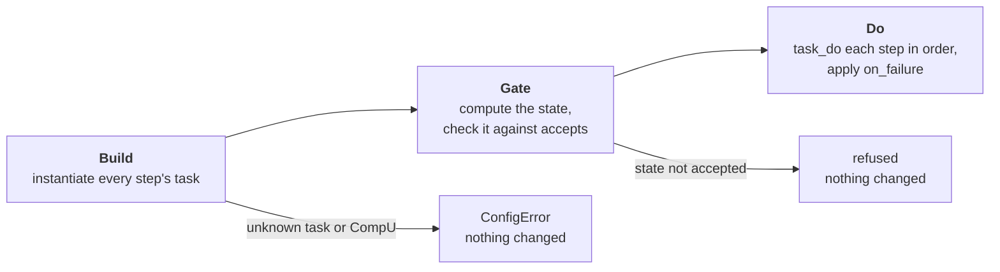

# Plans and tasks

The built-in plans and tasks, how a plan runs, and how to write and register your own plans.

**Audience:** Integrator · See also: [Operating](pipelines_operate.md) ·
[Configuration](pipelines_conf.md) · [Internals: task contract](pipelines_internals.md#6-task-contract) ·
[Glossary](pipelines_glossary.md)

A **task** is one idempotent action on the live pipeline (SHM, FPS, tmux, processes). It acts on
the pipeline as a whole, or on a CompU subset given at construction. Without one, the task picks
its own: all CompUs (`RunStart`: the [`runstart`](pipelines_conf.md#3-conftoml-keys) list;
`SetLoopOff`: the one `cacao-fpsexec-mfilt` CompU; `SetLinResp`, `WaitLinResp`: the one
`cacao-fpsexec-cacaoac-measlinresp` CompU), or it refuses (`LoadCM`). A **plan** is data: a name, ordered **steps**
(a task name and an optional CompU subset), a failure policy and the states it accepts to start
from. Plans and tasks are Python objects in `moka.operate.plans` and `moka.operate.tasks`, each
looked up by name in a registry (`PLANS`, `TASKS`). Each pipeline adds its own plans and tasks
over these ([§4](#4-custom-plans)).

## 1. Built-in plans

| Plan          | Steps                                                                           | `on_failure`  | `accepts`            |
| ------------- | ------------------------------------------------------------------------------- | ------------- | -------------------- |
| `deploy`      | ClaimRundir → InitFPS → LoadData → ConfStart                                    | `abort`       | `cold_or_consistent` |
| `teardown`    | RunStop → DeapplyAllLinkages → ConfStop → KillTmux → DestroyFPS → ReleaseRundir | `best_effort` | `any`                |
| `runstart`    | RunStart                                                                        | `abort`       | `consistent`         |
| `runstop`     | RunStop                                                                         | `best_effort` | `any`                |
| `mlat`        | RunStart[acquWFS] → RunStart[mlat] → WaitRunEnd[mlat]                           | `abort`       | `consistent`         |
| `mkpokes`     | MakePokes                                                                       | `abort`       | `consistent`         |
| `measlinresp` | RunStart[acquWFS] → SetLinResp → RunStart[measlinresp] → WaitLinResp            | `abort`       | `consistent`         |
| `mkcm`        | MakeCM                                                                          | `abort`       | `cold_or_consistent` |
| `spool`       | SetLoopOff → RunStop → LoadCM → RunStart[acquWFS] → RunStart → SetLoopOff       | `abort`       | `consistent`         |

`mlat` needs CompUs named `acquWFS` and `mlat` (otherwise it is `n/a` in `moka plans` and fails
with a `ConfigError`). It leaves `acquWFS` running (the state is then `mixed` when other `runstart`
CompUs are idle); a second run skips that start and starts `mlat` again.

`moka mkpokes [TYPE]` writes the poke cube `<rootdir>/calib/RMmodesDM.fits` (float32, header
`POKETYPE`) over the actuators of the [`[dmhint]`](pipelines_conf.md#3-conftoml-keys) mask, which
it needs. `TYPE` is `hadamard` (default: `next_pow2(Nact)` slices) or `zonal` (one actuator per
slice). A cube already of that type and DM size is left alone; a hand-made one (no `POKETYPE`) is
replaced. The cube is FITS (NAXIS1, NAXIS2, NAXIS3) = (`xsize`, `ysize`, modes).

`moka measlinresp [-a AMPL]` measures the response to the cube in `calib/RMmodesDM.fits` (made by
`mkpokes` or dropped there by hand). It needs CompUs `acquWFS`, `mlat` and `measlinresp`, the
latency of a past `moka mlat` (`work/fps.<mlat FPS>.datadir/cacaovars.bash`, kept by
`teardown`), and the `streamin` stream, whose shape must match the cube's. Everything else comes
from the `measlinresp` FPS conf; `-a` sets `ampl` until the next deploy. All files are in
`<rootdir>/calib/`:

| File                         | Is                                                                     |
| ---------------------------- | ---------------------------------------------------------------------- |
| `RMmodesWFS.inprogress.fits` | what the run writes, rewritten at every cycle                          |
| `RMmodesWFS.fits`            | a complete run only (`procinfo.loopcntMax` cycles), renamed at its end |
| `RMmodesWFS.prev.fits`       | the `RMmodesWFS.fits` that was there when the latest run began         |

Every `moka measlinresp` measures again. Nothing checks that other writers leave the DM alone:
run it before `moka runstart`.

`moka mkcm [FLAVOR] [-n NMODES] [-r REG]` computes the control matrix pair from whatever
response matrix pair is in `<rootdir>/calib/` (`RMmodesDM.fits`, `RMmodesWFS.fits`: measured or
dropped there by hand) and writes `CMmodesWFS.fits` and `CMmodesDM.fits` there, float32. It
touches no stream, so it also runs on a pipeline that is not deployed. The loop computes the mode
coefficients `a = CMmodesWFS · wfs` and the DM command `dm = CMmodesDMᵀ · a`, so both cubes have
the same number of slices. With the response `W` (one row per poke mode) decomposed as
`V · diag(σ) · Uᵀ`, σ descending:

- `tsvd` (default): one slice per kept singular mode, `u_k / σ_k` and the DM shape `v_kᵀ · D`.
- `tikhonov`: the same slices with gain `σ_k / (σ_k² + λ²)`, `λ = REG · σ_0`. It needs `-r`.
- `pinv`: the pseudo-inverse restricted to the kept modes; the slices are the poke modes
  themselves (`CMmodesDM` is `RMmodesDM`).

`-n` keeps the singular modes of index below `NMODES` (1 to the number of poke modes); `-r` keeps,
for `tsvd` and `pinv`, those with `σ_k > REG · σ_0` (default `1e-6`: only null modes go). They
combine. If no mode is kept, `mkcm` fails and writes nothing. Both headers hold `CMFLAVOR`,
`CMNCUT` (the `-n` given; absent without `-n`), `CMREG` (the effective `-r`) and `CMNKEPT` (the
number of singular modes kept); `CMmodesWFS.fits` also has an HDU `SINGVALS` with all singular
values, to choose `-n` and `-r` from. A pair of the same parameters, newer than both RM files, is
left alone; a hand-made pair (no `CMFLAVOR`) is replaced.

`moka spool` loads the control matrix pair in `<rootdir>/calib/` (`CMmodesWFS.fits`,
`CMmodesDM.fits`: made by `mkcm` or dropped there by hand) and starts the loop with the
integrator off. It needs CompUs `acquWFS`, `wfs2modes`, `mfilt` and `modes2dm`, and takes no
parameter. Step by step:

1. `SetLoopOff[mfilt]`: `loopON` false, before anything runs.
2. `RunStop[modes2dm,mfilt,wfs2modes]`: they copy the matrix and the mode count at run start.
3. `LoadCM[wfs2modes,modes2dm]`: each cube into the `immodes` stream of its CompU, as
   (`xsize`, `ysize`, modes). It refuses if the files are missing, their mode counts differ, or
   `CMmodesDM.fits` is not the [`[dmhint]`](pipelines_conf.md#3-conftoml-keys) size.
4. `RunStart[acquWFS]`: skipped if it runs.
5. `RunStart[wfs2modes,mfilt,modes2dm]`: one at a time, in that order. It waits for each run flag
   only; nothing checks that the stream a CompU reads exists or has the size the pair implies.
6. `SetLoopOff[mfilt]`: checked again once `mfilt` runs.

`spool` never writes to the DM; whatever command it holds stays. Closing the loop is left to the
operator, in `milk-fpsCTRL` on the `mfilt` FPS: `loopON`, `loopgain`, `loopmult`, `looplimit`, and
`loopZERO` to zero the command. A second `spool`, for instance after a new `mkcm`, restarts the
three CompUs with the new pair.

Every plan of the pipeline, built-in or [local](#4-custom-plans), is a `moka` subcommand. `runstart` and `runstop` also take CompU names
(`moka runstart -p basic delay1`, `run_plan(pp, "runstart", ["delay1"])`): every step then acts
on those CompUs. From Python, `run_plan(pipeline, name, compus)` applies the subset to every step
of any plan, so a plan with a pipeline-wide task (`deploy`, `teardown`) is then a `ConfigError`.

=== "CLI"

    ```bash
    moka deploy -p basic
    ```

=== "Python"

    ```python
    from moka.operate.pipeline import Pipeline
    from moka.operate.plans import run_plan

    run_plan(Pipeline("basic"), "deploy")
    ```

## 2. Built-in tasks

| Task                 | Goal (`success()`)                                                                                                                                                                                         |
| -------------------- | ---------------------------------------------------------------------------------------------------------------------------------------------------------------------------------------------------------- |
| `ClaimRundir`        | The rundir is claimed by this rootdir for the current boot. It refuses if another rootdir holds the name, or another pipeline holds the `loop_number`                                                      |
| `InitFPS`            | Every FPS exists and is valid. It runs `fpsinit` in `work/`, then sets the `[compute_units.<cu>.fps]` values                                                                                               |
| `LoadData`           | Every `[[dataloads]]` target stream exists with the source FITS shape and dtype                                                                                                                            |
| `ConfStart`          | Every conf process is running                                                                                                                                                                              |
| `RunStart`           | Every run process of the subset (default: `runstart`) is running. It starts them one at a time, in order (all at once if neither step nor conf.toml names them), and requires the conf processes to run    |
| `RunStop`            | No run process is running                                                                                                                                                                                  |
| `WaitRunEnd`         | No run process is running. It waits up to 120 s for the runs to end by themselves and never stops anything                                                                                                 |
| `SetLinResp`         | The `measlinresp` FPS holds the cube and output paths (relative to `work/`), mlat's frame rate and latency, and `-a`; no `RMmodesWFS.fits` nor in-progress file is left (the first is archived to `.prev`) |
| `WaitLinResp`        | As `WaitRunEnd`, with a timeout of 2x expected +10 s; then a complete run's in-progress file is renamed `RMmodesWFS.fits`                                                                                  |
| `DeapplyAllLinkages` | No systemlinkage symlink remains                                                                                                                                                                           |
| `ConfStop`           | No conf process is running                                                                                                                                                                                 |
| `KillTmux`           | No tmux session with a CompU's FPS name is left. It does nothing unless `teardown_kill_tmux = true`                                                                                                        |
| `DestroyFPS`         | No FPS of the subset exists                                                                                                                                                                                |
| `ReleaseRundir`      | The rundir is gone                                                                                                                                                                                         |

## 3. Running a single task

`Pipeline.task_do(task)` runs one task, on its default CompUs or on a subset. It is the low-level entry
point and bypasses the state gate.

```python
from moka.operate.pipeline import Pipeline
from moka.operate.tasks import RunStart, RunStop, WaitRunEnd

pp = Pipeline("basic")
pp.task_do(RunStart)                        # (1)!
pp.task_do(RunStart(pp, ["mlat"]))          # (2)!
pp.task_do(WaitRunEnd(pp, ["mlat"]))        # (3)!
pp.task_do(RunStop(pp, ["wfscam", "dmdelay"]))
```

1. The CompUs of `runstart` (default: all); `RunStop`, `WaitRunEnd`: every CompU.
2. One CompU.
3. Waits (up to 120 s) for a run that ends by itself.

`task_do` skips the work when the goal already holds, which is what makes every plan safe to
re-run.

## 4. Custom plans

A pipeline carries its own plans and tasks in its confdir, from two optional sources:
`[plans.<name>]` tables in `conf.toml`, and the file `scripts/moka_plans.py`. Both are
[conf files](pipelines_conf.md#1-the-confdir), copied to `rootdir/conf/` at init and tracked by
drift. They are read from the rootdir.

`Pipeline.plans` and `Pipeline.tasks` look a name up in the pipeline's own definitions first,
then in `PLANS` and `TASKS`. `run_plan`, `run` and `moka` resolve names through them, so
`moka -h -p PIPE` lists the pipeline's plans as commands, and
[`moka plans`](pipelines_operate.md#22-plans) their status. A local definition that has the name of
a built-in one (or a Python plan that has the name of a TOML plan) overrides it and logs a
warning. A plan named like a fixed `moka` command (`state`, `plans`, `tasks`, `link`, `unlink`, `nuke`) is refused
by the CLI only: every `moka` command on that pipeline then fails with an error; `run_plan` from
Python is unaffected.

The local definitions are loaded on the first access to `plans` or `tasks`, not when the
`Pipeline` is constructed. They never change `PLANS` and `TASKS`, so two pipelines in one
process do not see each other's definitions.

=== "conf.toml"

    ```toml
    [plans.latency]
    steps = [
        "RunStart[dmdelay]",
        "RunStart[wfscam]",
        "RunStart[mlat]",
        "WaitRunEnd[mlat]",
        "RunStop[wfscam,dmdelay]",
    ]
    # on_failure = "abort"
    # accepts = "consistent"
    ```

    A step is `Task` or `Task[cu1,cu2]`. Only the syntax is checked at load; task and CompU names
    are checked when the plan runs. `compus_arg` is not settable in TOML, so a `[plans.runstart]`
    or `[plans.runstop]` table that overrides the built-in loses its `[CU]...` arguments; use
    `moka_plans.py` to keep them.

=== "scripts/moka_plans.py"

    ```python
    from moka.operate.plans import Plan, Step
    from moka.operate.tasks import Task

    class AcquireDark(Task):
        ...

    TASKS = [AcquireDark]   # (1)!
    PLANS = [Plan("dark", (Step("AcquireDark"),))]
    ```

    1. Registered under the class name.

    Both lists are optional. The file is imported, not sandboxed: it is trusted like a
    [`command` hook](pipelines_conf.md#33-hooks-fetching-and-generating-files). An error in it
    surfaces on the first access to `plans` or `tasks`; `moka -h` then lists the built-in plans
    only.

From Python, `run(pipeline, plan)` runs any plan, registered or not, and `PLANS.register(name, plan)` adds a plan for every pipeline of the current process:

```python
from moka.operate.plans import Plan, Step, run

run(pp, Plan(
    "restart_wfs",
    (
        Step("RunStop", ("wfs",)),       # only CompU "wfs"
        Step("RunStart", ("wfs",)),
        Step("WaitRunEnd"),              # all CompUs
    ),
    on_failure="abort",
    accepts="consistent",
))
```

| Field             | Type                                            | Default        | Meaning                                                                                                                                                                                        |
| ----------------- | ----------------------------------------------- | -------------- | ---------------------------------------------------------------------------------------------------------------------------------------------------------------------------------------------- |
| `Step.task`       | `str`                                           | —              | A task name of the pipeline, which is the task's class name                                                                                                                                    |
| `Step.compus`     | `tuple[str, ...] \| None`                       | `None`         | The CompU subset; `None`: the task's default, all CompUs for most (see the top of this page). Unknown names raise `ConfigError`                                                                |
| `Plan.name`       | `str`                                           | —              | The plan's name, which is also the `moka` command name. In TOML, the table name                                                                                                                |
| `Plan.steps`      | `tuple[Step, ...]`                              | —              | The steps, run in order                                                                                                                                                                        |
| `Plan.on_failure` | `"abort" \| "best_effort"`                      | `"abort"`      | `abort` stops at the first failing step and raises its error. `best_effort` runs every step, then raises one `BestEffortError` that lists the failures                                         |
| `Plan.accepts`    | `"consistent" \| "cold_or_consistent" \| "any"` | `"consistent"` | The [states](pipelines_operate.md#1-lifecycle) the plan may start from. `consistent` refuses `cold` and `inconsistent`, `cold_or_consistent` refuses `inconsistent`, and `any` refuses nothing |
| `Plan.compus_arg` | `bool`                                          | `False`        | `True`: its `moka` command takes `[CU]...` and runs every step on those CompUs. Not settable in TOML                                                                                           |
| `Plan.params`     | `tuple[Param, ...]`                             | `()`           | Values its `moka` command takes, handed to every task of the plan (below). Not settable in TOML                                                                                                |

A step with a CompU subset appears in messages as `Task[cu1,cu2]`.

A `Param(name, type=str, default=None, positional=False, short=None)` adds `[NAME]` (positional)
or `-<short>/--<name> NAME` to the plan's command; `type` is `str`, `int` or `float`. Every task of
the plan receives the same dict as `self.params`, without the values left at `None`; a task reads
only the keys it knows, and must work with an empty dict (`moka plans` and `moka tasks` build it
so). From Python: `run_plan(pp, "probe", params={"ampl": 0.5})`, or `run(pp, plan, params)`.

```python
Plan("probe", (Step("Probe"),), params=(Param("kind", positional=True), Param("ampl", float, short="a")))
# moka probe -p basic hadamard -a 0.5   →   self.params == {"kind": "hadamard", "ampl": 0.5}
```

A task of your own subclasses `Task`; see
[Internals: task contract](pipelines_internals.md#6-task-contract).

## 5. How a plan runs

`run_plan(pipeline, name)`, `run(pipeline, plan)` and `moka <name>` run a plan in three
phases.



1. **Build.** An unknown task or CompU name raises `ConfigError` here, before anything has
   changed.
2. **Gate.** The state is computed once and checked against `accepts`.
3. **Do.** `pipeline.task_do(task)` runs for each step, in order. `abort` stops at the first
   failure; `best_effort` runs every step, then raises one `BestEffortError`.
