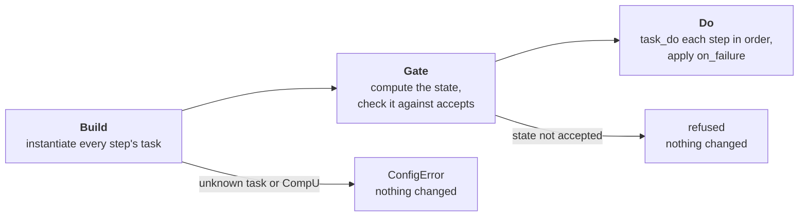

# Plans and tasks

The built-in plans and tasks, how a plan runs, and how to write and register your own plans.

**Audience:** Integrator · See also: [Operating](pipelines_operate.md) ·
[Configuration](pipelines_conf.md) · [Internals: task contract](pipelines_internals.md#6-task-contract) ·
[Glossary](pipelines_glossary.md)

!!! note "Status"
    Custom plans and tasks are registered from Python code, and registration affects the current
    Python process. Carrying custom plans in a confdir is planned.

A **task** is one idempotent action on the live pipeline (SHM, FPS, processes). It acts on
all CompUs, or on a subset given at construction. A **plan** is data: a name, ordered **steps**
(a task name and an optional CompU subset), a failure policy and the states it accepts to start
from. Plans and tasks are Python objects in `milk.operate.plans` and `milk.operate.tasks`, each
looked up by name in a registry (`PLANS`, `TASKS`).

## 1. Built-in plans

| Plan | Steps | `on_failure` | `accepts` |
|---|---|---|---|
| `deploy` | ClaimRundir → InitFPS → LoadData → ConfStart | `abort` | `cold_or_consistent` |
| `teardown` | RunStop → DeapplyAllLinkages → ConfStop → DestroyFPS → ReleaseRundir | `best_effort` | `any` |

Every plan in `PLANS` is a `milk-pipes` subcommand.

=== "CLI"

    ```bash
    milk-pipes deploy -p basic
    ```

=== "Python"

    ```python
    from milk.operate.pipeline import Pipeline
    from milk.operate.plans import run_plan

    run_plan(Pipeline("basic"), "deploy")
    ```

## 2. Built-in tasks

| Task | Goal (`success()`) |
|---|---|
| `ClaimRundir` | The rundir is claimed by this rootdir for the current boot. It refuses if another rootdir holds the name, or another pipeline holds the `loop_number` |
| `InitFPS` | Every FPS exists and is valid. It runs `fpsinit` in `work/`, then sets the `[compute_units.<cu>.fps]` values |
| `LoadData` | Every `[[dataloads]]` target stream exists with the source FITS shape and dtype |
| `ConfStart` | Every conf process is running |
| `RunStart` | Every run process is running. It requires the conf processes to be running |
| `RunStop` | No run process is running |
| `WaitRunEnd` | No run process is running. It waits up to 120 s for the runs to end by themselves and never stops anything |
| `DeapplyAllLinkages` | No systemlinkage symlink remains |
| `ConfStop` | No conf process is running |
| `DestroyFPS` | No FPS of the subset exists |
| `ReleaseRundir` | The rundir is gone |

## 3. Running a single task

`Pipeline.task_do(task)` runs one task, on all CompUs or on a subset. It is the low-level entry
point and bypasses the state gate.

```python
from milk.operate.pipeline import Pipeline
from milk.operate.tasks import RunStart, RunStop, WaitRunEnd

pp = Pipeline("basic")
pp.task_do(RunStart)                        # (1)!
pp.task_do(RunStart(pp, ["mlat"]))          # (2)!
pp.task_do(WaitRunEnd(pp, ["mlat"]))        # (3)!
pp.task_do(RunStop(pp, ["wfscam", "dmdelay"]))
```

1. Every CompU.
2. One CompU.
3. Waits (up to 120 s) for a run that ends by itself.

`task_do` skips the work when the goal already holds, which is what makes every plan safe to
re-run.

## 4. Custom plans

```python
from milk.operate.plans import PLANS, Plan, Step, run

mlat = Plan("mlat", (
    Step("RunStart", ("dmdelay",)),
    Step("RunStart", ("wfscam",)),
    Step("RunStart", ("mlat",)),
    Step("WaitRunEnd", ("mlat",)),
    Step("RunStop", ("wfscam", "dmdelay")),
))
run(pp, mlat)                  # (1)!

PLANS.register("mlat", mlat)   # (2)!
```

1. Any plan, registered or not.
2. Now runnable by name in this Python process: `run_plan(pp, "mlat")`.

Policy and accepted states are set at construction:

```python
PLANS.register("restart_wfs", Plan(
    "restart_wfs",
    (
        Step("RunStop", ("wfs",)),       # only CompU "wfs"
        Step("RunStart", ("wfs",)),
        Step("WaitRunEnd"),              # all CompUs
    ),
    on_failure="abort",
    accepts="consistent",
))
```

| Field | Type | Default | Meaning |
|---|---|---|---|
| `Step.task` | `str` | — | A name in `TASKS`, which is the task's class name |
| `Step.compus` | `tuple[str, ...] \| None` | `None` | The CompU subset; `None` means all CompUs. Unknown names raise `ConfigError` |
| `Plan.name` | `str` | — | The name to register it under, which is also the `milk-pipes` command name |
| `Plan.steps` | `tuple[Step, ...]` | — | The steps, run in order |
| `Plan.on_failure` | `"abort" \| "best_effort"` | `"abort"` | `abort` stops at the first failing step and raises its error. `best_effort` runs every step, then raises one `BestEffortError` that lists the failures |
| `Plan.accepts` | `"consistent" \| "cold_or_consistent" \| "any"` | `"consistent"` | The [states](pipelines_operate.md#1-lifecycle) the plan may start from. `consistent` refuses `cold` and `inconsistent`, `cold_or_consistent` refuses `inconsistent`, and `any` refuses nothing |

A step with a CompU subset appears in messages as `Task[cu1,cu2]`.

If the pipeline's `conf.toml` sets `plans = ["deploy", ...]`, only those plans may run on it
through `milk-pipes` and `run_plan`; `run` ignores it. The `milk-pipes` commands are still
generated from every registered plan.

A task of your own subclasses `Task` and is named in a `Step` once registered; see
[Internals: task contract](pipelines_internals.md#6-task-contract).

## 5. How a plan runs

`run_plan(pipeline, name)`, `run(pipeline, plan)` and `milk-pipes <name>` run a plan in three
phases.



1. **Build.** An unknown task or CompU name raises `ConfigError` here, before anything has
   changed.
2. **Gate.** The state is computed once and checked against `accepts`.
3. **Do.** `pipeline.task_do(task)` runs for each step, in order. `abort` stops at the first
   failure; `best_effort` runs every step, then raises one `BestEffortError`.
