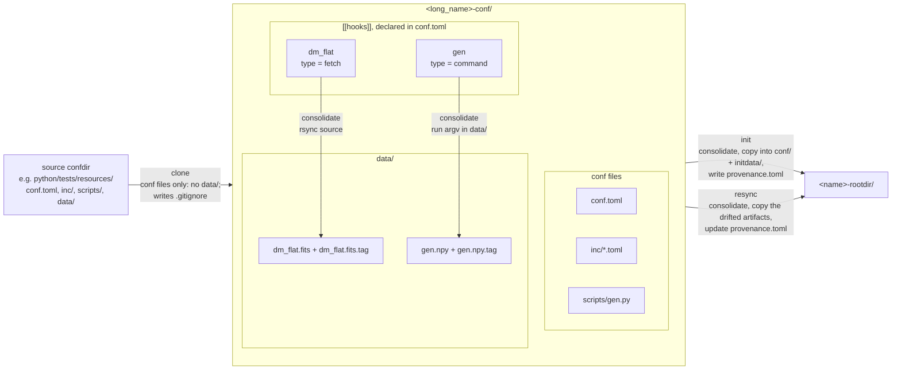

# Provisioning a pipeline: `milk-pipeinit`

`milk-pipeinit` does file operations on confdirs and rootdirs; it never touches the live
system. What the files contain, and the drift and resync rules, are in
[Configuration files](pipelines_conf.md); to operate a rootdir, see
[`milk-pipes`](pipelines_operate.md). Terms are defined in the
[glossary](pipelines_glossary.md).

From a source confdir to a rootdir, with a `fetch` and a `command` hook; every file shown is a
tracked artifact:



## Commands

| Command | Effect |
|---|---|
| `milk-pipeinit list [DIR]` | List the confdirs and rootdirs in DIR (default cwd). |
| `milk-pipeinit clone SRC [DEST_PARENT] [-u\|-d]` | Copy the conf files of SRC to `DEST_PARENT/<SRC name>` (default cwd). Refuses an existing target unless `-u`/`--update` (copy over it) or `-d`/`--override` (first delete all but its `.git`, leaving a fresh clone whose changes git tracks). Runs no hooks and no git. |
| `milk-pipeinit consolidate CONFDIR [--refetch ID ...] [--refetch-all]` | Run the pending conf hooks; print the ids that ran. `--refetch` reruns a hook even when resolved: upstream changes (for example a new file at an rsync source) are not detected otherwise. |
| `milk-pipeinit resolve DIR` | Print the resolved configuration of a confdir or a rootdir as TOML. |
| `milk-pipeinit init CONFDIR [--parent DIR] [--set K=V ...]` | Consolidate CONFDIR and build `<DIR>/<name>-rootdir` (DIR defaults to CONFDIR's parent). Refuses an existing rootdir. |
| `milk-pipeinit drift ROOTDIR` | One line per drifted artifact, the milk version if it changed, then the resolved diff, then `STRUCTURAL:` lines. |
| `milk-pipeinit resync ROOTDIR [--artifact KEY ...] [--set K=V ...] [--overwrite-local]` | Bring confdir changes into the rootdir. Always ends with the "teardown → deploy may be needed" banner and the structural lines. |

`--set` values are parsed as TOML values (`0.5`, `true`, `[1, 2]`); anything else is taken as a
string. Identity keys (`long_name`, `name`, `loop_number`) cannot be overridden.

The Python API behind these commands is `milk.provision` (`clone`, `consolidate`, `init`,
`drift`, `resync`); see [API concepts](pipelines_api.md#provisioning-milkprovision).

## Environment and errors

`milk-pipeinit` and `milk-pipes` print any error as `Error: <message>`, without a stack trace,
and exit 1. A `MilkError` message carries its context lines, e.g.:

```
$ milk-pipeinit resolve aoloop-conf
Error: Invalid config:
  compute_units.delay0.fps.procinfo: procinfo: 1 validation error ...
path: aoloop-conf/conf.toml
```

`--errstack`, placed before the command (`milk-pipeinit --errstack resolve aoloop-conf`), lets
the exception propagate with its stack trace. Log records of the package print to stderr as
`LEVEL: message`.

Anything that touches the live system needs `MILK_ROOT`, `MILK_INSTALLDIR` and `MILK_SHM_DIR`
in the environment; `milk-pipeinit` itself does not, except `resync`, which checks that no run
process is active. The exception hierarchy is described in
[API concepts: errors and environment](pipelines_api.md#errors-and-environment).
