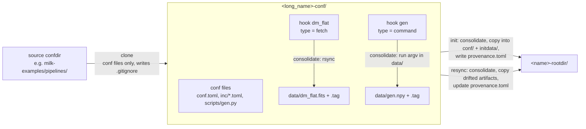

# Drift, resync and `milk-pipeinit`

How confdir changes reach a rootdir, and the `milk-pipeinit` commands that build and update
rootdirs.

**Audience:** Integrator · See also: [Configuration](pipelines_conf.md) ·
[Operating](pipelines_operate.md) · [Tour](pipelines_tour.md) · [Glossary](pipelines_glossary.md)

`milk-pipeinit` does file operations on confdirs and rootdirs; it never touches the live system.

## 1. Changing a deployed pipeline

After `init`, the rootdir is authoritative. It has its own copies of the conf files
(`rootdir/conf/`) and of the hook products (`rootdir/initdata/`), and `provenance.toml` records
the fingerprint of each of these **artifacts** as copied, the source confdir and the overrides.

Edits can then happen in two places:

- **in the confdir**: the normal workflow. The rootdir does not change until a `resync`.
- **in `rootdir/conf/`**: a hand edit of a deployed pipeline. It takes effect at the next deploy
  and is reported as a *local* drift; nothing in the confdir is affected.

The confdir workflow, after editing the confdir:

```bash
milk-pipes state -p basic           # (1)!
milk-pipeinit drift basic-rootdir   # (2)!
milk-pipes teardown -p basic
milk-pipeinit resync basic-rootdir  # (3)!
milk-pipes deploy -p basic
```

1. The drift line reports `1 artifact(s)`.
2. What changed, and whether it is structural.
3. Copies the changes into the rootdir.

Nothing is automatic: `resync` is refused while a run process is active and never deploys.

## 2. Drift

`milk-pipes state` says whether anything drifted; `milk-pipeinit drift ROOTDIR` says what:

=== "CLI"

    ```bash
    milk-pipeinit drift basic-rootdir
    ```

=== "Python"

    ```python
    from milk.provision.rootdir import drift

    report = drift(rootdir)  # (1)!
    ```

    1. A `DriftReport`: `artifacts`, `resolved_diff`, `structural`, `milk_version`. Only reads.

```text title="Output"
conf.toml: source modified, local unchanged
data/dm.fits: source stale, local unchanged
  compute_units.delay0.fps.delaysec: 0.01 -> 0.02
STRUCTURAL: compute unit delay2: added
```

Each artifact gets two statuses against its record: `source` (the confdir now) and `local` (the
rootdir now), each `unchanged`, `modified`, `added` or `removed`; a hook product is `stale` when
only its declaration changed. Then come the key-level differences between the rootdir's resolved
config and the confdir's (resolved with the recorded overrides, so overrides never show as
drift), and the `STRUCTURAL` lines: CompUs added or removed, or whose `exec` changed. A structural
change means the deployed set of FPSs no longer matches, and the pipeline has to be torn down and
deployed again. The milk version is also reported when it differs from the one recorded at init.

## 3. Resync

Resync copies the drifted artifacts from the confdir into the rootdir and updates the records.

=== "CLI"

    ```bash
    milk-pipeinit resync basic-rootdir  # (1)!
    ```

    1. Options: `--artifact KEY ...`, `--set K=V ...`, `--overwrite-local`.

=== "Python"

    ```python
    from milk.operate.pipeline import Pipeline
    from milk.provision.rootdir import resync

    report = resync(rootdir, run_active=lambda: Pipeline(rootdir).any_run_active())  # (1)!
    ```

    1. A `ResyncReport`. The "is a run process active?" check is passed as a callable, so that
       provisioning stays free of live-system code; the CLI passes this `Pipeline` query.

```text title="Output"
applied conf.toml
refused scripts/mkdm.py: local edit (modified); use overwrite_local
Resynced: teardown → deploy may be needed.
  compute_units.delay0.fps.delaysec: 0.01 -> 0.02
```

In order:

1. It is refused while any run process of the pipeline is active, and when the identity keys
   differ between the rootdir and the confdir (init a new rootdir instead).
2. The confdir is consolidated, so the hook products are current.
3. Every artifact whose `source` drifted is copied, or deleted when it was removed, and recorded.
   `--artifact KEY` restricts this to the given keys (`conf.toml`, `scripts/a.py`,
   `data/<product>`). An artifact that also has a `local` edit is refused, so a hand edit is
   never silently lost, unless `--overwrite-local`. One refusal does not stop the others.
4. The `--set` overrides are merged into the recorded ones.

Resync never tears down or deploys anything, and the banner is always printed: it is up to you to
run `milk-pipes teardown` and `deploy` when the resolved diff or a structural line calls for it.
After a partial resync (a refused artifact), `drift` shows the remaining state.

## 4. Where the files are

| | confdir | rootdir |
|---|---|---|
| conf files | `conf.toml`, `*.toml`, `scripts/` | `conf/` (same relative paths) |
| hook products | `data/<product>`, `data/<product>.tag` | `initdata/<product>`, `initdata/<product>.tag` |
| records | — | `provenance.toml` |
| FPS work folder, logs | — | `work/`, `logs/` |

A folder is a confdir when it is named `*-conf` and holds `conf.toml` but no `provenance.toml`; a
rootdir when it is named `*-rootdir` and holds `provenance.toml` and `conf/conf.toml`.
`milk-pipeinit list [DIR]` lists both.

## 5. `milk-pipeinit` commands

From a source confdir to a rootdir, with a `fetch` and a `command` hook; every file shown is a
tracked artifact:



| Command | Effect |
|---|---|
| `milk-pipeinit list [DIR]` | List the confdirs and rootdirs in DIR (default cwd). |
| `milk-pipeinit clone SRC [DEST_PARENT] [-u\|-d]` | Copy the conf files of SRC to `DEST_PARENT/<SRC name>` (default cwd). Refuses an existing target unless `-u`/`--update` (copy over it) or `-d`/`--override` (first delete all but its `.git`, leaving a fresh clone whose changes git tracks). Runs no hooks and no git. |
| `milk-pipeinit consolidate CONFDIR [--refetch ID ...] [--refetch-all]` | Run the pending conf hooks; print the ids that ran. `--refetch` reruns a hook even when resolved: upstream changes (for example a new file at an rsync source) are not detected otherwise. |
| `milk-pipeinit resolve DIR` | Print the resolved configuration of a confdir or a rootdir as TOML. |
| `milk-pipeinit init CONFDIR [--parent DIR] [--set K=V ...]` | Consolidate CONFDIR and build `<DIR>/<name>-rootdir` (DIR defaults to CONFDIR's parent). Refuses an existing rootdir. |
| `milk-pipeinit drift ROOTDIR` | One line per drifted artifact, the milk version if it changed, then the resolved diff, then `STRUCTURAL:` lines. |
| `milk-pipeinit resync ROOTDIR [--artifact KEY ...] [--set K=V ...] [--overwrite-local]` | Bring confdir changes into the rootdir. Always ends with the "teardown → deploy may be needed" banner and the structural lines. |

`--set` values are parsed as TOML values (`0.5`, `true`, `[1, 2]`); anything else is taken as a
string. Identity keys (`long_name`, `name`, `loop_number`) cannot be overridden. Errors and the
environment are described in [Operating: errors](pipelines_operate.md#3-errors).

The Python functions behind these commands:

```python
from milk.provision.clone import clone
from milk.provision.hooks import consolidate
from milk.provision.rootdir import init

confdir = clone(src_confdir, dest_parent)  # (1)!
consolidate(confdir)                       # (2)!
rootdir = init(confdir, overrides={"compute_units.delay0.fps.delaysec": 0.02})  # (3)!
```

1. Copies the conf files; refuses an existing target.
2. Runs the pending hooks; returns their ids.
3. Consolidates, copies, writes `provenance.toml` and resolves the new rootdir once to check it.

`drift` and `resync` are shown above. Their reports are plain dataclasses with the same content as
the CLI output.
