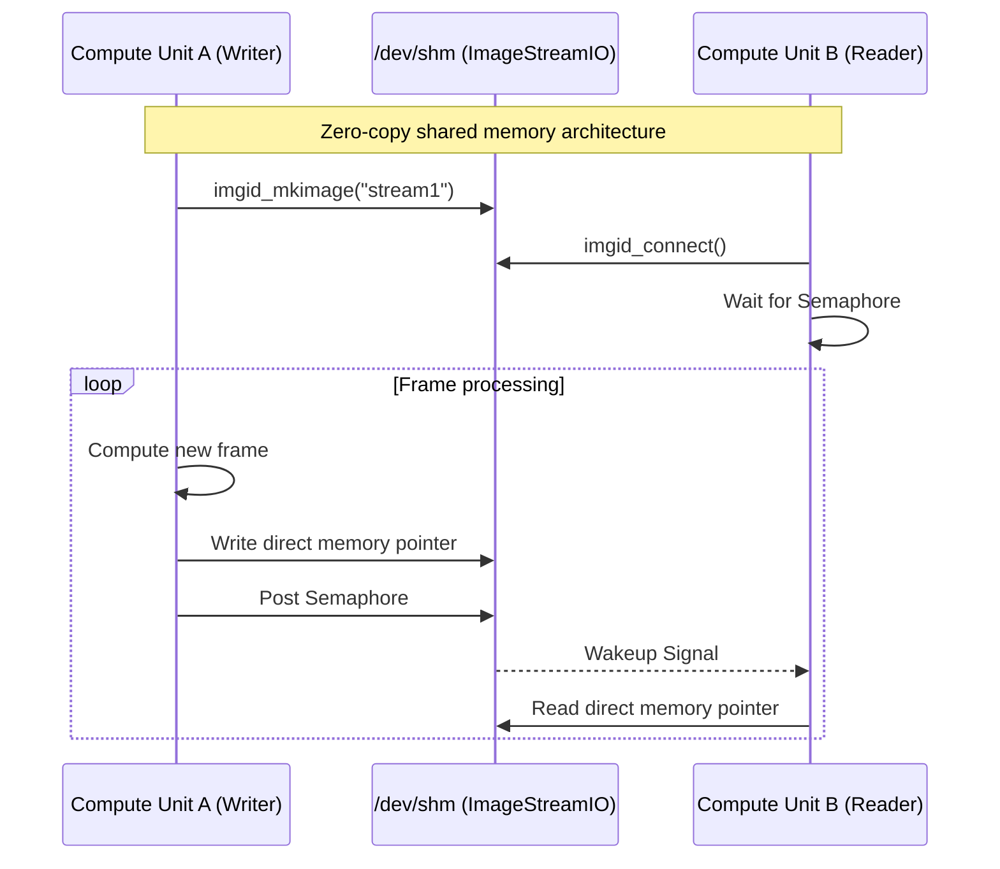

---
tags:
  - streams
  - imagestreamio
  - zero-copy
  - shared-memory
---

# Shared Memory Streams (`ImageStreamIO`)

`milk` is built around a low-latency, zero-copy architecture designed for high-performance
pipelines. This core feature is powered by `ImageStreamIO` which allocates streams (n-dimensional
tensors, typically images or data cubes) directly in the Linux tmpfs (`/dev/shm/`).

See also: [FPS](fps.md) · [Process Info](procinfo.md) · [CLI Reference](CLIcore.md) ·
[Scripts Reference](scripts.md)

## 1. Core Concepts

Unlike file-system-based intermediate data passing, `ImageStreamIO` provides direct memory pointers
to running compute units. Processes can read from or write to the same stream with microsecond
latencies.



## 2. Metadata and Semaphores

Every stream contains more than just pixel values. It includes a comprehensive metadata header:

1. **Dimensionality:** Size and shape axes (1D arrays to 3D cubes).
2. **Data Types:** Support for signed/unsigned integers and floating point up to 64-bit precision.
3. **Keywords:** An embedded dictionary of FITS-style keywords to propagate state (e.g., exposure
   parameters or telemetry data).
4. **Semaphores:** POSIX semaphores are bound natively to streams. When a compute unit finishes
   writing a frame, it posts a semaphore. Downstream processes blocking on that stream immediately
   wake up, ensuring synchronized cascading pipelines.

## 3. Stream Modifiers

When interacting with streams on the CLI or within `milk` algorithms, standard modifiers are
supported directly inside the stream string. E.g. passing `myImage@L:` to a module.

- `@S:` (Shared): Expected to reside in `/dev/shm/`. This is the default if no modifier is given.
- `@L:` (Local): Allocated in private local process memory. Used for internal buffering that doesn't
  need to be visible externally.
- `@E:` (Exists): The stream must already exist. Returns an error if not found.
- `@N:` (New): The stream must **not** exist. Returns an error if it already exists.
- `@F:<path>`: Connect to or create a FITS-backed image at `<path>`.
- `@T<type>:`: Set creation data type (e.g., `@TF32:im1`, `@TUI16:im2`, `@TCF32:im3`).

Entity-path prefixes are also recognized in stream names: `s.im1` or `stream.im1` selects shared
memory (`@S:`), while `l.im1` or `local.im1` selects local process memory (`@L:`).

> [!NOTE]
> FITS configuration files (`./conf/shmim.<name>.fits`) are checked automatically in the default
> search order when connecting to a stream. No explicit modifier is needed.

Modifiers are composable: `@LE:name` means "local memory, must exist", and `@STF32:im1` means
"shared memory, float32".

_When writing modules using `fpsexec` patterns, passing a non-existent or disallowed modifier
automatically alerts the user and aborts the module spin-up to prevent silent failures._

### `@T<type>:` Type Modifier

The `@T<type>:` modifier embeds creation type hints directly in the stream name string:

| Modifier               | Example      | Data Type             |
| ---------------------- | ------------ | --------------------- |
| `@TUI8:` / `@TUINT8:`  | `@TUI8:im1`  | `uint8`               |
| `@TI8:` / `@TINT8:`    | `@TI8:im1`   | `int8`                |
| `@TUI16:` / `@TUINT16:`| `@TUI16:im1` | `uint16`              |
| `@TI16:` / `@TINT16:`  | `@TI16:im1`  | `int16`               |
| `@TUI32:` / `@TUINT32:`| `@TUI32:im1` | `uint32`              |
| `@TI32:` / `@TINT32:`  | `@TI32:im1`  | `int32`               |
| `@TUI64:` / `@TUINT64:`| `@TUI64:im1` | `uint64`              |
| `@TI64:` / `@TINT64:`  | `@TI64:im1`  | `int64`               |
| `@TF16:`               | `@TF16:im1`  | `float16` (half)      |
| `@TF32:` / `@TFLOAT:`  | `@TF32:im1`  | `float32`             |
| `@TF64:` / `@TDOUBLE:` | `@TF64:im1`  | `float64` (double)    |
| `@TCF32:`              | `@TCF32:im1` | `complex_float`       |
| `@TCF64:`              | `@TCF64:im1` | `complex_double`      |

> [!NOTE]
> The legacy `t<type>>` prefix syntax (e.g., `tf32>im1`) is deprecated; use `@T<type>:im1` instead.

These are parsed by `imgid_make_from_name()`. Keyword count and circular buffer size are set via
`mdt->NBkw` and `mdt->CBsize` before calling `imgid_mkimage()`. Shared memory is the default; use
`@S:` for explicit shared-memory annotation if needed.

## 4. Introspection

Tools like `milk-streamCTRL` provide real-time introspection into active streams, displaying frame
arrival rates, recent values, and the current state of semaphores without disrupting operations.
To look at a stream's image in the terminal, use [`milk-termview`](termview.md).

## 5. C API (`IMGID`)

`milk` uses the `IMGID` structure to hold references to images and streams. This structure is one
level above `ImageStreamIO`, and is local to the `milk` process. It is the preferred way to pass
images and streams as function arguments.

=== "Create"

    Creating a blank `IMGID` (does not allocate memory yet):

    ```c
    static inline IMGID imgid_make()
    ```

    Creating an `IMGID` with a name:

    ```c
    static inline IMGID imgid_make_from_name(
        CONST_WORD name
    )
    ```

    Creating a new stream in shared memory:

    ```c
    IMGID img = imgid_make_from_name("im1");
    img.mdt->naxis = 2;
    img.mdt->size[0] = 128;
    img.mdt->size[1] = 128;
    img.mdt->shared = 1; // 1 = SHM, 0 = local

    imgid_mkimage(&img);

    // When done:
    imgid_free(&img);
    ```

=== "Connect"

    Connect to an existing stream:

    ```c
    IMGID img1 = imgid_make_from_name("streamname1");
    imgid_connect(&img1, IMGID_CONNECT_NOCHECK);
    if (img1.ID == -1) {
        // handle failure
    }
    ```

    Type modifiers like `@TF32:im1` set the data type automatically. Use `@S:` / `@L:` modifiers for
    location control (see section 3 above).

=== "Format-checked"

    Ensure the stream has specific dimensions, or create it if it doesn't match:

    ```c
    IMGID img1 = imgid_make_from_name("streamname1");
    img1.mdt->naxis = 2;
    img1.mdt->size[0] = 128;
    img1.mdt->size[1] = 128;

    // Create if format is wrong or doesn't exist
    imgid_connect(&img1,
        IMGID_CONNECT_CHECK_CREATE);
    ```

    Typed convenience function:

    ```c
    // Force 2D float32 creation/connection
    IMGID img1 = imgid_make_from_name("streamname1");
    imgid_connect_create_2Df32(
        &img1, xsize, ysize
    );
    ```

<!-- prettier-ignore -->
!!! tip
    Functions should prefer passing parameters using `IMGID` pointers and accessing pixels through
    `img.im->array.F` or similar data type unions based on `img.im->md->datatype`.

## 6. Stream Process Trace (Ancestry)

Every stream carries an array of `STREAM_PROC_TRACE` entries (`IMAGE_NB_PROCTRACE` = 10 by default)
that records which processes produced the data and which upstream streams triggered them.

### Data Structure

Each entry contains:

| Field             | Type              | Description                                    |
| ----------------- | ----------------- | ---------------------------------------------- |
| `procwrite_PID`   | `pid_t`           | PID of writing process                         |
| `trigger_inode`   | `ino_t`           | inode of triggering stream                     |
| `trigsemindex`    | `int`             | Trigger semaphore index                        |
| `triggermode`     | `int`             | How process was triggered (sem, cnt0, delay)   |
| `triggerstatus`   | `int`             | Trigger result (waiting, received, timed out)  |
| `ts_procstart`    | `struct timespec` | When process computation started               |
| `ts_streamupdate` | `struct timespec` | When stream was written                        |
| `cnt0`            | `uint64_t`        | Trigger stream's frame counter at trigger time |

### How It Works

When a compute unit calls
`processinfo_update_output_stream(processinfo, output_image, input_image)`:

1. The function writes the current process's info into `output_image->streamproctrace[0]`.
2. It copies `input_image->streamproctrace[0..N-2]` into `output_image->streamproctrace[1..N-1]`,
   preserving the upstream ancestry chain.
3. It then calls `ImageStreamIO_UpdateIm()` to finalize.

This creates a rolling history where `[0]` is always the most recent writer and `[N-1]` is the
oldest ancestor in the chain.

### Viewing the Trace

- In `milk-CTRL` (or `milk-streamCTRL`), F3: select a stream, press Right to open the inspector and
  Right again until the TRACE page: each hop's process, trigger stream, mode and timing.
- In `milk-CTRL` overview: the trace is used to draw stream→process→stream dependency graphs.

---

← [Documentation Index](../index.md)
