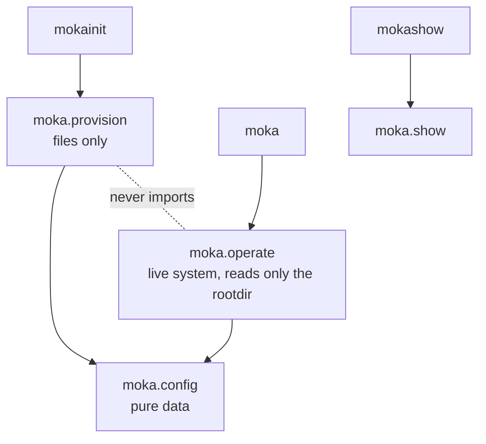
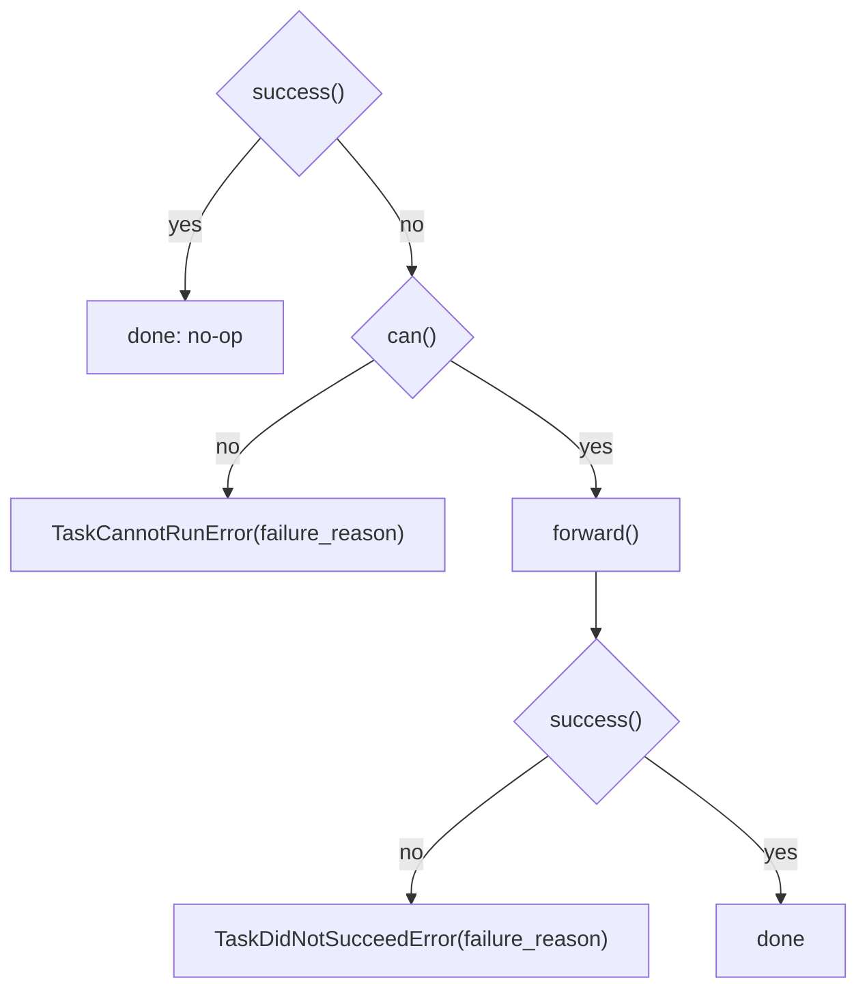

# moka: internals

How the `moka` package is built: its layout and layering, the objects behind the commands, how
the state is computed, the task contract and the errors.

**Audience:** Internals · See also: [moka](moka.md) · [Plans and tasks](plans.md) ·
[Configuration](conf.md) · [Glossary](glossary.md)

## 1. Package layout and layering

```text
moka/
  config/      what a pipeline is: the model, {var} substitution, confresolve. Pure data.
  provision/   confdirs and rootdirs: clone, consolidate, init, drift, resync. Files only.
  operate/     the live pipeline: Pipeline, ComputeUnit, tasks, plans, state, rundir.
  calibs/      the calibration plans and tasks: mlat, mkpokes, measlinresp, mkcm, spool,
               takeref, takedark.
  show/        mokashow: displays (matplotlib) of pipeline results.
  registry.py  the named registries of tasks, plans and hook runners
  wait.py      wait_until, the polling primitive of tasks
  ui.py        colors and text layout of the CLI output
  cliwrap.py   a Python wrapper around milk-cli (used by tests)
  errors.py    every exception of the package
  env.py       the only reader of the MILK_* environment variables
```

The CLIs only parse arguments and call the API; `provision` and `operate` both build on `config`
and never import each other.



Provisioning is file operations and never touches SHM, FPS, tmux or processes; its only contact
with the live system is the "is a run process active?" callable that `resync` receives
([Drift and resync](provision.md#3-resync)). Operating reads only the rootdir.

## 2. Configuration: `PipelineConfig`

`confresolve` is the only way to obtain a configuration ([Configuration:
resolving](conf.md#4-resolving-includes-overrides-substitution)). It merges the layers,
expands the substitutions and validates, every time it is called, with no side effects. The
result is a frozen `PipelineConfig` (a pydantic model): `long_name`, `name`, `loop_number`,
`compute_units` (a dict of `ComputeUnitSpec`: `exec`, `fps`), `dataloads`, `hooks`,
`systemlinkage`, `plans`, `runstart`, `teardown_kill_tmux`. `fps_name(cu)` is the one place where FPS names
are made.

## 3. Operating: `Pipeline` and `ComputeUnit`

```python
from moka.operate.pipeline import Pipeline

pp = Pipeline("basic")                 # <cwd>/basic-rootdir
pp = Pipeline("/elsewhere/basic-rootdir")
pp.config                              # the resolved PipelineConfig
pp.root_folder, pp.work_folder         # the rootdir, and rootdir/work (the FPS work folder)
pp.compute_units                       # {'delay0': ComputeUnit, 'delay1': ComputeUnit}
pp.compute_units["delay0"].fps         # the pyMilk FPS, or None while it does not exist
pp.any_run_active()
pp.link("loopback"); pp.linked(); pp.unlink("all")
```

A `Pipeline` is a view on one rootdir: it resolves the configuration once, at construction, and
derives everything else from the live system when asked. `compute_units` builds fresh
`ComputeUnit` views on each access; a `ComputeUnit` wraps one `fpsexec` executable and its FPS
(`fpsinit`, `confstart`, `confstop`, `runstart`, `runstop` run the executable's commands, in tmux
when asked). You seldom call these yourself: tasks do.

## 4. State

```python
from moka.operate.state import state

st = state(pp)            # PipelineState: state, reasons
st.state.value            # 'cold' | 'inconsistent' | 'deployed' | 'configured' | 'running' | 'mixed'
```

The state is never stored. It is computed from the rundir claim (`$MILK_SHM_DIR/pipe_rundirs/ <name>/`: boot id, rootdir, loop number) and from the existence and the conf/run status of each
CompU's FPS. `cold` means nothing is deployed; `inconsistent` means the rundir and the FPSs
disagree (a stale rundir from a previous boot, an FPS destroyed by hand, a failed deploy), and only
`teardown` is accepted from there. Operations that need a given state raise a `StateError`
(`ColdSystemError`, `InconsistentStateError`) that names the command to run. The diagrams are in
[Operating: lifecycle](operate.md#1-lifecycle).

## 5. Errors and environment

Every exception of the package lives in `moka.errors`, under `MilkError`: `EnvError`,
`ConfigError`, `ProvisionError`, `TaskError` (`TaskCannotRunError`, `TaskDidNotSucceedError`),
`ComputeUnitError`, `LinkageError`, `StateError` (`ColdSystemError`, `InconsistentStateError`)
and `BestEffortError` (the aggregate of a best-effort plan, with `.failures`). An error carries
context when it has some (`pipeline`, `compu`, `task`, `path`, `cmd`, `stderr`), appended to its
message one per line. Library code never prints or exits; pyMilk exceptions propagate as they
are. How the CLIs print errors is in [Operating: errors](operate.md#3-errors).

`moka.env` reads `MILK_ROOT`, `MILK_INSTALLDIR` and `MILK_SHM_DIR` when a function is called, not
at import, and raises `EnvError` naming what is missing. `import moka` and `confresolve` work
without a milk environment; anything that touches SHM or runs an executable needs one.

## 6. Task contract

A task subclasses `moka.operate.tasks.Task` and implements `forward()` and `success()`, plus
`_refusal()` when it has preconditions. `pipeline.task_do` calls them in this order:



The no-op on an already reached goal is what makes plans idempotent.

- **`success()`** checks whether the goal already holds, and must not have side effects.
- **`can()`** is derived: `False` when `_refusal()` returns a reason, which it stores in
  `self.failure_reason`. `_refusal()` returns `None` by default.
- **`forward()`** does the work. For asynchronous effects (tmux, processes), it waits with
  `wait_until(self.success, self.TIMEOUT)` (from `moka.wait`); `TIMEOUT` defaults to 10 s.
- **`Task`** acts on the pipeline as a whole and refuses a step that names CompUs.
  **`TaskOnCompuSet`** acts on the step's CompU subset: `self.compute_units` is that subset as
  `{name: ComputeUnit}`, `self._existing()` the part of it whose FPS exists, as
  `(ComputeUnit, FPS)` pairs. A step that names none gets the subset that `locate_defaults()` sets:
  every CompU. `COUNT` fixes the subset's size; `locate_defaults()` then requires the step to
  name it. **`TaskOnOneCompu`** is the `COUNT = 1` case, with `self.compu` and `self.fps`. A
  wrong subset is a `ConfigError` when the plan is built.
- Tasks act on the live pipeline (SHM, FPS, tmux, processes) and never modify `rootdir/conf/`.

Tasks defined in `moka/operate/tasks.py` are registered under their class name
automatically. A task defined anywhere else needs `TASKS.register("MyTask", MyTask)`, or a
pipeline's `scripts/moka_plans.py`; it can then be named in a `Step`
([Plans and tasks](plans.md#4-custom-plans)).
