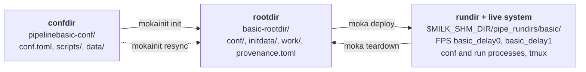

# moka

`moka` (Milk OrKestrAtion) declares, deploys and operates **pipelines**: sets of milk compute units
run together.

**Audience:** Operator · See also: [Tour](tour.md) · [Configuration](conf.md) ·
[Operating](operate.md) · [Glossary](glossary.md)

!!! note "Status"

    The deploy lifecycle (provision, deploy, start, stop, teardown, linkages) is implemented.
    Calibration store/load and the port of the cacao `aorun` operations are not.

## 1. Commands

The Python package (`python/moka`) is the API; the commands wrap it:

| Command    | Acts on                                   | Page                                                  |
| ---------- | ----------------------------------------- | ----------------------------------------------------- |
| `mokainit` | confdirs and rootdirs (files only)        | [Drift and resync](provision.md)                      |
| `moka`     | the live pipeline: plans, state, linkages | [Operating](operate.md)                               |
| `mokashow` | displays of a pipeline's results          | [Operating: displays](operate.md#4-displays-mokashow) |

## 2. Key concepts

A pipeline lives in three places: the confdir you edit, the rootdir built from it, and the rundir
plus live system created by a deploy.

**Pipeline.** A named set of **compute units** (CompUs). Each CompU is one milk `fpsexec`
executable with its FPS, its conf and run processes and its tmux session. A pipeline has a
`long_name` (`pipelinebasic`), a short `name` (`basic`) and a `loop_number`; these three identity
keys fix every path and FPS name (`<name>_<cu>`, e.g. `basic_delay0`).

**Confdir** (`<long_name>-conf/`). The editable source of a pipeline: a `conf.toml`, optional
included TOML files, a `scripts/` folder, and `data/` where **conf hooks** put the large files
they fetch or generate. A confdir is what you keep in git and share.

**Rootdir** (`<name>-rootdir/`). The long-lived home of one pipeline instance, built from a
confdir by `init`. It holds its own copy of the conf files (`conf/`), of the hook products
(`initdata/`), the FPS work folder (`work/`) and a `provenance.toml` that records where it came
from. After init, only the rootdir matters: the live system never reads the confdir. Confdir
changes reach the rootdir only through an explicit `resync`.

**Rundir** (`$MILK_SHM_DIR/pipe_rundirs/<name>/`). The claim that `deploy` writes for the current
boot. It is what makes the pipeline **state** computable: `cold`, `deployed`, `configured`,
`running`, `mixed` or `inconsistent` (see [Operating: lifecycle](operate.md#1-lifecycle)).

**Plans and tasks.** Everything that touches the live system is a **task** (`InitFPS`,
`ConfStart`, `RunStart`, ...), idempotent and restricted to any subset of CompUs. A **plan** is an
ordered list of tasks with a failure policy (see [Plans and tasks](plans.md)).

## 3. Where to go

- **Operate**

    ______________________________________________________________________

    Deploy, link, run and tear down a pipeline; read its state; handle failures.

    [⮕ Tour](tour.md) · [⮕ Operating](operate.md)

- **Integrate**

    ______________________________________________________________________

    Write a confdir, keep a rootdir in sync, write your own plans.

    [⮕ Configuration](conf.md) · [⮕ Drift and resync](provision.md) ·
    [⮕ Plans and tasks](plans.md)

- **Internals**

    ______________________________________________________________________

    Package layout, objects, state computation, task contract.

    [⮕ Internals](internals.md)

## 4. Installing

See [Installation: Python packages](../quickstart/compile.md#4-python-packages). Anything that
touches the live system needs `MILK_ROOT`, `MILK_INSTALLDIR` and `MILK_SHM_DIR` set.
