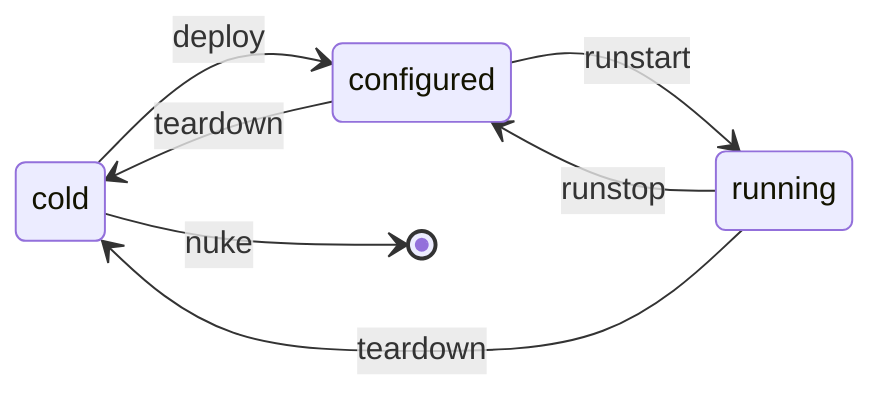
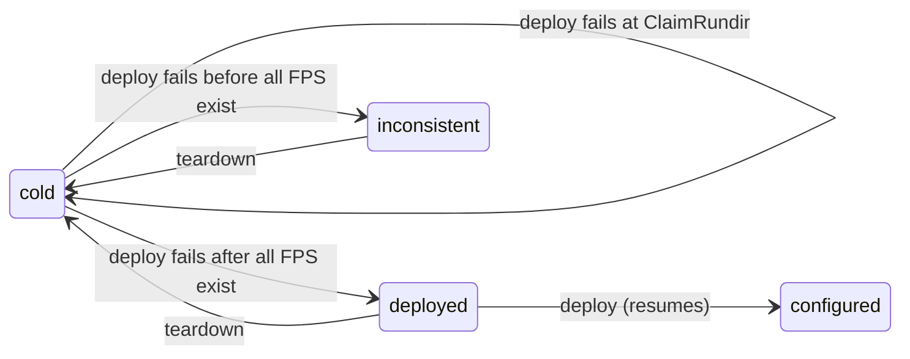

# moka: operating

The states of a deployed pipeline, the `moka` commands that move between them, and their errors.

**Audience:** Operator · See also: [Tutorial](../quickstart/moka_tutorial.md) · [Plans and tasks](plans.md) ·
[Drift and resync](provision.md) · [Glossary](glossary.md)

## 1. Lifecycle

States and the commands between them:



| State          | Rundir                                                            | FPS  | Processes                      |
| -------------- | ----------------------------------------------------------------- | ---- | ------------------------------ |
| `cold`         | absent                                                            | none | none                           |
| `deployed`     | claimed                                                           | all  | conf stopped                   |
| `configured`   | claimed                                                           | all  | conf running                   |
| `running`      | claimed                                                           | all  | every `runstart` CompU running |
| `mixed`        | claimed                                                           | all  | anything else                  |
| `inconsistent` | stale, or claimed with an FPS missing, or absent with FPS present |      |                                |

The rundir is the deploy's claim for this boot, `$MILK_SHM_DIR/pipe_rundirs/<name>/`.
`deployed` and `configured` also require that no run process is running. `running` looks only at
the CompUs listed in [`runstart`](conf.md#3-conftoml-keys) (default: all).

### 1.1. Failures and recovery

States after a failed deploy:



- A reboot wipes the rundir and the FPSs: the pipeline is `cold`. A rundir from a previous boot
  is `inconsistent`.
- From `inconsistent`, only `teardown` is accepted. Teardown is accepted from every state.
- `mixed` counts as consistent (for a plan's `accepts`).
- A rundir claimed by another rootdir adds a reason to the state, not a new state.

## 2. Commands

```text
moka <plan>  [-p PIPE]                   run plan <plan>: deploy, teardown, ...
moka runstart|runstop [-p PIPE] [CU]...  the plan; with CU: on these CompUs only
moka state   [-p PIPE]                   state, reasons, drift summary, milk version change
moka plans   [-p PIPE]                   the plans, and which the current state accepts
moka tasks   [-p PIPE] [PLAN]            the tasks (or a plan's steps): success, can
moka link    [LINKAGE] [-p PIPE]         apply [systemlinkage.<LINKAGE>]; none: list them
moka unlink  LINKAGE [-p PIPE]           remove its symlinks; `all`: of every linkage
moka nuke    [-p PIPE] [--yes]           teardown, then rm -rf the rootdir
moka completion bash                     print the tab completion script
```

- **`-p/--pipe PIPE`** is a rootdir path, or a short name meaning `<cwd>/<PIPE>-rootdir`.
  Without `-p`, the current directory must be a rootdir. In Python: `Pipeline(pipe)`.
- **Output.** Commands that act (plans, `link LINKAGE`, `unlink`, `nuke`) print on stderr only;
  the others print their data on stdout.
- **Plan commands**: one per plan of the pipeline, built-in or
  [local](plans.md#4-custom-plans); `moka -h -p PIPE` lists them, `moka <plan> -h` describes
  one. Their steps are in [Plans and tasks: built-in plans](plans.md#1-built-in-plans).
  `deploy` is idempotent. `teardown` is best effort and keeps the rootdir and `work/`.
- **`link`** is allowed only in `deployed` and `configured`. `teardown` removes every linkage.
- **`nuke`** asks for the short name; `--yes` skips that. It deletes the rootdir even if
  teardown fails, or if the pipeline's local plans do not load (teardown then does not run).

### 2.1. `state`

Never fails because of the pipeline's state. Drift: see
[Drift and resync](provision.md#2-drift).

=== "CLI"

    ```bash
    moka state -p basic
    ```

=== "Python"

    ```python
    from moka.operate.pipeline import Pipeline
    from moka.operate.state import state

    # <cwd>/basic-rootdir, or a rootdir path
    pp = Pipeline("basic")
    state(pp)
    ```

```text title="Output"
rootdir: /home/vdeo/pipes/basic-rootdir
basic: configured
drift: 1 artifact(s); run `mokainit drift /home/vdeo/pipes/basic-rootdir`
```

### 2.2. `plans`

`NOW` checks only the plan's `accepts` gate; `n/a`: a task or CompU the plan names does not exist.

```bash
moka plans -p aoloop
```

```text title="Output"
rootdir: /home/vdeo/pipes/aoloop-rootdir
aoloop: cold
USAGE                                         NOW
deploy [-p PIPE]                              ok
  ClaimRundir -> InitFPS -> LoadData -> ConfStart
...
runstart [-p PIPE] [CU]...                    no (cold; run deploy)
  RunStart
...
teardown [-p PIPE]                            ok
  RunStop -> DeapplyAllLinkages -> ConfStop -> KillTmux -> DestroyFPS -> ReleaseRundir
```

### 2.3. `tasks`

Never runs a task. Without `PLAN`: every task, on all CompUs (`RunStart`: the
[`runstart`](conf.md#3-conftoml-keys) ones).

```bash
moka tasks -p aoloop
```

```text title="Output"
rootdir: /home/vdeo/pipes/aoloop-rootdir
aoloop: cold
TASK         DONE  CAN  REASON
ClaimRundir  no    yes
...
ConfStart    no    no   FPS aoloop_acquWFS is missing or invalid.
```

### 2.4. Plan runs

A plan command exits 1 when a step is refused or fails.

=== "CLI"

    ```bash
    moka measlinresp -p aoloop
    ```

=== "Python"

    ```python
    from moka.operate.pipeline import Pipeline
    from moka.operate.plans import run_plan

    run_plan(Pipeline("aoloop"), "measlinresp")
    ```

```text title="Output"
rootdir: /home/vdeo/pipes/aoloop-rootdir
aoloop: configured
  [1/4] RunStart[acquWFS] ....... [ -- ] already done
...
  [4/4] WaitLinResp ............. [ ok ] done (21.3 s)
[ ok ] measlinresp done in 21.9 s
```

```text title="Output"
  [1/1] MakeCM ... [ NO ] refused: /.../calib/RMmodesWFS.fits does not exist; run `moka measlinresp`.
[FAIL] mkcm: stopped at step 1/1 (MakeCM)
```

### 2.5. Tab completion (bash)

In `~/.bashrc`:

```bash
eval "$(moka completion bash)"
eval "$(mokainit completion bash)"
```

## 3. Errors

`moka` and `mokainit` exit 1 on an error. A best-effort plan (`teardown`) runs every step first.

```text title="Output"
[FAIL] Invalid config:
  compute_units.delay0.fps.procinfo: procinfo: 1 validation error ...
path: aoloop-conf/conf.toml
```

```text title="Output"
[FAIL] Pipeline basic is cold; run deploy.
pipeline: basic
```

Options placed before the command (`mokainit --errstack resolve aoloop-conf`):

| Option                        | Effect                                                      |
| ----------------------------- | ----------------------------------------------------------- |
| `--errstack`                  | let the exception propagate, with its stack trace           |
| `--pdb`                       | open an `ipdb` post-mortem session on it                    |
| `--color auto\|always\|never` | `auto` (default): color a terminal unless `NO_COLOR` is set |

`mokainit` needs no milk environment, except `resync`
([environment](moka.md#4-installing)).

## 4. Displays: `mokashow`

```bash
mokashow mlat -p PIPE  # (1)!
mokashow rm -p PIPE    # (2)!
mokashow cm -p PIPE    # (3)!
```

1. `hardwlatency.dat` of the `mlat` CompU, under `rootdir/work/` (`-w/--workdir DIR`: under `DIR`).
2. `calib/RMmodes{WFS,DM}.fits`.
3. `calib/CMmodes{WFS,DM}.fits`, with their singular values.

| Key      | Effect                                                             |
| -------- | ------------------------------------------------------------------ |
| `r`      | re-read the files                                                  |
| `w`, `d` | `rm`, `cm`: stats within `calib/wfsmask.fits`, `calib/dmmask.fits` |

From a script or a notebook: `moka.show.cli.mlat_figure(datadir)`,
`moka.show.modes.modes_figure(calib, "rm" | "cm")`.
