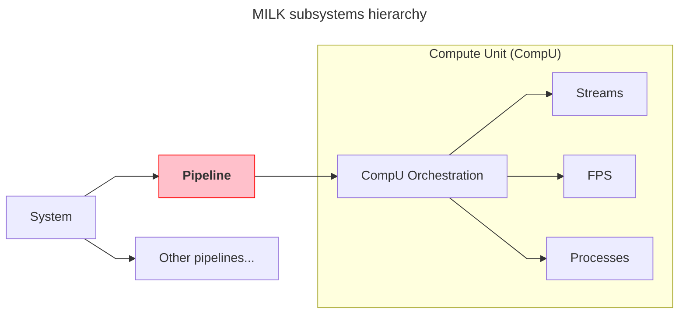

# **Pipeline** layer and python API

Terms used here (pipeline, confdir, rootdir, compute unit (CompU), and others) are defined in the [pipelines glossary](pipelines_glossary.md).



A __pipeline__ is a set of MILK __compute units__ orchestrated and operated jointly. It inherits for MILK v1 notion of _AO loop_.

__Pipelines__ provided namespacing and functionality isolation for multiple common sets of tasks initiated by the AO operator:
- __Initialization__: create a pipeline from a static set of toml configuration files.
- __Deployment__: spin up and connect all the relevant CompUs on a cold RTC.
- __Configuration__: store and load configuration files (e.g. AO calibrations).
- __Operations__: provide the needed primitives to execute complex actions (AO user control, AO reconfiguration, pipeline restart, real-time resources monitoring)


__Downwards__, the pipeline layer coordinates the manipulation of it member CompUs and their connectivity:
- Control the CompU runtime orchestration (conf and run processes, tmuxes)
- Control and modify FPS attributes of the CompUs
- Orchestrate streams (initialization, destruction, sanitization and runtime checks) that are used for the core real-time data flow.

__Upwards__, the pipeline layer is controlled by the system layer:
- which coordinates the startup and shutdown of multiple pipelines
- which mediates data connections between various pipelines: an AO loop, a DMComb pipeline, an AO linear simulator, etc.

## Some examples

- AO loop
- AO linsim
- DMcomb + DM driver


## Initalization


A pipeline is defined by its *long name* and its *short name*.
Prior to initialization, a pipeline prototype is defined by its configuration folder `<long_name>-conf`, e.g. `aolinearsimulator-conf`.

The `<long_name>-conf` folder should contain a `conf.toml` file that describes the pipeline, more on this below.

The __initialization__ step consists on the copying of the `conf` folder to its operational location, fetching data files, and creating the pipelines `root` directory (calibration files, etc), `run` directory (temporary runtime files) and `log` directory (logs).

`milk-pipes` is the key utility for initiazizing and deploying pipelines.

`milk-pipes -c` information. Deploy from examples.

!!! info "TOML files description"
    info

Maybe make this a foldable box with key info, then link to another page with "conf.toml features"
Pipelines conf.toml features:
- main variable section
- `[[dataloads]]` (`source`, `target`) and `[systemlinkage.<mode>]`
- `[compute_units.<cu>]` tables (`exec`, `.fps`, `.fps.procinfo`)

```bash
milk-pipes -c --folder ~/src/milk-standalone/python/tests/resources/ pipelinebasic
milk-pipes -r pipelinebasic
```

## Deployment

`milk-pipes -r` information

`milk-pipes nuke [--folder F] <name>` is destructive and meant for test machines.
Without confirmation, it runs `runstop` on all CompUs, deapplies all system linkages,
runs `confstop` on all CompUs, then deletes the pipeline root directory.
Failures in a step are reported and do not prevent the following steps.

FPS names are `<name>_<cu>` (for example `basic_delay0`), derived from the pipeline short name and the CompU key.

## Configuration

TBC.

milk-config-store
milk-config-load

## Operations

TBC.

But everything from the aorun framework should get in there really.

## Environment and errors

`milk.env` is the only reader of `MILK_*` variables; every accessor is lazy and raises
`EnvError` naming what is missing, so `import milk` works without a milk install.
`milk/errors.py` holds the whole exception hierarchy under `MilkError`, with optional context
attributes (`pipeline`, `compu`, `task`, `path`, `cmd`, `stderr`). pyMilk exceptions propagate
unwrapped. Contract: design-v7 §4.7 (`python/specs/pipelines/design-v7.md`).
