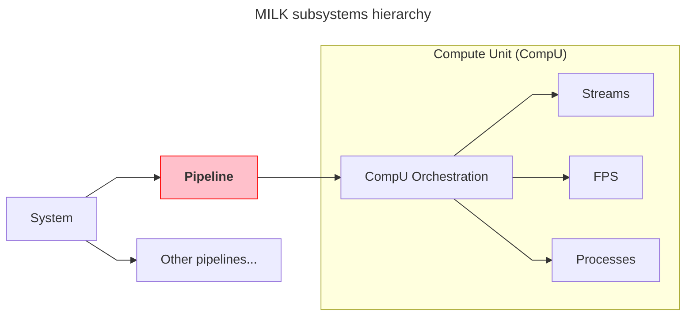

# **Pipeline** layer and python API

Terms used here (pipeline, confdir, rootdir, compute unit (CompU), and others) are defined in the [pipelines glossary](pipelines_glossary.md).



A __pipeline__ is a set of MILK __compute units__ orchestrated and operated jointly. It inherits for MILK v1 notion of _AO loop_.

__Pipelines__ provided namespacing and functionality isolation for multiple common sets of tasks initiated by the AO operator:
- __Initialization__: create a pipeline from a static set of toml configuration files.
- __Deployment__: spin up and connect all the relevant CompUs on a cold RTC.
- __Configuration__: store and load configuration files (e.g. AO calibrations).
- __Operations__: provide the needed primitives to execute complex actions (AO user control, AO reconfiguration, pipeline restart, real-time resources monitoring)


__Downwards__, the pipeline layer coordinates the manipulation of it member CompUs and their connectivity:
- Control the CompU runtime orchestration (conf and run processes, tmuxes)
- Control and modify FPS attributes of the CompUs
- Orchestrate streams (initialization, destruction, sanitization and runtime checks) that are used for the core real-time data flow.

__Upwards__, the pipeline layer is controlled by the system layer:
- which coordinates the startup and shutdown of multiple pipelines
- which mediates data connections between various pipelines: an AO loop, a DMComb pipeline, an AO linear simulator, etc.

## Some examples

- AO loop
- AO linsim
- DMcomb + DM driver


## Initalization


A pipeline is defined by its *long name* and its *short name*.
Prior to initialization, a pipeline prototype is defined by its configuration folder `<long_name>-conf`, e.g. `aolinearsimulator-conf`.

The `<long_name>-conf` folder should contain a `conf.toml` file that describes the pipeline, more on this below.

The __initialization__ step consists on the copying of the `conf` folder to its operational location, fetching data files, and creating the pipelines `root` directory (calibration files, etc), `run` directory (temporary runtime files) and `log` directory (logs).

`milk-pipes` is the key utility for initiazizing and deploying pipelines.

`milk-pipes -c` information. Deploy from examples.

!!! info "TOML files description"
    info

Maybe make this a foldable box with key info, then link to another page with "conf.toml features"
Pipelines conf.toml features:
- main variable section
- `[[dataloads]]` (`source`, `target`) and `[systemlinkage.<mode>]`
- `[compute_units.<cu>]` tables (`exec`, `.fps`, `.fps.procinfo`)

```bash
milk-pipeinit init ~/src/milk-standalone/python/tests/resources/pipelinebasic-conf --parent .
milk-pipes spool basic
```

### Confdir layout

```
<long_name>-conf/
  conf.toml          the pipeline description
  *.toml, inc/*.toml includes, listed in conf.toml `includes = [...]`
  scripts/           any files, copied as-is
  data/              conf-hook products, each with its <product>.tag; never cloned
  .gitignore         `data/`, written by clone
```

The conf files are every `*.toml` outside `data/` plus every file under `scripts/`.
A conf hook is a `[[hooks]]` entry with an `id`, a `type` and one `product` (a plain name under `data/`):

```toml
[[hooks]]
id      = "dm_flat"
type    = "fetch"                      # rsync -a --delete <source> data/<product>
source  = "calib/dm_flat.fits"         # relative to the confdir, absolute, or an rsync URL
product = "dm_flat.fits"

[[hooks]]
id      = "gen"
type    = "command"                    # argv run with cwd data/; must create <product>
command = ["python", "../scripts/gen.py"]
product = "gen.npy"
```

`data/<product>.tag` (TOML) records `hook_id`, `decl_digest`, `content_hash`, `size`, `source`
and `time`. A hook is re-run when its product is missing, its bytes changed, or its declaration
changed. Symlinks in products are refused.

### `milk-pipeinit`

File operations on confdirs; it never touches the live system.

| Command | Effect |
|---|---|
| `milk-pipeinit list [DIR]` | List the confdirs and rootdirs in DIR (default cwd). Examples: `milk-pipeinit list $MILK_ROOT/milk-examples/pipelines`. |
| `milk-pipeinit clone SRC [DEST_PARENT]` | Copy the conf files of SRC to `DEST_PARENT/<SRC name>`. Refuses an existing target; runs no hooks and no git. |
| `milk-pipeinit consolidate CONFDIR [--refetch ID ...] [--refetch-all]` | Run the pending conf hooks; print the ids that ran. `--refetch` reruns a hook even when resolved: upstream changes (for example a new file at an rsync source) are not detected otherwise. |
| `milk-pipeinit resolve DIR` | Print the resolved configuration of a confdir or a rootdir as TOML. |
| `milk-pipeinit init CONFDIR [--parent DIR] [--set K=V ...]` | Consolidate CONFDIR and build `<DIR>/<name>-rootdir` (DIR defaults to CONFDIR's parent). Refuses an existing rootdir. |
| `milk-pipeinit drift ROOTDIR` | One line per drifted artifact, then the resolved diff, then `STRUCTURAL:` lines. |
| `milk-pipeinit resync ROOTDIR [--artifact KEY ...] [--set K=V ...] [--overwrite-local]` | Bring confdir changes into the rootdir. Always ends with the "teardown → deploy may be needed" banner and the structural lines. |

`--set` values are parsed as TOML values (`0.5`, `true`, `[1, 2]`); anything else is taken as a
string. Identity keys (`long_name`, `name`, `loop_number`) cannot be overridden.

The Python API is `milk.provision` (`clone`, `consolidate`, `fingerprint`, `status`, ...) and
`milk.provision.rootdir` (`init`, `drift`, `resync`).

### Rootdir layout

The rootdir is authoritative: after `init`, the operating layer (`Pipeline`, tasks,
`milk-pipes`) reads only the rootdir, never the confdir, and hand edits under `conf/` are live.
`resync` is the only way confdir changes reach it.

```
<name>-rootdir/
  conf/            the conf files, copied
  initdata/        <product> and <product>.tag of each hook, copied from the confdir's data/
  provenance.toml  milk version, source confdir, dates, recorded overrides, one record per artifact
  work/            FPS workdir
  logs/
```

Folders are told apart by name and content: a confdir is named `*-conf` and has `conf.toml` and
no `provenance.toml`; a rootdir is named `*-rootdir` and has `provenance.toml` and
`conf/conf.toml`. Resolving a rootdir
replays the overrides recorded in `provenance.toml`.

Artifact keys are a conf file's relative path (`conf.toml`, `scripts/a.sh`) or `data/<product>`
for a hook product (`initdata/<product>` in the rootdir).

### Drift

Each artifact has two statuses against its record in `provenance.toml`:

| Field | Compares | Statuses |
|---|---|---|
| `source` | record vs the confdir now; for hooks also the recorded declaration digest vs the confdir's current declaration | `modified`, `added`, `removed`; `stale` when only a hook declaration changed. Upstream content is not watched: run `consolidate --refetch`. |
| `local` | record vs the rootdir now | `modified`, `added`, `removed` (a local edit) |

The drift report also gives the resolved diff (dotted keys, `(rootdir, confdir)`; the confdir is
resolved with the recorded overrides, so overrides never show as drift), the structural changes
(CompUs added or removed, or whose `exec` changed), and the milk version if it differs from
the recorded one.

### Resync

Checks run before any write; after them, resync is not atomic and `drift` shows a partial state.

1. A running CompU refuses the resync.
2. An identity key that differs between the rootdir and the confdir refuses it: init a new
   rootdir instead.
3. The confdir is consolidated.
4. Each artifact whose `source` drifted, optionally restricted by `--artifact`, is copied (or
   deleted) and recorded, in key order. An artifact that also has a `local` edit is refused,
   unless `--overwrite-local`; a refusal does not stop the others.
5. `--set` overrides are merged into the recorded ones.

resync never tears down or deploys.

## Deployment

`milk-pipes -r` information

`milk-pipes spool|sys|teardown|nuke TARGET [--parent DIR]`: TARGET is a rootdir path, or a
short name for `<cwd>/<TARGET>-rootdir` (`<DIR>/<TARGET>-rootdir` with `--parent`). In Python,
`Pipeline(target)`, `Pipeline.from_folder(rootdir)` and `Pipeline.from_parent(parent, short_name)`.

`milk-pipes teardown TARGET` runs `runstop` on all CompUs, deapplies all system linkages, runs
`confstop` and destroys the FPSs. It keeps the rootdir and `work/`.
`milk-pipes nuke TARGET` is teardown, then deletes the rootdir even if teardown failed. It asks
to type the short name first; `--yes` skips that.
In both, failures in a step are reported and do not prevent the following steps.

FPS names are `<name>_<cu>` (for example `basic_delay0`), derived from the pipeline short name and the CompU key.

## Configuration

`milk.config.confresolve(confdir, overrides)` is the only way to get a `PipelineConfig`; it re-reads the files on every call.
Layers, lowest to highest: kind defaults (`kind`, default `generic`), `includes` (paths relative to the confdir, one level), `conf.toml`, then `overrides` (dotted keys; `long_name`, `name`, `loop_number` cannot be overridden).
Tables merge recursively; lists and `[[table arrays]]` are replaced whole.
`{dotted.key}` substitution runs on the merged result (never inside table arrays), then validation; failures raise `ConfigError`.
Contract: [design-v7](../python/specs/pipelines/design-v7.md) D-5.

milk-config-store
milk-config-load

## Operations

TBC.

But everything from the aorun framework should get in there really.

## Environment and errors

`milk.env` is the only reader of `MILK_*` variables; every accessor is lazy and raises
`EnvError` naming what is missing, so `import milk` works without a milk install.
`milk/errors.py` holds the whole exception hierarchy under `MilkError`, with optional context
attributes (`pipeline`, `compu`, `task`, `path`, `cmd`, `stderr`). pyMilk exceptions propagate
unwrapped. Contract: design-v7 §4.7 (`python/specs/pipelines/design-v7.md`).

## Python package layout

```
milk/
  errors.py  env.py  cliwrap.py   shared; cliwrap is the milk-cli test harness
  config/      what a pipeline is: model, {var} substitution, confresolve. Pure data.
  provision/   milk-pipeinit: file operations, never the live system
  operate/     milk-pipes: SHM, FPS, tmux, processes (today still pipeline.py, compute_unit.py, infra/)
```

Dependencies go one way: `provision` and `operate` import `config`; they never import each other.
