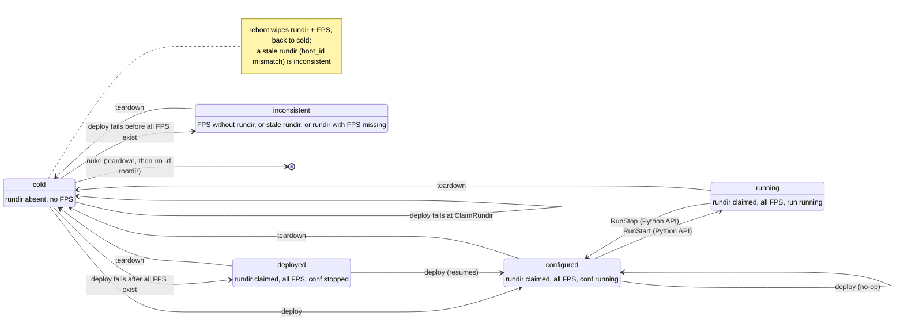

# Operating a pipeline: `milk-pipes`

`milk-pipes` operates an initialized pipeline from its rootdir: it deploys, links and tears
down. To build or update a rootdir, use [`milk-pipeinit`](pipelines.md#milk-pipeinit). Terms
are defined in the [pipelines glossary](pipelines_glossary.md).

## Lifecycle

The states are those printed by `milk-pipes state`; the arrows are commands and plans. The rundir
is the deploy's claim for this boot, `$MILK_SHM_DIR/pipe_rundirs/<name>/`.



Only `deploy` and `teardown` are plans; running is reached through the Python API. Some CompUs
running and others not is `mixed`. A rundir claimed by another rootdir adds a reason, not a state.
`milk-pipeinit resync` refuses while a CompU runs.

## Commands

```
milk-pipes <plan>  [-p PIPE]          run plan <plan>: deploy, teardown, ...
milk-pipes state   [-p PIPE]          state, reasons, drift summary, milk version change
milk-pipes link    [LINKAGE] [-p PIPE]  apply [systemlinkage.<LINKAGE>]; none: list them
milk-pipes unlink  LINKAGE [-p PIPE]  remove its symlinks; `all`: of every linkage
milk-pipes nuke    [-p PIPE] [--yes]  teardown, then rm -rf the rootdir
```

- **`-p/--pipe PIPE`** is a rootdir path, or a short name meaning `<cwd>/<PIPE>-rootdir`.
  Without `-p`, the current directory must be a rootdir. Every command first prints
  `rootdir: <path>`, the rootdir it acts on. In Python: `Pipeline(pipe)`.
- **Plan commands** are one per registered plan (`milk-pipes --help` lists them). `deploy` runs
  ClaimRundir → InitFPS → LoadData → ConfStart and is idempotent. `teardown` runs RunStop →
  DeapplyAllLinkages → ConfStop → KillTmux → DestroyFPS → ReleaseRundir, best effort, and keeps the
  rootdir and `work/`.
- **`state`** never fails because of the pipeline's state. It prints the state with its reasons,
  then `drift: none`, `drift: <n> artifact(s); run ...` or `drift: unavailable (<why>)` (for
  example when the source confdir is gone), then the milk version if it changed since `init`.
- **`link`** needs a deployed pipeline that is not running.
- **`nuke`** asks you to type the short name; `--yes` skips that. It deletes the rootdir even if
  teardown fails.

Errors print `Error: <message>` and exit 1. A best-effort plan prints one
`warning: <step>: <error>` line per failed step, after running all of them, and exits 1.

## Example session

```console
$ milk-pipeinit clone $MILK_ROOT/milk-examples/pipelines/pipelinebasic-conf ~/pipes
$ milk-pipeinit init ~/pipes/pipelinebasic-conf            # → ~/pipes/basic-rootdir
$ cd ~/pipes
$ milk-pipes state -p basic
rootdir: /home/vdeo/pipes/basic-rootdir
basic: cold
drift: none
$ milk-pipes deploy -p basic                               # ClaimRundir → InitFPS → LoadData → ConfStart
rootdir: /home/vdeo/pipes/basic-rootdir
$ milk-pipes state -p basic
rootdir: /home/vdeo/pipes/basic-rootdir
basic: configured
drift: none
$ milk-pipes link loopback -p basic                        # needs a deployed, non-running pipeline
rootdir: /home/vdeo/pipes/basic-rootdir
$ milk-pipes deploy -p basic                               # idempotent: every step already succeeded
rootdir: /home/vdeo/pipes/basic-rootdir
$ vi pipelinebasic-conf/conf.toml                          # edit the source confdir
$ milk-pipes state -p basic
rootdir: /home/vdeo/pipes/basic-rootdir
basic: configured
drift: 1 artifact(s); run `milk-pipeinit drift /home/vdeo/pipes/basic-rootdir`
$ milk-pipes teardown -p basic                             # best effort; keeps the rootdir and work/
rootdir: /home/vdeo/pipes/basic-rootdir
$ milk-pipeinit resync basic-rootdir                       # prints the teardown → deploy banner
$ milk-pipes deploy -p basic
rootdir: /home/vdeo/pipes/basic-rootdir
$ milk-pipes state -p /elsewhere/basic-rootdir             # a pipeline outside cwd
rootdir: /elsewhere/basic-rootdir
$ milk-pipes nuke -p basic                                 # asks you to type 'basic'
rootdir: /home/vdeo/pipes/basic-rootdir
Type 'basic' to delete /home/vdeo/pipes/basic-rootdir: basic
```

For the drift details and resync, see [Drift](pipelines.md#drift) and
[Resync](pipelines.md#resync).

## Failures

```console
$ milk-pipes link loopback -p basic                        # cold pipeline
rootdir: /home/vdeo/pipes/basic-rootdir
Error: Pipeline basic is cold; run deploy.
$ milk-pipes deploy -p basic                               # an FPS was destroyed by hand
rootdir: /home/vdeo/pipes/basic-rootdir
Error: Pipeline basic is inconsistent (FPS missing: basic_delay1); run teardown.
$ milk-pipes teardown -p basic                             # one step failed, the others ran
rootdir: /home/vdeo/pipes/basic-rootdir
warning: ConfStop: <error>
$ echo $?
1
```
