# Tutorial: a simulated AO loop with moka

From two example confdirs to an AO loop closed on simulated turbulence, with `moka` and the milk
TUIs.

**Audience:** Operator · See also: [Installation](compile.md) · [moka](../moka/moka.md) ·
[Operating](../moka/operate.md) · [fpsCTRL Reference](../guide/fpsCTRL_reference.md) ·
[pyMilk](../guide/pyMilk.md)

At the end of this page, your screen looks like this:

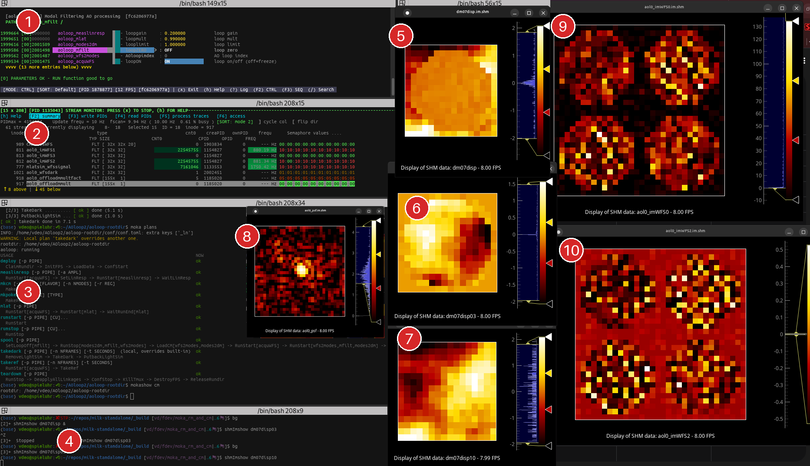
_The desktop with the loop closed on turbulence; the numbers are explained below._

| #   | Window                  | Shows                                                              |
| --- | ----------------------- | ------------------------------------------------------------------ |
| 1   | `milk-fpsCTRL`          | Engineering control of all compute units. Arrow keys and keyboard. |
| 2   | `milk-streamCTRL`       | Framerate, counters and symlinks of every stream on the machine.   |
| 3   | shell                   | moka working shell.                                                |
| 4   | shell                   | Second shell, for the viewers.                                     |
| 5   | `shmImshow dm07disp`    | Total DM output.                                                   |
| 6   | `shmImshow dm07disp03`  | AO loop output.                                                    |
| 7   | `shmImshow dm07disp10`  | Turbulence (FPS `mlatsim_dmturb`).                                 |
| 8   | `shmImshow aol0_psf`    | PSF of the DM phase (`dm_psf.py`).                                 |
| 9   | `shmImshow aol0_imWFS0` | PyWFS frames, as acquired.                                         |
| 10  | `shmImshow aol0_imWFS2` | WFS frames: dark subtracted, normalized, reference subtracted.     |

You run two pipelines. `mlatsim` simulates a DM, a pyramid WFS and its camera; `aoloop` is the AO
loop. The `delaysim` linkage of `aoloop` connects them: the loop reads the simulated camera and
writes into one channel of the simulated DM.

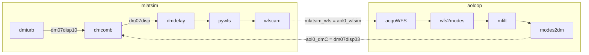

The page takes 30 to 45 minutes. Nothing touches hardware: every process runs on your machine.

## 1. Before you start

Check that milk, cacao, moka and tmux are installed and that the environment is set.

<!-- tut:run id=checks -->

```bash
moka -h | head -3
echo MILK_ROOT=$MILK_ROOT; echo MILK_INSTALLDIR=$MILK_INSTALLDIR; echo MILK_SHM_DIR=$MILK_SHM_DIR
ls -d "$MILK_ROOT"/milk-examples/pipelines/{mlatsim,aoloop}-conf
which cacao-fpsexec-mfilt milk-fpsexec-linalg-MVMextract milk-fpsCTRL milk-streamCTRL shmImshow
tmux -V
python -c 'import moka, pyMilk, matplotlib, numpy; print("ok")'
```

<!-- tut:out id=checks -->

```text title="Output"
Usage: moka [OPTIONS] COMMAND [ARGS]...

  Operate an initialized milk/cacao pipeline (see `mokainit init`).
MILK_ROOT=~/src/milk
MILK_INSTALLDIR=/usr/local/milk
MILK_SHM_DIR=/milk/shm
~/src/milk/milk-examples/pipelines/aoloop-conf
~/src/milk/milk-examples/pipelines/mlatsim-conf
/usr/local/milk/bin/cacao-fpsexec-mfilt
/usr/local/milk/bin/milk-fpsexec-linalg-MVMextract
/usr/local/milk/bin/milk-fpsCTRL
/usr/local/milk/bin/milk-streamCTRL
~/mambaforge/bin/shmImshow
tmux 3.3a
ok
```

!!! note "When a check fails"

    - `moka` or a `python` import missing: [Installation §4](compile.md#4-python-packages).
      `shmImshow` comes with pyMilk's `vis` extra.
    - An empty variable: [Installation §2](compile.md#2-environment-variables).
    - No `milk-examples/pipelines`: `MILK_ROOT` must point to the milk source tree.
      `mokainit clone --milk` copies the example confdirs from there.
    - A `which` line missing: milk or cacao is not installed in `$MILK_INSTALLDIR`, or its `bin/`
      is not on your `PATH`.

!!! tip "Look around"

    **Ask moka.** Every command has `--help`: `moka --help`, `moka deploy --help`,
    `mokainit --help`, `mokashow --help` (`mokashow` has no `-h`).

## 2. Set up your screen

Open four terminals, arranged as in the image at the top: two TUIs on the left, two shells below
them. Start the TUIs:

<!-- tut:manual -->

```bash
milk-fpsCTRL     # (1)!
milk-streamCTRL  # (2)!
```

1. In the first terminal: every FPS on the machine.
2. In the second terminal: every stream on the machine.

Both are empty for now.

<!-- tut:tui id=fpsctrl-empty cmd="milk-fpsCTRL" size=150x40 -->

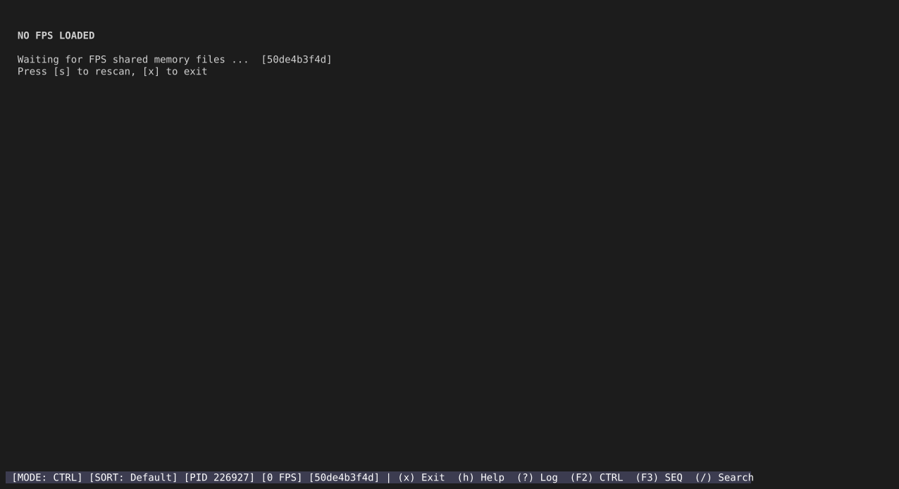
_milk-fpsCTRL before any deploy._

<!-- tut:tui id=streamctrl-empty cmd="milk-streamCTRL" size=150x40 -->

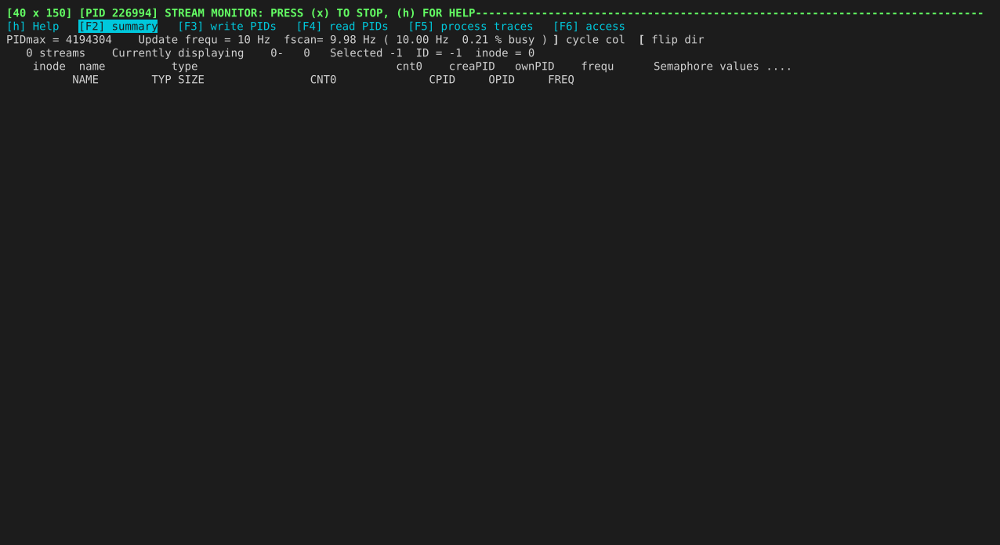
_milk-streamCTRL before any deploy._

!!! tip "Look around"

    Leave both TUIs open for the whole page: each stage below changes what they show. In either
    one, `h` shows the keys and `x` quits. The third terminal is your moka working shell, the
    fourth is for the viewers.

## 3. Get the two confdirs

Copy the example confdirs `mlatsim-conf` and `aoloop-conf` into a new working folder.

<!-- tut:run id=clone -->

```bash
mkdir ~/AOloop2
cd ~/AOloop2
mokainit clone --milk mlatsim .
mokainit clone --milk aoloop .
find mlatsim-conf aoloop-conf | sort
```

<!-- tut:out id=clone -->

```text title="Output"
Cloned ~/src/milk/milk-examples/pipelines/mlatsim-conf to mlatsim-conf
Cloned ~/src/milk/milk-examples/pipelines/aoloop-conf to aoloop-conf
aoloop-conf
aoloop-conf/conf.toml
aoloop-conf/fpsdetails.toml
aoloop-conf/.gitignore
aoloop-conf/scripts
aoloop-conf/scripts/dm_psf.py
aoloop-conf/scripts/moka_plans.py
mlatsim-conf
mlatsim-conf/conf.toml
mlatsim-conf/.gitignore
mlatsim-conf/scripts
mlatsim-conf/scripts/mkdm.py
mlatsim-conf/scripts/mkpupmask.py
```

!!! tip "Look around"

    **Under the hood.** Open `aoloop-conf/conf.toml`: the `[compute_units]` table names one milk
    or cacao executable per compute unit, `runstart` lists those that `moka runstart` starts,
    and `[systemlinkage.delaysim]` maps the loop's streams onto the simulator's. The FPS values
    are in `fpsdetails.toml`, included by `conf.toml`.

    **Change the configuration.** A confdir is what you edit and keep in git; nothing on this page
    edits it until [§14](#14-change-the-configuration). See
    [Configuration](../moka/conf.md#1-the-confdir).

## 4. Build the rootdirs

Check each confdir, then build its rootdir: the home of one pipeline instance.

<!-- tut:run id=resolve -->

```bash
mokainit resolve mlatsim-conf > /dev/null  # (1)!
mokainit resolve aoloop-conf > /dev/null
```

1. Prints the resolved configuration: includes merged, substitutions done. Drop the redirection
   to read it.

<!-- tut:run id=init -->

```bash
mokainit init mlatsim-conf
mokainit init aoloop-conf
find mlatsim-rootdir | sort
moka state -p aoloop
```

<!-- tut:out id=init -->

```text title="Output"
Initialized mlatsim-rootdir
INFO: aoloop-conf/conf.toml: extra keys ['_ln']
INFO: aoloop-rootdir/conf/conf.toml: extra keys ['_ln']
Initialized aoloop-rootdir
mlatsim-rootdir
mlatsim-rootdir/conf
mlatsim-rootdir/conf/conf.toml
mlatsim-rootdir/conf/scripts
mlatsim-rootdir/conf/scripts/mkdm.py
mlatsim-rootdir/conf/scripts/mkpupmask.py
mlatsim-rootdir/initdata
mlatsim-rootdir/initdata/dm.fits
mlatsim-rootdir/initdata/dm.fits.tag
mlatsim-rootdir/initdata/pupmask.fits
mlatsim-rootdir/initdata/pupmask.fits.tag
mlatsim-rootdir/initdata/wfs.fits
mlatsim-rootdir/initdata/wfs.fits.tag
mlatsim-rootdir/initdata/wfssignal.fits
mlatsim-rootdir/initdata/wfssignal.fits.tag
mlatsim-rootdir/logs
mlatsim-rootdir/provenance.toml
mlatsim-rootdir/work
INFO: ~/AOloop2/aoloop-rootdir/conf/conf.toml: extra keys ['_ln']
WARNING: Local plan 'takedark' overrides another one.
rootdir: ~/AOloop2/aoloop-rootdir
aoloop: cold
INFO: ~/AOloop2/aoloop-conf/conf.toml: extra keys ['_ln']
drift: none
```

!!! note "What moka did"

    `init` ran the hooks of `mlatsim-conf`, which generate the initial DM, camera and pupil
    files into `mlatsim-conf/data/`, then copied conf files and hook products into the rootdir
    (`conf/`, `initdata/`). From now on only the rootdir matters.

    Two lines come back at every `moka` call on `aoloop`, and are expected:
    `INFO: ... extra keys ['_ln']` (`_ln` is an alias that `conf.toml` defines for
    substitution) and `WARNING: Local plan 'takedark' overrides another one.` (see
    [§7](#7-take-a-dark-and-a-reference)). `mokainit` prints the first one only.

!!! tip "Look around"

    **Ask moka.** `moka state -p mlatsim`: `cold`, nothing is deployed. `moka plans -p mlatsim`
    lists every plan and whether it can run now: `deploy` is `ok`, and the plans that need
    `acquWFS` or `mfilt` (`mlat`, `measlinresp`, `takeref`, `spool`) show
    `n/a (Unknown compute units ...)`.

    **The `-p` rule.** `-p aoloop` means `./aoloop-rootdir`. Inside a rootdir, leave `-p` out:
    `cd mlatsim-rootdir && moka state`. Elsewhere, `moka state` without `-p` fails with
    `[FAIL] ... is not a rootdir.`

## 5. Deploy and start the simulator

Deploy `mlatsim` (its FPS, streams and conf processes), then start its run processes.

<!-- tut:run id=deploy-mlatsim -->

```bash
moka deploy -p mlatsim
moka runstart -p mlatsim
```

<!-- tut:out id=deploy-mlatsim -->

```text title="Output"
> moka deploy
rootdir: ~/AOloop2/mlatsim-rootdir
mlatsim: cold
  [1/4] ClaimRundir ... [ ok ] done (0.0 s)
  [2/4] InitFPS ....... [ ok ] done (0.0 s)
WARNING
 (PID n) Cannot open shm file "/milk/shm/dm07disp.im.shm"

WARNING
 (PID n) Cannot open shm file "/milk/shm/dm07disp02.im.shm"

WARNING
 (PID n) Cannot open shm file "/milk/shm/dm07disp03.im.shm"

WARNING
 (PID n) Cannot open shm file "/milk/shm/dm07disp10.im.shm"

WARNING
 (PID n) Cannot open shm file "/milk/shm/mlatsim_dmdelayed.im.shm"

WARNING
 (PID n) Cannot open shm file "/milk/shm/mlatsim_wfs.im.shm"

WARNING
 (PID n) Cannot open shm file "/milk/shm/mlatsim_wfssignal.im.shm"

WARNING
 (PID n) Cannot open shm file "/milk/shm/mlatsim_pupmask.im.shm"

  [3/4] LoadData ...... [ ok ] done (0.2 s)
  [4/4] ConfStart ..... [ ok ] done (0.2 s)
[ ok ] deploy done in 0.4 s
dm07disp.im.shm will be created
dm07disp02.im.shm will be created
dm07disp03.im.shm will be created
dm07disp10.im.shm will be created
mlatsim_dmdelayed.im.shm will be created
mlatsim_wfs.im.shm will be created
mlatsim_wfssignal.im.shm will be created
mlatsim_pupmask.im.shm will be created
> moka runstart
rootdir: ~/AOloop2/mlatsim-rootdir
mlatsim: configured
  [1/1] RunStart ... [ ok ] done (0.7 s)
[ ok ] runstart done in 0.7 s
```

!!! note "What moka did"

    The `WARNING ... Cannot open shm file` lines and the `... will be created` lines come from
    the C code of `LoadData`: the streams do not exist yet, so they are created. You see the
    same at the first `takedark`, at `spool` and in the `dm_psf` session of
    [§13](#13-add-turbulence-and-watch-the-psf). On a second pass
    through this page the streams already exist and the lines are absent.

fpsCTRL now lists the five `mlatsim` FPS. `mlatsim_dmturb` is deployed but not running: it is not
in the `runstart` list of `mlatsim-conf/conf.toml`, and starts on demand in
[§13](#13-add-turbulence-and-watch-the-psf).

<!-- tut:tui id=fpsctrl-mlatsim cmd="milk-fpsCTRL" size=150x40 -->

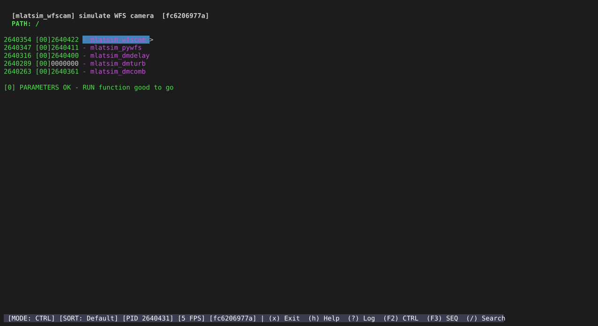
_milk-fpsCTRL after the deploy of mlatsim._

streamCTRL lists the DM channels `dm07disp00` to `dm07disp11`, their sum `dm07disp`, and the
simulator's streams. `mlatsim_wfs`, the camera, counts at about 800 Hz.

<!-- tut:tui id=streamctrl-mlatsim cmd="milk-streamCTRL" size=150x40 -->

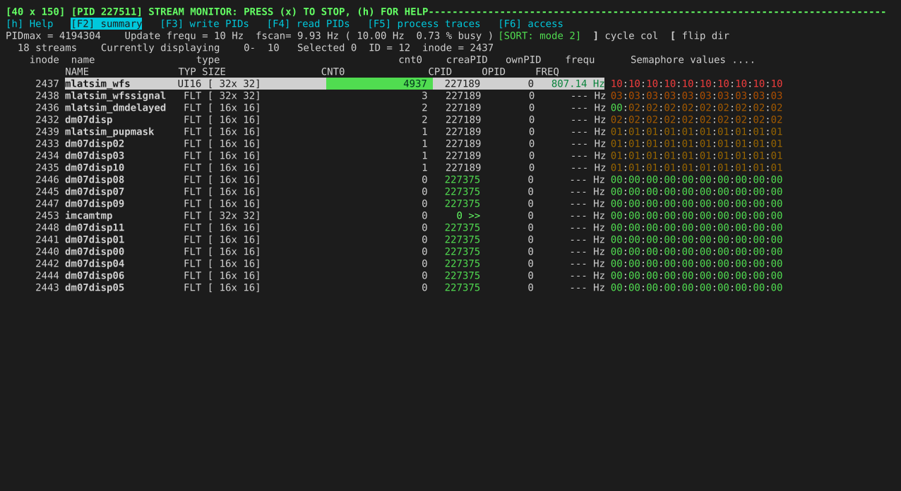
_milk-streamCTRL with the simulator running._

!!! tip "Look around"

    **Ask moka.** `moka state -p mlatsim`: `running`.

    **Under the hood.** `tmux ls` shows one session per compute unit, `mlatsim_dmturb`
    included. Attach to one with `tmux a -t mlatsim_wfscam`, detach with `Ctrl+b d`. In the
    fourth terminal, `shmImshow mlatsim_wfs &` shows the four pupil images of the pyramid
    and `shmImshow dm07disp &` the DM, flat for now.

## 6. Deploy the loop and link it

Deploy `aoloop`, then apply its linkage to the simulator.

<!-- tut:run id=deploy-aoloop -->

```bash
moka deploy -p aoloop
moka link -p aoloop           # (1)!
moka link delaysim -p aoloop  # (2)!
```

1. Without a name: lists the linkages of the pipeline, applies nothing.
2. Applies `[systemlinkage.delaysim]`. It prints no step line.

<!-- tut:out id=deploy-aoloop -->

```text title="Output"
INFO: ~/AOloop2/aoloop-rootdir/conf/conf.toml: extra keys ['_ln']
WARNING: Local plan 'takedark' overrides another one.
> moka deploy
rootdir: ~/AOloop2/aoloop-rootdir
aoloop: cold
  [1/4] ClaimRundir ... [ ok ] done (0.0 s)
  [2/4] InitFPS ....... [ ok ] done (0.1 s)
  [3/4] LoadData ...... [ -- ] already done
  [4/4] ConfStart ..... [ ok ] done (0.3 s)
[ ok ] deploy done in 0.6 s
INFO: ~/AOloop2/aoloop-rootdir/conf/conf.toml: extra keys ['_ln']
WARNING: Local plan 'takedark' overrides another one.
rootdir: ~/AOloop2/aoloop-rootdir
delaysim
INFO: ~/AOloop2/aoloop-rootdir/conf/conf.toml: extra keys ['_ln']
WARNING: Local plan 'takedark' overrides another one.
> moka link
rootdir: ~/AOloop2/aoloop-rootdir
```

The linkage is three symlinks, which streamCTRL shows (names truncated): `aol0_wfsim` to
`mlatsim_wfs`, `aol0_dmC` to `dm07disp03`, `aol0_dmRM` to `dm07disp02`.

<!-- tut:tui id=streamctrl-links cmd="milk-streamCTRL" size=150x40 -->

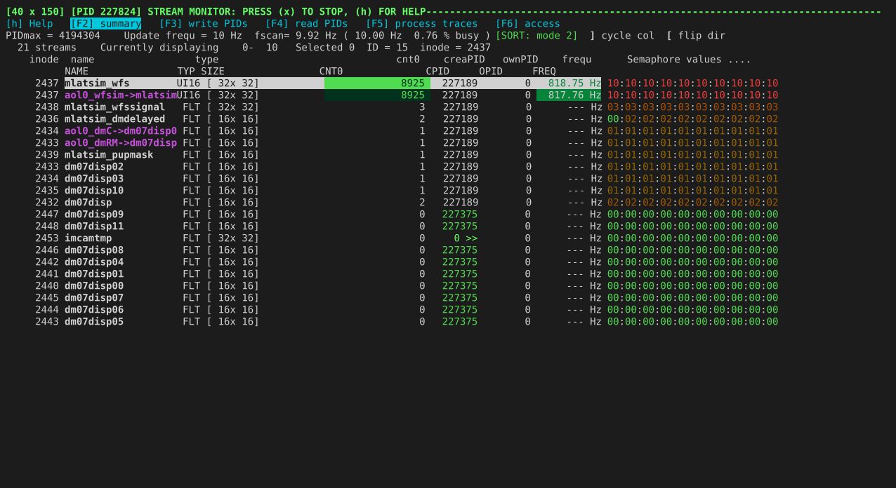
_milk-streamCTRL after `moka link delaysim`._

!!! tip "Look around"

    **Under the hood.** The loop reads `aol0_wfsim` and writes `aol0_dmC`, whatever they point to.
    Swapping the simulator for a real camera and DM is another linkage, not another loop. Read
    the camera from Python, through the loop's name:

    <!-- tut:py id=read-wfsim -->

    ```python
    from pyMilk.interfacing.shm import SHM

    wfs = SHM("aol0_wfsim")
    print(wfs.shape, wfs.get_data().mean())
    ```

    **Ask moka.** fpsCTRL now lists 11 FPS. `moka state -p aoloop`: `configured`.

## 7. Take a dark and a reference

Record the camera dark, then the reference WFS frame that the loop subtracts.

<!-- tut:run id=dark-ref -->

```bash
moka takedark -p aoloop
moka takeref -p aoloop
```

<!-- tut:out id=dark-ref -->

```text title="Output"
INFO: ~/AOloop2/aoloop-rootdir/conf/conf.toml: extra keys ['_ln']
WARNING: Local plan 'takedark' overrides another one.
> moka takedark
rootdir: ~/AOloop2/aoloop-rootdir
aoloop: configured
  [1/3] RemoveLightSim .... [ ok ] done (1.0 s)
WARNING
 (PID n) Cannot open shm file "/milk/shm/aol0_wfsdark.im.shm"

  [2/3] TakeDark .......... [ ok ] done (5.2 s)
  [3/3] PutbackLightSim ... [ ok ] done (1.0 s)
[ ok ] takedark done in 7.2 s
aol0_wfsdark.im.shm will be created
INFO: ~/AOloop2/aoloop-rootdir/conf/conf.toml: extra keys ['_ln']
WARNING: Local plan 'takedark' overrides another one.
> moka takeref
rootdir: ~/AOloop2/aoloop-rootdir
aoloop: configured
  [1/2] RunStart[acquWFS] ... [ ok ] done (0.0 s)
  [2/2] TakeRef ............. [ ok ] done (5.2 s)
[ ok ] takeref done in 5.2 s
```

!!! note "What moka did"

    `takedark` here is not the built-in plan. `aoloop-conf/scripts/moka_plans.py` defines a local
    one that wraps it: `RemoveLightSim` sets the simulated camera's flux to 0, `TakeDark`
    averages frames into `aol0_wfsdark`, `PutbackLightSim` restores the flux. The dark needs only
    the linkage that gives `aol0_wfsim` its data. `takeref` starts `acquWFS`, then averages its
    `aol0_imWFS1` frames into the reference.

In the fourth terminal, open the WFS frames as `acquWFS` reads them, and as the loop uses them:

<!-- tut:manual -->

```bash
shmImshow aol0_imWFS0 &
shmImshow aol0_imWFS2 &
```

<!-- tut:tui id=imwfs0 cmd="milk-termview aol0_imWFS0" size=80x40 -->

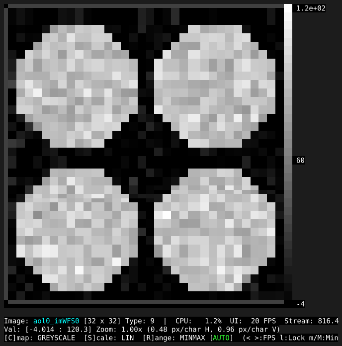
_`aol0_imWFS0`: the camera frame, four pupil images._

<!-- tut:tui id=imwfs2 cmd="milk-termview aol0_imWFS2" size=80x40 -->

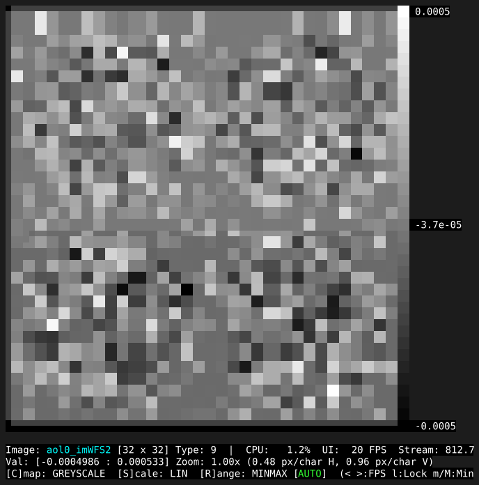
_`aol0_imWFS2`: with the DM flat, the frame minus the reference is noise around zero._

!!! tip "Look around"

    **Ask moka.** `moka plans -p aoloop` marks `takedark` `(local, overrides built-in)` and shows
    its three steps.

    **Under the hood.** `ls aoloop-rootdir/calib`: `wfsdark.fits`, `wfsref.fits`.
    `-n NFRAMES` or `-t SECONDS` sets how much is averaged.

    If `takedark` stops midway, the simulated light stays off (`mlatsim_wfscam.fluxtotal` is 0
    in fpsCTRL). Run `moka takedark -p aoloop` again: it puts the light back.

## 8. Measure the latency

Measure the time from a DM command to its effect on the WFS, which the response measurement needs.
Method: [Plans and tasks §1](../moka/plans.md#1-built-in-plans).

<!-- tut:run id=measure-mlat -->

```bash
moka mlat -p aoloop
```

<!-- tut:out id=measure-mlat -->

```text title="Output"
INFO: ~/AOloop2/aoloop-rootdir/conf/conf.toml: extra keys ['_ln']
WARNING: Local plan 'takedark' overrides another one.
> moka mlat
rootdir: ~/AOloop2/aoloop-rootdir
aoloop: mixed
  [1/3] RunStart[acquWFS] ... [ -- ] already done
  [2/3] RunStart[mlat] ...... [ ok ] done (0.2 s)
  [3/3] WaitRunEnd[mlat] .... [ ok ] done (2.0 s)
[ ok ] mlat done in 2.1 s
```

<!-- tut:manual -->

```bash
mokashow mlat -p aoloop
```

<!-- tut:fig id=mlat -->

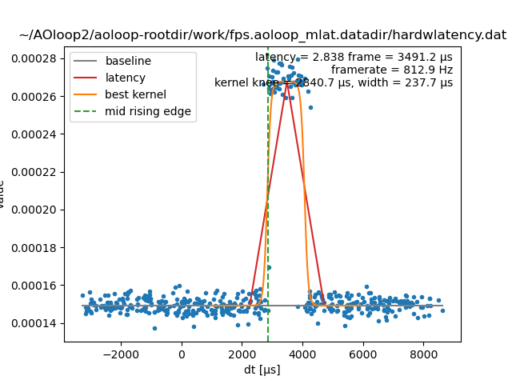
_The latency measured by `mlat`, in frames and microseconds, and the camera frame rate._

The simulator's `dmdelay` delays every DM write by 3 ms (`delaysec`), so expect a latency a little
above 3 ms.

!!! tip "Look around"

    **Ask moka.** `moka state -p aoloop`: `mixed`. `acquWFS`, started by `takeref`, is running;
    the other compute units of `runstart` are not. See
    [Operating §1](../moka/operate.md#1-lifecycle).

    **Under the hood.** The result is in `aoloop-rootdir/work/fps.aoloop_mlat.datadir/`
    (`hardwlatency.dat`); `teardown` keeps it.

    **Change the configuration.** The step amplitude is `OPDamp` of `[compute_units.mlat.fps]`
    in `aoloop-conf/fpsdetails.toml`.

## 9. Measure the response

Poke the DM with a set of modes and record the WFS response to each. Method:
[Plans and tasks §1](../moka/plans.md#1-built-in-plans).

First, on purpose, ask for the control matrix before there is anything to compute it from:

<!-- tut:run id=mkcm-refused expect=1 -->

```bash
moka mkcm -p aoloop -n 156
```

<!-- tut:out id=mkcm-refused -->

```text title="Output"
INFO: ~/AOloop2/aoloop-rootdir/conf/conf.toml: extra keys ['_ln']
WARNING: Local plan 'takedark' overrides another one.
> moka mkcm
rootdir: ~/AOloop2/aoloop-rootdir
aoloop: mixed
  [1/1] MakeCM ... [ NO ] refused: ~/AOloop2/aoloop-rootdir/calib/RMmodesDM.fits does not exist; run `moka mkpokes`.
[FAIL] mkcm: stopped at step 1/1 (MakeCM)
```

A refusal names the fix: here, `moka mkpokes`. Make the poke cube, then measure (about 20 s):

<!-- tut:run id=measure-rm -->

```bash
moka mkpokes -p aoloop
moka measlinresp -p aoloop
```

<!-- tut:out id=measure-rm -->

```text title="Output"
INFO: ~/AOloop2/aoloop-rootdir/conf/conf.toml: extra keys ['_ln']
WARNING: Local plan 'takedark' overrides another one.
> moka mkpokes
rootdir: ~/AOloop2/aoloop-rootdir
aoloop: mixed
  [1/1] MakePokes ... [ ok ] done (0.3 s)
[ ok ] mkpokes done in 0.3 s
INFO: ~/AOloop2/aoloop-rootdir/conf/conf.toml: extra keys ['_ln']
WARNING: Local plan 'takedark' overrides another one.
> moka measlinresp
rootdir: ~/AOloop2/aoloop-rootdir
aoloop: mixed
  [1/4] RunStart[acquWFS] ....... [ -- ] already done
  [2/4] SetLinResp .............. [ ok ] done (0.2 s)
  [3/4] RunStart[measlinresp] ... [ ok ] done (0.1 s)
  [4/4] WaitLinResp ............. [ ok ] done (19.1 s)
[ ok ] measlinresp done in 19.3 s
```

<!-- tut:manual -->

```bash
mokashow rm -p aoloop
```

<!-- tut:fig id=rm -->

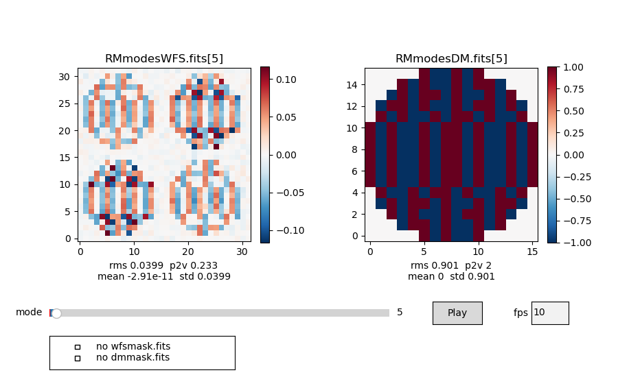
_The response matrix: a poke mode on the DM and the WFS response it gave._

!!! tip "Look around"

    **Under the hood.** `ls aoloop-rootdir/calib`: `RMmodesDM.fits` (the pokes) and
    `RMmodesWFS.fits` (the responses).

    **Ask moka.** `moka tasks measlinresp -p aoloop` lists the steps of the plan, which are done
    and which can run now.

    **Change the configuration.** `moka mkpokes -p aoloop zonal` pokes one actuator at a time
    instead of Hadamard modes; `moka measlinresp -p aoloop -a 0.01` changes the amplitude until
    the next deploy. The configured amplitude is `ampl` of `[compute_units.measlinresp.fps]`.

## 10. Compute the control matrix

Invert the response into the matrices that turn WFS frames into mode values and mode values into
DM commands, keeping the first 156 modes.

<!-- tut:run id=mkcm -->

```bash
moka mkcm -p aoloop -n 156  # (1)!
```

1. `-n 156` keeps the 156 strongest singular modes of the response: the WFS sees only the 156
   actuators lit by the pupil of `mlatsim` (`mlatsim_pupmask`), out of the 208 of the DM mask. The
   other modes are noise to the WFS; without the cut, the loop is unstable and corrects badly.

<!-- tut:out id=mkcm -->

```text title="Output"
INFO: ~/AOloop2/aoloop-rootdir/conf/conf.toml: extra keys ['_ln']
WARNING: Local plan 'takedark' overrides another one.
> moka mkcm
rootdir: ~/AOloop2/aoloop-rootdir
aoloop: mixed
  [1/1] MakeCM ... [ ok ] done (0.2 s)
[ ok ] mkcm done in 0.2 s
```

<!-- tut:manual -->

```bash
mokashow cm -p aoloop
```

<!-- tut:fig id=cm -->

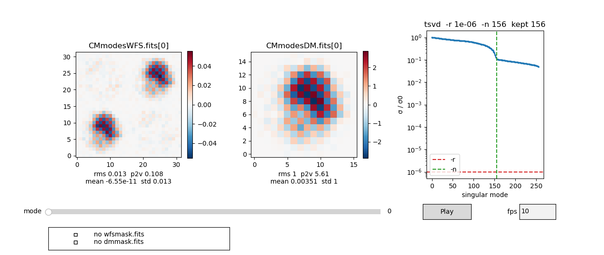
_The control matrix: a control mode, and the singular values of the response with the `-n` cut._

The singular values drop after mode 156, where `-n 156` cuts.

!!! tip "Look around"

    **Change the configuration.** Without `-n`, `mkcm` keeps every mode, the ones the WFS does
    not see included. `moka mkcm -p aoloop tikhonov -r 0.01` regularizes instead of cutting.
    Options: [Plans and tasks §1](../moka/plans.md#1-built-in-plans).

    **Ask moka.** `mkcm` touches no stream: `moka plans -p aoloop` shows it `ok` even on a
    `cold` pipeline.

## 11. Spool: the loop ready, open

Load the control matrix and start the loop's compute units, with the integrator off.

<!-- tut:run id=spool -->

```bash
moka spool -p aoloop
```

<!-- tut:out id=spool -->

```text title="Output"
INFO: ~/AOloop2/aoloop-rootdir/conf/conf.toml: extra keys ['_ln']
WARNING: Local plan 'takedark' overrides another one.
> moka spool
rootdir: ~/AOloop2/aoloop-rootdir
aoloop: mixed
  [1/6] SetLoopOff[mfilt] .................... [ -- ] already done
  [2/6] RunStop[modes2dm,mfilt,wfs2modes] .... [ -- ] already done
WARNING
 (PID n) Cannot open shm file "/milk/shm/aol0_CMmodesWFS.im.shm"

WARNING
 (PID n) Cannot open shm file "/milk/shm/aol0_CMmodesDM.im.shm"

  [3/6] LoadCM[wfs2modes,modes2dm] ........... [ ok ] done (0.2 s)
  [4/6] RunStart[acquWFS] .................... [ -- ] already done
  [5/6] RunStart[wfs2modes,mfilt,modes2dm] ... [ ok ] done (0.4 s)
  [6/6] SetLoopOff[mfilt] .................... [ -- ] already done
[ ok ] spool done in 0.6 s
aol0_CMmodesWFS.im.shm will be created
aol0_CMmodesDM.im.shm will be created
```

In fpsCTRL, the `aoloop_mfilt` FPS holds the loop parameters. `loopON` is `OFF`:

<!-- tut:tui id=fpsctrl-mfilt cmd="milk-fpsCTRL -n aoloop_mfilt" size=150x30 keys="Right" -->

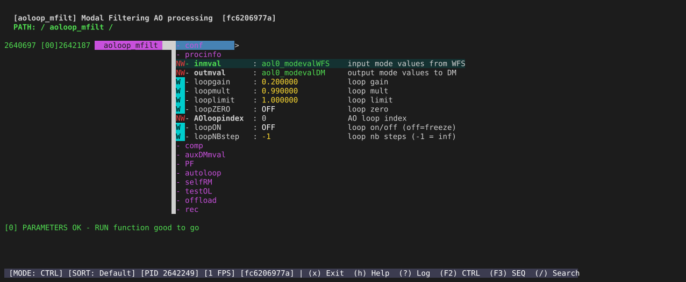
_The `aoloop_mfilt` FPS after `spool`: `loopgain`, `loopmult`, `looplimit`, `loopON`._

<!-- tut:tui id=streamctrl-spool cmd="milk-streamCTRL" size=150x40 -->

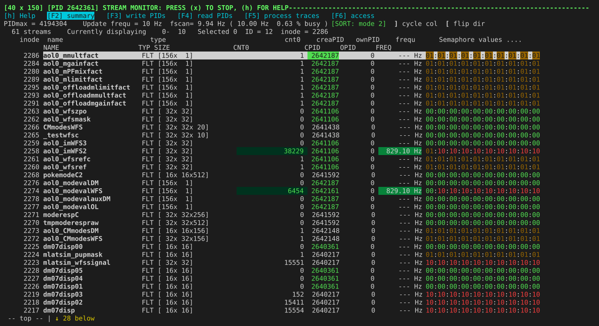
_milk-streamCTRL after `spool`: the loop's streams are created._

!!! tip "Look around"

    **Ask moka.** `moka state -p aoloop`: `running`, every compute unit of `runstart` runs.

    **Under the hood.** In streamCTRL, `aol0_modevalWFS` (mode values measured) counts at the
    camera rate; `aol0_modevalDM` (mode values sent) stays at 0 while `loopON` is `OFF`.
    `milk-fpsCTRL -n aoloop_mfilt` opens fpsCTRL on that FPS alone.

## 12. Close the loop

Turn the integrator on.

=== "fpsCTRL"

    In the fpsCTRL window:

    1. select `aoloop_mfilt` with the Up and Down keys;
    2. press Right to show its parameters, then Down to `loopON`;
    3. press Space: `loopON` turns `ON`.

=== "Python"

    <!-- tut:py id=close-loop -->

    ```python
    from pyMilk.interfacing.fps import FPS

    mfilt = FPS("aoloop_mfilt")
    mfilt["loopgain"] = 0.2
    mfilt["loopmult"] = 0.99
    mfilt["loopON"] = True
    ```

<!-- tut:tui id=fpsctrl-mfilt-loopon cmd="milk-fpsCTRL -n aoloop_mfilt" size=150x30 keys="Right" -->

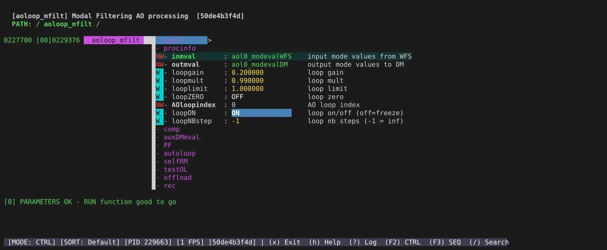
_The loop closed: `loopON` is `ON`._

There is nothing to correct yet, so the loop output stays close to zero (a few thousandths of a
µm). Watch it in the fourth terminal:

<!-- tut:manual -->

```bash
shmImshow dm07disp03 &
```

<!-- tut:tui id=dm07disp03 cmd="milk-termview dm07disp03" size=80x40 -->

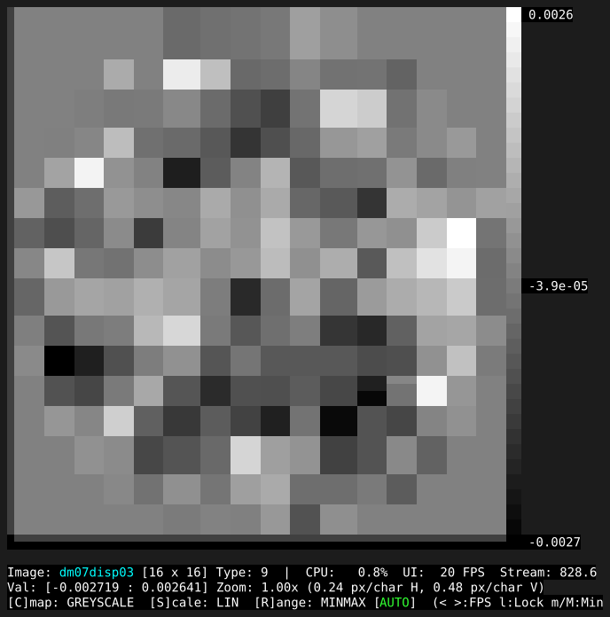
_`dm07disp03`, the loop closed with no turbulence: small values around zero._

!!! tip "Look around"

    **Play with the loop.** Press Space on `loopON` again: the loop freezes, `dm07disp03` keeps its
    last command. `loopZERO` (Space) zeroes the command. Close the loop again before going on.

## 13. Add turbulence and watch the PSF

Start the turbulence generator of `mlatsim` and turn it on, then compute the PSF of the DM.

<!-- tut:run id=dmturb -->

```bash
moka runstart -p mlatsim dmturb
```

<!-- tut:out id=dmturb -->

```text title="Output"
> moka runstart
rootdir: ~/AOloop2/mlatsim-rootdir
mlatsim: running
  [1/1] RunStart[dmturb] ... [ ok ] done (0.2 s)
[ ok ] runstart done in 0.2 s
```

=== "fpsCTRL"

    In the fpsCTRL window, select `mlatsim_dmturb`, show its parameters, move to `turbON` and
    press Space.

=== "Python"

    <!-- tut:py id=turb-on -->

    ```python
    from pyMilk.interfacing.fps import FPS

    FPS("mlatsim_dmturb")["turbON"] = True
    ```

<!-- tut:tui id=fpsctrl-dmturb cmd="milk-fpsCTRL -n mlatsim_dmturb" size=150x30 keys="Right" -->

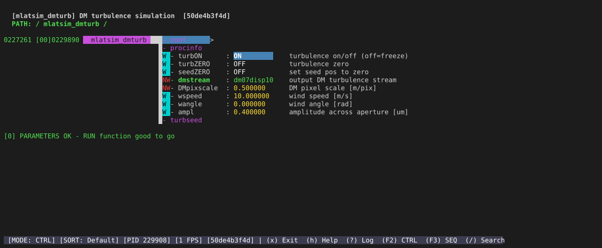
_The turbulence generator: `turbON`, `ampl`, `wspeed`._

The turbulence shows on `dm07disp10` about 2 s later. Compute the PSF of the DM in a tmux session:

<!-- tut:run id=dm-psf -->

```bash
tmux new-session -d -s dm_psf "python aoloop-rootdir/conf/scripts/dm_psf.py"  # (1)!
```

1. Writes the PSF of `dm07disp` to `aol0_psf` ten times a second, until
   [§15](#15-tear-down) stops it. `tmux a -t dm_psf` shows its output.

In the fourth terminal, open the viewers of the image at the top:

<!-- tut:manual -->

```bash
shmImshow aol0_psf &
shmImshow dm07disp10 &
shmImshow dm07disp &
```

<!-- tut:tui id=dm07disp10 cmd="milk-termview dm07disp10" size=80x40 -->

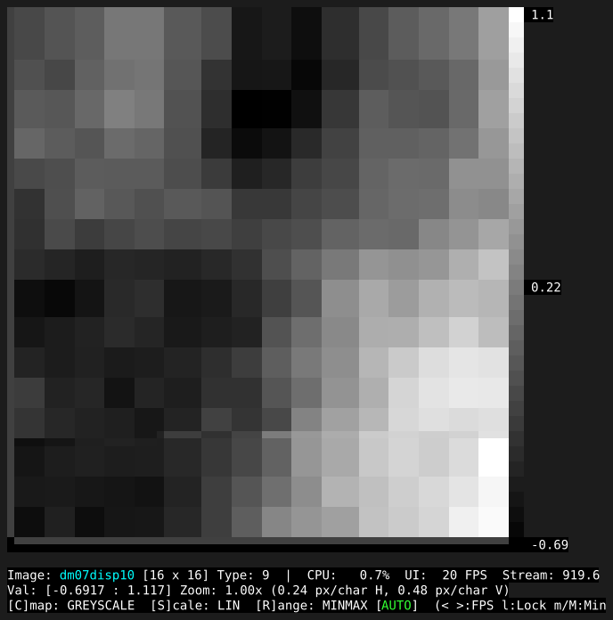
_`dm07disp10`: the turbulence written by `mlatsim_dmturb`._

With the loop closed, `dm07disp03` cancels `dm07disp10` inside the pupil: there `dm07disp`, their
sum, is flat. The PSF is sharper than with the loop open, shown next.

<!-- tut:tui id=dm07disp-closed cmd="milk-termview dm07disp" size=80x40 -->

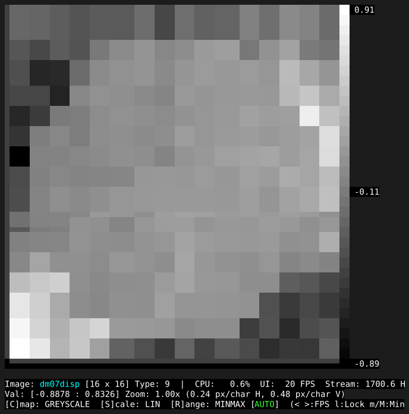
_`dm07disp`, the loop closed: flat inside the pupil, the turbulence left outside it._

<!-- tut:tui id=psf-closed cmd="milk-termview aol0_psf" size=80x40 -->

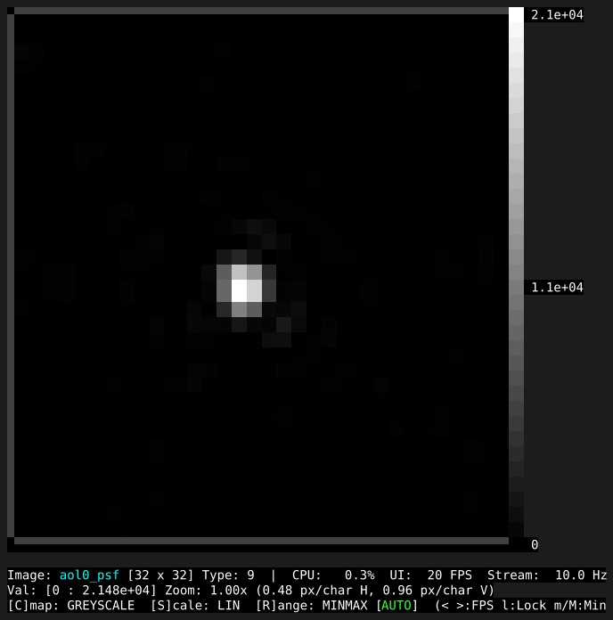
_`aol0_psf`, the loop closed._

To see the open loop, set `loopON` to `OFF`, then `loopZERO`:

<!-- tut:py id=open-loop -->

```python
import time

from pyMilk.interfacing.fps import FPS

mfilt = FPS("aoloop_mfilt")
mfilt["loopON"] = False
time.sleep(0.5)
mfilt["loopZERO"] = True
```

<!-- tut:tui id=dm07disp-open cmd="milk-termview dm07disp" size=80x40 -->

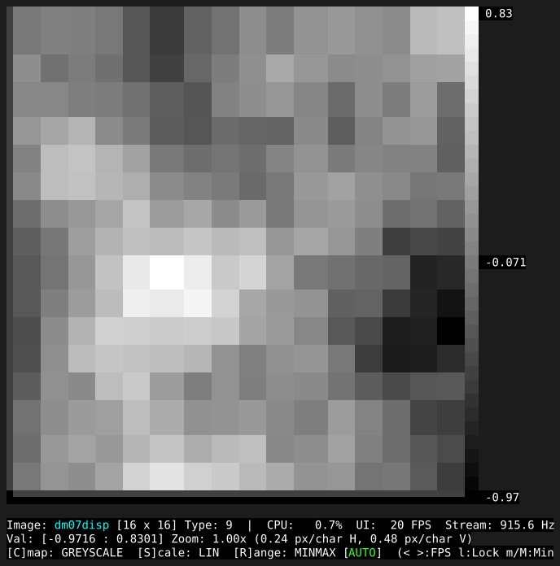
_`dm07disp`, the loop open: the turbulence alone._

<!-- tut:tui id=psf-open cmd="milk-termview aol0_psf" size=80x40 -->

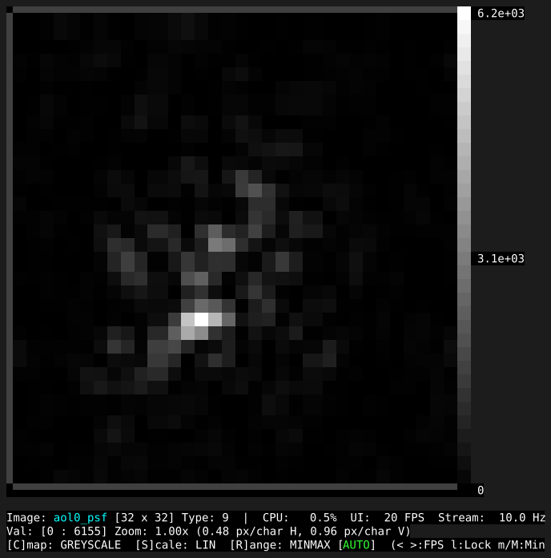
_`aol0_psf`, the loop open._

Close it again with `loopON`:

<!-- tut:py id=reclose-loop -->

```python
from pyMilk.interfacing.fps import FPS

FPS("aoloop_mfilt")["loopON"] = True
```

!!! note "Open loop"

    `loopON` `OFF` freezes the correction, it does not remove it; `loopZERO` removes it.

!!! note "Mask of the PSF"

    `dm_psf.py` computes the PSF over the DM mask (`[dmhint]`, 208 actuators), while the WFS sees
    156 of them: the loop leaves the ring outside the pupil uncorrected, which limits the gain in
    the PSF. Masks can be made from the control matrix; this page will be amended when that is
    done.

!!! tip "Look around"

    **Play with the loop.** On `aoloop_mfilt`, edit (Enter) `loopgain` and `loopmult`; on
    `mlatsim_dmturb`, `ampl` (the configured amplitude, rms in µm) and `wspeed` (m/s). Watch the
    PSF and `dm07disp03` after each change.

    - The loop diverges from a `loopgain` of about 0.6; with `loopmult` at 0.999 or 1.0 it
      diverges slowly.
    - `looplimit` limits each mode, not the total: it does not stop a divergence.
    - To recover: `loopON` `OFF`, then `loopZERO`, then a lower gain and `loopON` again.

    **Under the hood.** Read the loop from Python while you play:

    <!-- tut:py id=read-dm -->

    ```python
    from pyMilk.interfacing.shm import SHM

    for name in ("dm07disp10", "dm07disp03", "dm07disp"):
        print(name, SHM(name).get_data().std())
    ```

    **Change the configuration.** Values set in fpsCTRL last until the next deploy. To keep a
    turbulence amplitude, change `ampl` in `mlatsim-conf/conf.toml`, as
    [§14](#14-change-the-configuration) does for `loopgain`.

## 14. Change the configuration

Change the loop gain in the confdir, and carry the change to the live pipeline.

In `aoloop-conf/fpsdetails.toml`, set the gain to 0.3:

<!-- tut:manual id=edit-loopgain -->

```toml
[compute_units.mfilt.fps]           # modal filter (integrator)
loopgain = 0.3
```

The rootdir does not change by itself. `drift` shows the difference:

<!-- tut:run id=drift -->

```bash
mokainit drift aoloop-rootdir
moka state -p aoloop
```

<!-- tut:out id=drift -->

```text title="Output"
INFO: aoloop-rootdir/conf/conf.toml: extra keys ['_ln']
INFO: ~/AOloop2/aoloop-conf/conf.toml: extra keys ['_ln']
fpsdetails.toml: source modified, local unchanged
  compute_units.mfilt.fps.loopgain: 0.2 -> 0.3
INFO: ~/AOloop2/aoloop-rootdir/conf/conf.toml: extra keys ['_ln']
WARNING: Local plan 'takedark' overrides another one.
rootdir: ~/AOloop2/aoloop-rootdir
aoloop: running
INFO: ~/AOloop2/aoloop-conf/conf.toml: extra keys ['_ln']
drift: 1 artifact(s); run `mokainit drift ~/AOloop2/aoloop-rootdir`
```

`resync` refuses while a run process is active: tear `aoloop` down first, then resync, deploy and
link again (teardown removes the links).

<!-- tut:run id=resync -->

```bash
moka teardown -p aoloop
mokainit resync aoloop-rootdir
moka deploy -p aoloop
moka link delaysim -p aoloop
```

<!-- tut:out id=resync -->

```text title="Output"
INFO: ~/AOloop2/aoloop-rootdir/conf/conf.toml: extra keys ['_ln']
WARNING: Local plan 'takedark' overrides another one.
> moka teardown
rootdir: ~/AOloop2/aoloop-rootdir
aoloop: running
  [1/6] RunStop .............. [ ok ] done (0.1 s)
  [2/6] DeapplyAllLinkages ... [ ok ] done (0.0 s)
  [3/6] ConfStop ............. [ ok ] done (0.1 s)
  [4/6] KillTmux ............. [ ok ] done (0.1 s)
  [5/6] DestroyFPS ........... [ ok ] done (0.0 s)
  [6/6] ReleaseRundir ........ [ ok ] done (0.0 s)
[ ok ] teardown done in 0.3 s
INFO: ~/AOloop2/aoloop-rootdir/conf/conf.toml: extra keys ['_ln']
INFO: ~/AOloop2/aoloop-conf/conf.toml: extra keys ['_ln']
INFO: aoloop-rootdir/conf/conf.toml: extra keys ['_ln']
applied fpsdetails.toml
Resynced: teardown, then deploy may be needed.
  compute_units.mfilt.fps.loopgain: 0.2 -> 0.3
INFO: ~/AOloop2/aoloop-rootdir/conf/conf.toml: extra keys ['_ln']
WARNING: Local plan 'takedark' overrides another one.
> moka deploy
rootdir: ~/AOloop2/aoloop-rootdir
aoloop: cold
  [1/4] ClaimRundir ... [ ok ] done (0.0 s)
  [2/4] InitFPS ....... [ ok ] done (0.1 s)
  [3/4] LoadData ...... [ -- ] already done
  [4/4] ConfStart ..... [ ok ] done (0.3 s)
[ ok ] deploy done in 0.6 s
INFO: ~/AOloop2/aoloop-rootdir/conf/conf.toml: extra keys ['_ln']
WARNING: Local plan 'takedark' overrides another one.
> moka link
rootdir: ~/AOloop2/aoloop-rootdir
```

!!! tip "Look around"

    **Change the configuration.** Edits in fpsCTRL are live and lost at teardown; edits in the
    confdir are kept, and reach the pipeline through `resync`. Details:
    [Drift and resync](../moka/provision.md#1-changing-a-deployed-pipeline). A plan of your own,
    like the `takedark` of [§7](#7-take-a-dark-and-a-reference), goes in
    `scripts/moka_plans.py`: [Plans and tasks §4](../moka/plans.md#4-custom-plans).

    **Play with the loop.** `calib/` survived the teardown: `moka spool -p aoloop` brings the
    loop back, open, and fpsCTRL shows `loopgain` at 0.3.

    **Ask moka.** `moka state -p aoloop` now reads `drift: none`.

## 15. Tear down

Close the viewers, then stop `dm_psf.py` and tear both pipelines down.

<!-- tut:run id=teardown -->

```bash
tmux kill-session -t dm_psf
moka teardown -p aoloop
moka teardown -p mlatsim
moka state -p aoloop
moka state -p mlatsim
```

<!-- tut:out id=teardown -->

```text title="Output"
INFO: ~/AOloop2/aoloop-rootdir/conf/conf.toml: extra keys ['_ln']
WARNING: Local plan 'takedark' overrides another one.
> moka teardown
rootdir: ~/AOloop2/aoloop-rootdir
aoloop: configured
  [1/6] RunStop .............. [ -- ] already done
  [2/6] DeapplyAllLinkages ... [ ok ] done (0.0 s)
  [3/6] ConfStop ............. [ ok ] done (0.1 s)
  [4/6] KillTmux ............. [ ok ] done (0.1 s)
  [5/6] DestroyFPS ........... [ ok ] done (0.0 s)
  [6/6] ReleaseRundir ........ [ ok ] done (0.0 s)
[ ok ] teardown done in 0.2 s
> moka teardown
rootdir: ~/AOloop2/mlatsim-rootdir
mlatsim: running
  [1/6] RunStop .............. [ ok ] done (0.1 s)
  [2/6] DeapplyAllLinkages ... [ -- ] already done
  [3/6] ConfStop ............. [ ok ] done (0.1 s)
  [4/6] KillTmux ............. [ ok ] done (0.1 s)
  [5/6] DestroyFPS ........... [ ok ] done (0.0 s)
  [6/6] ReleaseRundir ........ [ ok ] done (0.0 s)
[ ok ] teardown done in 0.3 s
INFO: ~/AOloop2/aoloop-rootdir/conf/conf.toml: extra keys ['_ln']
WARNING: Local plan 'takedark' overrides another one.
rootdir: ~/AOloop2/aoloop-rootdir
aoloop: cold
INFO: ~/AOloop2/aoloop-conf/conf.toml: extra keys ['_ln']
drift: none
rootdir: ~/AOloop2/mlatsim-rootdir
mlatsim: cold
drift: none
```

fpsCTRL is empty again. What survives:

- the rootdirs, with `conf/`, `initdata/`, `work/` (the latency) and `calib/` (dark, reference,
  response and control matrices);
- the streams in `/milk/shm` (`dm07disp*`, `mlatsim_*`, `aol0_*`), until you remove them or
  reboot. `dm07disp03` keeps the last loop command. On a second pass through this page, the
  `Cannot open shm file` warnings of [§5](#5-deploy-and-start-the-simulator) do not appear.

<!-- tut:tui id=streamctrl-teardown cmd="milk-streamCTRL" size=150x40 -->

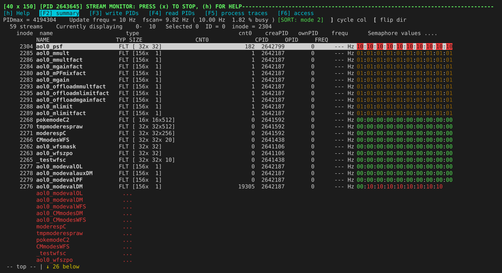
_milk-streamCTRL after both teardowns: the streams remain._

`moka nuke -p aoloop` tears down and also deletes the rootdir; it is not needed here.

!!! tip "Look around"

    **Ask moka.** `moka plans -p aoloop`: on the `cold` pipeline, `deploy`, `mkcm`, `runstop` and
    `teardown` show `ok`; the plans that need running compute units cannot run.

    **Under the hood.** `ls $MILK_SHM_DIR` lists the streams left behind; `tmux ls` no longer
    lists the compute units.

## 16. Where next

- [Operating](../moka/operate.md): states, every `moka` command, errors.
- [Configuration](../moka/conf.md): what a confdir and `conf.toml` can say.
- [Plans and tasks](../moka/plans.md): the plans run on this page, and how to write your own.
- [fpsCTRL Reference](../guide/fpsCTRL_reference.md): every key of the TUI.
- [pyMilk](../guide/pyMilk.md): streams and FPS from Python.
- [Glossary](../moka/glossary.md).

_Outputs and images on this page are generated by
[scripts/docs/tutorial_capture.py](<{{ github_blob_url }}/scripts/docs/tutorial_capture.py>).
To rebuild them, follow the
[docs-writer skill](<{{ github_blob_url }}/.agents/skills/docs-writer/SKILL.md#rebuilding-the-moka-tutorial>)._
