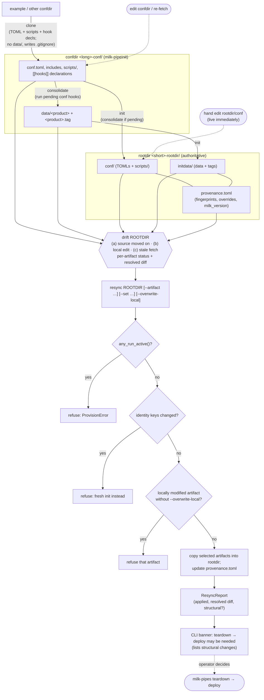
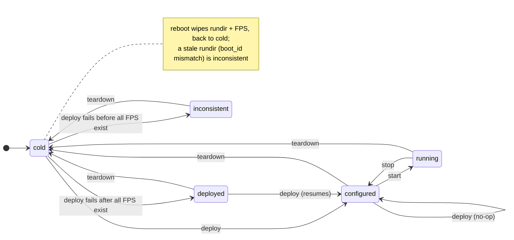

# `python/milk` pipeline layer: design v7 (frozen)

Status: **v7, frozen 2026-10-27.** This is the normative design for the Spec Kit roadmap in
`specs/pipelines/ROADMAP.md`. It changes only through an amendment that Vincent agrees to, which
bumps the version to v8. Spec Kit commands and agents must **not** edit this file.
Companion: `design-v7-appendix-a.md` (TOML shapes, file formats, CLI map).

Provenance: drafts 1–6 and two independent reviews, recorded in the claude.ai project
"milk pipelines and system". §1–§2 describe the code as reviewed on 2026-10-26/27
(`milk-standalone-wt/python/milk`). `docs/pipelines.md` predates this design and is not intent.

Purpose: give `/speckit-specify` a stable WHAT/WHY and give `/speckit-plan` agreed technical
constraints.

---

## 0. Terms (normative)

These definitions bind every spec, plan and doc. Spec Kit artifacts must use these words only in
these senses. They will move to `docs/` (a pipelines glossary), and specs and the constitution will
**link** to it rather than restate it.

| Term | Definition |
|------|-----------|
| **confdir** | `<long>-conf/`. The editable configuration source of a pipeline: TOML files, `scripts/`, conf-hook declarations, and `data/` (conf-hook products plus tagfiles, git-ignored). No rootdir operation ever reads it. |
| **clone** | A one-time, plain copy of a confdir's TOML files, `scripts/` and hook declarations to a new location. It excludes `data/`, writes a `.gitignore` containing `data/`, runs no conf hooks, makes no git commit, and refuses if the target exists. It leaves no ongoing link to the source. |
| **conf hook** | A declared, idempotent provisioning action whose product lands in `confdir/data/` with a tagfile, for example fetching large files. Conf hooks never touch SHM, FPS, tmux, processes or machine configuration. |
| **conf artifact** | A file-level unit of configuration whose fingerprint is tracked. There are two types: **conf file artifacts** (each TOML file of the conf set and each file under `scripts/`) and **hook artifacts** (each conf-hook product). Fetching produces hook artifacts; drift is computed per artifact. |
| **fingerprint** | A small record that identifies an artifact's content and origin without storing the content: `content_hash` (sha256 of the file bytes; for a directory product, a hash over the sorted (relpath, hash) list, with empty directories included as `(relpath/, "")`), `size`, and for hook artifacts also `decl_digest` (a hash of the hook's TOML declaration) plus informational `source` and `time`. Equality is decided **only** by `content_hash` and `decl_digest`. Modes and mtime are ignored. Symlinks inside products are refused. The `.tag` suffix is reserved. |
| **tagfile** | The recorded fingerprint of a hook artifact, stored next to it as `<product>.tag`. |
| **consolidate** | Run the pending conf hooks of a confdir. Local to the confdir. It can be re-run at any time without affecting any rootdir. |
| **confresolve** | API call: a TOML set (from a confdir or a rootdir) plus overrides → one validated `PipelineConfig`. Layers are merged and substitutions resolved. It always re-resolves (there is no cache this round) and has no side effects. |
| **identity keys** | `long_name`, `name` (the short name) and `loop_number`. Paths, FPS names and the uniqueness rule derive from them. They are never overridable, and resync refuses to change them. |
| **init** | Create a rootdir from a confdir: consolidate if needed, copy the conf file artifacts to `rootdir/conf/`, copy data and tagfiles to `rootdir/initdata/`, write `provenance.toml` (including the overrides used), and confresolve successfully. Refuses if the rootdir exists (use resync). Not atomic this round: on failure it reports and leaves what it wrote. |
| **rootdir** | `<short>-rootdir/`. The authoritative, long-lived home of one pipeline instance after init. Hand edits of `rootdir/conf/` take effect immediately and are reported as drift. |
| **drift** | A change between a conf artifact's recorded fingerprint and its current one, in the confdir or in the rootdir. It is reported **per artifact**, plus a **key-level resolved diff** (a difference in the confresolve output). Artifact drift is reported even when the resolved config is unchanged. Drift is only ever reported; resync is the only way to apply confdir changes to a rootdir. |
| **resync** | Explicit propagation of selected drifted conf artifacts from the confdir into an existing rootdir. Records new fingerprints in provenance and returns a `ResyncReport`. Refused while the pipeline is running, refused for identity-key changes, and refuses to overwrite a locally modified rootdir artifact unless `--overwrite-local` is given. |
| **provisioning** | Umbrella term for clone, consolidate, confresolve, init, drift and resync. File operations only; API `milk.provision`, CLI `milk-pipeinit`. The only contact with the live system: resync reads `any_run_active()` (§4.0 rule 5). Provisioning never writes to the rundir. |
| **rundir** | `$MILK_SHM_DIR/pipe_rundirs/<short>/`. Ephemeral. It holds only non-derivable runtime facts: boot_id, the claim (short name, loop_number, **the deployed FPS names**), and the **applied linkage pairs**. `deploy` creates it and `teardown` removes it. Teardown, unlink and the consistency check read what was deployed from here, not from the current config. |
| **cold** | No rundir and no FPS for this pipeline. `deploy` is the only operation allowed from cold. Any other operation raises `ColdSystemError` ("not deployed on this boot; run deploy"). |
| **inconsistent** | Any mismatch between the rundir and the live FPS set: a stale rundir (boot_id mismatch), a valid rundir with some **recorded** FPS missing (for example after a failed deploy), or pipeline FPS present without a valid rundir. Every operation except `teardown` raises `InconsistentStateError`, with guidance to run teardown. |
| **compute unit (CompU)** | One running instance of a milk compute unit within a pipeline, identified by (executable, FPS name): its FPS, its conf/run processes and its tmux session. "Session" is **not** used for this concept; it only ever means a tmux session. Code: `ComputeUnit`, `compute_units`, `ComputeUnitSpec`. |
| **task** | A unit of operation on a rootdir's live pipeline with `can()` / `forward()` / `success()`. It is idempotent and may touch SHM, FPS, tmux and processes. It never modifies `rootdir/conf/`. It acts on all CompUs by default, or on an optional CompU subset. |
| **plan** | Data, not code: a name, an ordered list of steps (task name plus an optional CompU subset), and a failure policy `on_failure: abort \| best_effort`. Defined in the generic registry or by a kind. Plans are what operators invoke. |
| **kind** | A protocol that a pipeline declares (`kind = "…"`). It contributes required CompUs, live defaults from the installed package, allowed plans, and extra validation. |
| **state** | The lifecycle status of a pipeline (`cold`, `inconsistent`, `deployed`, `configured`, `running`, or mixed), derived from rootdir + rundir + the live system. It is never stored. |

## 1. What the code actually is today (≈1.7k LOC)

```
milk-pipes (click)                    infra/mains_pipeline_mgmt.py
  clone | init | spool | sys | nuke
        │
        ▼
Pipeline(parent_folder, long_name)    pipeline.py
  ├─ config  ← load_pipeline_config() infra/toml_manipulation.py
  │            tomli → {var} substitution (flat dotted keys, DAG resolve)
  │            → PipelineConfigModel (pydantic) → copied into PipelineConfig (plain)
  ├─ task_do(Task)  can()/forward()/success()      infra/task_models.py
  │     InitialFolderSetup, DeployFPS, StartConfProcesses, LoadDataFiles
  │                                                infra/deploy_tasks.py
  ├─ get_session(name) → ComputeSession(exec, f"{name}_{loop:03d}")  session.py
  │     wraps `milk-fpsexec-*  <fps>:<cmd>` subprocesses + pyMilk FPS handle
  ├─ apply/deapply_system_linkage  (symlinks in MILK_SHM_DIR; tag in rootdir)
  ├─ clone_to / update_local_git   (rsync conf folder, commit into a local git)
  └─ nuke
cliwrap.py: CLI/CLICommands — drive interactive milk-cli (test harness, unrelated to pipelines)
```

On-disk model today: `<parent>/<long_name>-conf/conf.toml` →
`<parent>/<short>-rootdir/{conf.toml,data/,scripts/,rundir/,logdir→,fpstmuxenv,aorun-*,fpsCTRL.log→}`
plus `<parent>/<short>-logdir/`. `fpsinit` runs in `rootdir/rundir`, and the engine records that cwd
as the FPS workdir (`fps.<name>.datadir`/`confdir` are created there, and tmux `cd`s into it).

Worth **keeping**:

- The idempotent task protocol (`success()` short-circuits, `can()` gives a `failure_reason`).
- `{var}` substitution with dependency-ordered resolution, type-preserving single-token
  substitution and format specs.
- Pydantic validation at load time (`extra="forbid"` on procinfo, SHM-name checks on linkages).
- Defensive symlink handling in the linkage code (check-all-then-apply).

## 2. Defects and design smells

### 2.1 Correctness bugs

| # | Where | Issue |
|---|-------|-------|
| B1 | `StartConfProcesses.can` | Sets `failure_reason` for an invalid FPS but does not `return False`. |
| B2 | `conf.toml` `tasks = [...]` | The key is silently accepted (`extra="allow"`) and ignored, and its names don't match the `TASK_DB` class names. The real task lists are hard-coded in the CLI. |
| B3 | `mains_pipeline_mgmt.py`, `cliwrap.py` | `mains_pipeline_mgmt` reads `MILK_ROOT` at import. `cliwrap` reads `MILK_INSTALLDIR` and `dlopen`s `libmilkcommon.so` at import. Importing `milk` or `milk.pipeline` alone works. `cliwrap_test` relies on module-level `HAVE_CLI`, so a lazy version must keep that accessor. |
| B4 | `InitialFolderSetup` | `can()` is always `True`. Re-init of a *complete* rootdir is a no-op (`task_do` checks `success()` first). A *partial* rootdir (one without `conf.toml`) crashes on `mkdir(exist_ok=False)`. |
| B5 | `LoadDataFiles.success` | Only checks that the `.im.shm` file exists, not its content or shape. |
| B6 | `StartConfProcesses.forward` | The timeout path is silent (`task_do` then raises `NoSuccessTaskError`). The tmux-busy restart case is unhandled. |
| B7 | `Pipeline.nuke` | `fps.destroy()` is not wrapped in the best-effort `attempt`, so a failure there skips the rmtree step. The CLI docstring omits the destroy step. |

### 2.2 Duplication / inconsistency

| # | Issue |
|---|-------|
| X1 | **Three config representations**: `PipelineConfigModel`, the plain `PipelineConfig` (re-copied field by field, unused `dm_number`), and `LOOP_INFO`. |
| X2 | Session naming `f"{name}_{loop:03d}"` is re-implemented in 5 places although `Pipeline.get_session_abs_name` exists. |
| X3 | `ComputeSession` objects are constructed ad hoc in every task. |
| X4 | `MILK_SHM_DIR` is read via `os.environ` in tasks but via `pyMilk…MILK_SHM_DIR()` in `pipeline.py`. |
| X5 | Two "what is a pipeline" theories coexist in comments, plus empty typed stubs `DMCombPipeline`/`AOSimPipeline`/`AOPipeline`. |
| X6 | `CompoundTask`, `TestConfig` and `task_undo` are empty. `ReversibleTask` declares `reverse`/`best_effort_reverse` but nothing implements it. |
| X7 | cacao vocabulary leaks (`CACAO_LOOPNAME`, the `aorun-*` copy, `fpsCTRL.log`). |
| X8 | **Exception classes are scattered** (`infra/exceptions.py`, `task_models`, `cliwrap`, pyMilk). There is no common base and no rule about who prints. Some failures are printed and swallowed. |
| X9 | "session" names remain throughout: `ComputeSession`, `get_session*`, `self.sessions`, the CLI help text, and test helpers (e.g. `StreamDelayComputeSession`). |

### 2.3 Coupling

- `milk` imports pyMilk for SHM/FPS, and `pipeline_models` pulls `ImageStreamIOWrap` just for a
  name validator. pyMilk vendors milk's `libfps`/`libprocessinfo` by copy+sed, which is the
  ISIO/FPS version-skew risk noted in `WORKLIST.md`.
- `ComputeSession` drives fpsexecs via subprocess **and** reads state via the pyMilk FPS.

## 3. Decisions

| ID | Decision |
|----|----------|
| D-1 | **Scope: the deploy lifecycle only.** That means provisioning plus deploy, start, stop, teardown and linkages. Configuration store/load, Operations (aorun) and machine configuration (RT priorities, cset/taskset, hugepages) are out of scope. |
| D-2 | **Clean break from cacao is allowed.** The aorun-port round will audit cacao's stack; the long-term aim is no regression in AO capability. |
| D-3 | **Pipeline kinds = config + live package defaults + a protocol for standard kinds** (DMComb, SCAOLoop, AOLinearSimulator). |
| D-4 | **The Python API comes first.** The CLIs are thin. |
| D-5 | **Config layering:** kind defaults (live, from the installed package) → includes (confdir-relative) → conf.toml → API/CLI overrides (applied at init/resync only, recorded in provenance, replayed on rootdir resolves) → any-key substitution → validation. **There is no env layer.** |
| D-6 | **Provisioning is outside the task framework.** There are two isolated CLIs: `milk-pipeinit` (conf, provisioning, fetching, conf syncing) and `milk-pipes` (rootdir-only actions). |
| D-7 | **After init, the rootdir is authoritative.** It keeps the original conf files in `rootdir/conf/`. confresolve always re-resolves; there is no cache this round. |
| D-8 | **Conf-hook products live in `confdir/data/`**, git-ignored, with tagfiles. Init copies them to `rootdir/initdata/`. Re-fetching never affects the rootdir until a resync. |
| D-9 | **Rundir** `$MILK_SHM_DIR/pipe_rundirs/<short>/`. `deploy` creates it; `teardown` removes it. |
| D-10 | **Connectivity check / graph-gen is deferred.** |
| D-11 | **One exception contract** (§4.7). A CLI catch-all with pretty printing is anticipated, not scoped. |
| D-12 | **Standard-kind content is not designed now.** Only the infrastructure is in scope. |
| D-13 | **milk and pyMilk will eventually merge.** pyMilk exceptions propagate unwrapped. |
| D-14 | **Conventions:** lean docs, early returns and human-centric readability, no API duplication (§4.8). |
| D-15 | **"compute unit" (CompU) replaces "session"** everywhere. "Session" is reserved for tmux. |
| D-16 | **Resync rules:** refused while any CompU run process is active; refuses identity-key changes; refuses to overwrite locally modified rootdir artifacts unless `--overwrite-local`; returns a `ResyncReport`. The CLI always shows a strong "teardown → deploy may be needed" banner, listing structural changes when present. Nothing is automatic. |
| D-17 | **FPS workdir is `rootdir/work/`** (persistent; written only by tasks). |
| D-18 | **Cold / inconsistent model** (§0, §4.1). `deploy` from cold creates the rundir. A stale rundir or an FPS-set mismatch raises; teardown is the remedy. |
| D-19 | **Naming and uniqueness:** FPS name = `<short>_<cu>`. The (short name, loop_number) pair is unique per machine, enforced by `deploy` when it claims the rundir. |
| D-20 | **Concurrency: no locks.** Resync relies only on its `any_run_active()` refusal. Running resync at the same time as a plan is documented as operator error. Tasks take no exclusive lock: the design must leave room for future long-running AO tasks running concurrently. |
| D-21 | **Not this round:** atomic init/resync, the confresolve cache, the fingerprint stat cache, plan extensions, an undo protocol. |
| D-22 | **Legacy rootdir items:** `scripts/` is kept and tracked as conf file artifacts. The linkage tag moves to the rundir. `aorun-*`, `fpstmuxenv`, the `fpsCTRL.log` link and the sibling logdir are dropped (logs go to `rootdir/logs/`). |
| D-23 | **Tests:** the existing suite is green (Vincent fixed it). Every slice keeps it green. |
| D-24 | **Tasks vs plans:** tasks are code (with optional CompU subsets); plans are data (steps + `on_failure: abort \| best_effort`). Operators invoke plans only, as `milk-pipes` subcommands generated from the registry; single tasks via the API. |
| D-25 | **The rundir records what was deployed** (FPS names, applied linkage pairs); teardown, unlink and consistency use it. Consistency is checked once per plan. `deploy` accepts cold or any consistent state (idempotent); a failed deploy ⇒ inconsistent ⇒ teardown. |
| D-26 | **`{var}` substitution does not apply inside table arrays** (`[[dataloads]]`, `[[hooks]]`); their values pass through untouched. |

## 4. Design

### 4.0 Directory contracts

| | **confdir** `<long>-conf/` | **rootdir** `<short>-rootdir/` | **rundir** `$MILK_SHM_DIR/pipe_rundirs/<short>/` |
|--|--|--|--|
| Role | Editable source; conf-hook products | Authoritative home of one pipeline instance | Ephemeral, non-derivable runtime facts |
| Created by | `clone` | `init` | `deploy` |
| Removed by | user | user | `teardown` |
| Mutated by | humans; `consolidate` | `init`; `resync`; hand edits of `conf/` (live, reported as drift); tasks write `work/` and `logs/` | `deploy`, `teardown`, linkage apply/deapply |
| Read by `milk-pipes`? | **Never** | Yes | Yes |
| Git | TOML + `scripts/` tracked; `data/` ignored (clone writes `.gitignore`) | (Configuration round) | — |
| Lifetime | user-managed | indefinite | until teardown or reboot |
| Contents | `conf.toml`, includes, `scripts/`, conf-hook declarations, `data/<product>` + `data/<product>.tag` | `conf/` (original TOMLs + `scripts/`), `initdata/` (data + tags as of the last init/resync), `provenance.toml`, `work/` (FPS workdir), `logs/`, `calib/` (later) | `boot_id`, claim (short, loop_number, FPS names), applied linkage pairs |

Rules:

1. **Drift** is reported per conf artifact, plus a key-level resolved diff
   (confresolve(confdir) vs. confresolve(rootdir)). Three comparisons:
   - (a) **source moved on:** confdir current vs. rootdir recorded;
   - (b) **local edit:** rootdir current vs. rootdir recorded (the edit is already live);
   - (c) **stale fetch:** hook declaration vs. the artifact's `decl_digest` (status `stale`).

   Statuses: `unchanged | modified | stale | added | removed`. **Structural** means the CompU set,
   an executable or an FPS name changed. TOML artifacts are hashed as raw bytes, so cosmetic edits
   count; semantic changes show in the resolved diff.
2. **confresolve is the only way to obtain a `PipelineConfig`.** A rootdir resolve uses
   `rootdir/conf/` plus the overrides recorded in `provenance.toml`, so it is reproducible from
   any shell. Kind defaults come live from the installed package. `provenance.toml` records the
   milk package version, so a package upgrade can be reported (it does not count as artifact drift).
3. Consolidate and conf hooks have no side effects outside the confdir. Machine configuration is
   out of scope.
4. **Cold, inconsistent, uniqueness:**
   - **The rundir records what was deployed.** ClaimRundir writes boot_id and the claim
     (short, loop_number, refusing if another rundir holds either) together with the list of FPS
     names it is about to create. `link` records the applied (local → remote) pairs. Teardown,
     unlink and the consistency check use these records, never the current config, so a resync
     that changed the CompU set or the linkage map cannot leak FPSs or leave stale symlinks.
   - **Consistency** = a valid rundir (current boot_id) and every *recorded* FPS present. If the
     current config's CompU set differs from the recorded one (after a resync), that is not an
     inconsistency. `state()` reports it as "config changed since deploy", and teardown → deploy
     applies it.
   - **The check runs once per plan**, before the first step, not per task.
   - **`deploy` accepts `cold` and any consistent state.** From `cold` it runs fully; otherwise
     each step short-circuits on `success()`, so re-running deploy is safe. It refuses
     `inconsistent`. A deploy that fails partway leaves the pipeline `inconsistent` (recorded FPS
     missing); the remedy is teardown, then deploy.
   - Every other plan requires a consistent, non-cold pipeline and otherwise raises
     `ColdSystemError` or `InconsistentStateError`. `teardown` works in any state, acts on the
     recorded FPS and linkage pairs, and finishes by removing the rundir.
5. **Resync and the live system:** resync calls `any_run_active()` (from R1c) and refuses if it is
   true. This read is provisioning's only contact with the live system. There is no lock (D-20):
   the operator must not run resync and a plan at the same time.
6. **Resync outcome:** resync returns a `ResyncReport` (the artifacts applied, the resolved diff,
   structural yes/no). It never triggers teardown or deploy. The CLI always prints a strong
   banner saying a teardown → deploy may be needed, listing the structural changes when there are
   any. There is no `warnings`-module signal.

**Provisioning and resync flow** (`milk-pipeinit`):



A refused artifact does not abort the resync: the other selected artifacts are still applied, and
the report lists the refusals.

### 4.1 Pipeline identity and state

A pipeline is a pure function of (rootdir, rundir facts, live system). CompU and FPS naming
(`<short>_<cu>`) lives in exactly one place.

**`Pipeline.compute_units` is a read-only property returning `dict[str, ComputeUnit]`.** The keys
are the CompU names from the config. The getter builds or refreshes each `ComputeUnit` view from the
resolved `ComputeUnitSpec` and the canonical FPS name: it re-links an FPS that has become invalid
and drops a stale link. It never creates or starts anything. Tasks, `state()`, `any_run_active()`
and teardown obtain CompUs only through this property. Specs live in
`PipelineConfig.compute_units: dict[str, ComputeUnitSpec]`, and live views in
`Pipeline.compute_units`; both use the same keys.

Operating lifecycle (`milk-pipes <rootdir>`; plans on the arrows):



`deployed` exists only as a resumable partial state (all recorded FPS exist, but `deploy` stopped
before ConfStart completed). Re-running `deploy` resumes it.

`state()` reports `cold`, `inconsistent`, the states above, or a mixed state (for example only
some CompUs running). It never raises for these and never coerces them.

### 4.2 Tasks and plans

- Task protocol: `can() / forward() / success()` with `failure_reason`. Tasks are idempotent. A task
  acts on all CompUs by default; a plan step may restrict it to a CompU subset (e.g.
  `RunStart[delay1]`), as calibration-style procedures will need.
- Plans are data: name + ordered steps + `on_failure`. The plan runner applies the `task_do` rule
  to every step (skip if already successful, check `can`, run `forward`, verify `success`). With
  `abort` it stops at the first failure. With `best_effort` it runs every step, then raises one
  aggregate error.
- Operators invoke **plans only**, as `milk-pipes` subcommands generated from the plan registry.
  Single tasks are reachable through the Python API only.
- Generic plans: `deploy` = ClaimRundir → InitFPS (params, in `rootdir/work/`) → LoadData →
  ConfStart (abort); `start` = RunStart (abort); `stop` = RunStop (abort); `teardown` = RunStop →
  DeapplyLinkages → ConfStop → DestroyFPS → ReleaseRundir (best_effort; replaces `nuke`, fixes B7).
- Delete `ReversibleTask`, `CompoundTask`, `TestConfig` and `task_undo`. There is no undo protocol
  this round; teardown covers reversal.
- `conf.toml` may select plans only by names its kind allows (fixes B2).
- No task takes an exclusive lock. Future long-running AO tasks may run concurrently (anticipated).
- Complex aorun-style procedures will later be plans/tasks. Simple aorun actions get a separate,
  direct API in a later round.

### 4.3 Pipeline kinds: infrastructure only

```text
PipelineKind (protocol)
  kind_id            "generic" | user-registered ids
  required_compus    executables that must be present (by role name)
  defaults           TOML defaults shipped with the installed package (live)
  plans              generic plans + kind-specific plans (composed from task names)
  validate(config)   kind-specific checks
```

- Pipelines without `kind` are `generic`.
- **In scope:** the protocol, registration, the `generic` kind, and one stub kind that proves
  extensibility end to end.
- **Out of scope (Vincent authors manually later):** FPS defaults, tasks and plans for DMComb,
  SCAOLoop and AOLinearSimulator.
- Reference only (illustrates a stub, not to be specified): a SCAO loop contains
  `cacao-fpsexec-cacaoiot-acquireWFS`, `milk-fpsexec-linalg-MVMextract`, `cacao-fpsexec-mfilt`
  and a second `milk-fpsexec-linalg-MVMextract`.
- Acceptance criterion: Vincent can redefine the SCAO kind (CompUs, defaults, extra tasks and
  plans) **without editing the `milk` package core**.

### 4.4 Configuration model

- A single frozen pydantic `PipelineConfig`, produced only by confresolve.
- CompUs are typed: `compute_units: dict[str, ComputeUnitSpec]` (exec, FPS params, procinfo).
- Delete the plain `PipelineConfig` class and `LOOP_INFO`.
- Exact TOML shapes: Appendix A (`design-v7-appendix-a.md`).

### 4.5 Package hygiene and boundaries

- The package is safe to import. All `MILK_*` env access goes through `milk.env`. `cliwrap` loads
  build tags lazily but keeps a `HAVE_CLI` accessor.
- pyMilk is used through a narrow surface with a pure-Python SHM-name validator. A contract test
  checks the ISIO/FPS ABI version.

### 4.6 Linkages

Linkages stay inside the pipeline this round. `link` records the applied (local → remote) pairs in
the rundir, and `unlink`/teardown remove exactly those pairs. A `System` arbiter is deferred.

### 4.7 Exception contract

1. **One location:** `milk/errors.py` holds the whole hierarchy under `MilkError`: `EnvError`,
   `ConfigError`, `ProvisionError`, `TaskError` (`TaskCannotRunError`, `TaskDidNotSucceedError`),
   `ComputeUnitError`, `LinkageError`, `StateError` (`ColdSystemError`, `InconsistentStateError`;
   each names the command to run). No module defines its own exception class.
2. **Library code never prints, exits, or swallows errors.** Best-effort operations collect
   failures and raise one aggregate error at the end.
3. **Exceptions carry structured context** (pipeline, CompU, task, path, subprocess command and
   stderr). Native exceptions are wrapped with `raise … from`.
4. **pyMilk exceptions propagate as they are** (D-13). Unify the hierarchies when the repos merge.
5. **Anticipated, not scoped:** a top-level handler in both CLIs that pretty-prints errors and maps
   them to exit codes.

Rules 1–4 become a constitution principle.

### 4.8 Engineering conventions (→ constitution)

1. **Lean.** Low-volume documentation with clear intent. Docstrings say *why*. Specs, plans and
   docs are as short as they can be while staying unambiguous. Terms come from §0, with no
   synonyms.
2. **Human-centric readability.** Flat control flow, **early returns / guard clauses**, small
   intent-named functions. Indirection is welcome at declared protocols (§4.9); avoid ad-hoc
   indirection and metaprogramming elsewhere.
3. **No API duplication.** Reuse or extend before adding. One construction point for CompUs, one
   way to get a config (confresolve), one exception location, one registry. CLIs only parse and
   call the API. Flag duplicates rather than adding a variant.

Spec Kit: use the bundled `lean` preset; keep the core `clarify`, `analyze` and `converge`.

### 4.9 Abstraction points (protocols)

| Protocol | Contract | Implementations (round 1) | Selected by |
|----------|----------|---------------------------|-------------|
| **`Task`** | `can()` (sets `failure_reason`), `forward()`, `success()`. Idempotent. May touch SHM/FPS/tmux/processes; never writes `rootdir/conf/`. | deploy steps, confstart, data load, runstart, runstop, confstop, teardown steps | plan (by registered name) |
| **`ConfHook`** | `id`; `artifacts() -> list[HookArtifact]`; `resolve(confdir)` writes the products + tagfiles under `confdir/data/`. Resolved when all its artifacts match their declaration. Idempotent; confdir-only. Declared as `[[hooks]] type = "…"`. | file fetch, local generator command | `type` key in the TOML |
| **`ConfArtifact`** | `id`, `relpath`, `fingerprint()`, `recorded()`, `drift()`. Copying is generic over artifacts. Shared by fetching, init, drift and resync. | `ConfFileArtifact` (TOML files + `scripts/` files), `HookArtifact` | artifact type |
| **`PipelineKind`** | §4.3 | `generic`, one stub kind | `kind` key in the TOML |

Rules:

- `Task` and `ConfHook` share a shape (check → act → verify) but stay distinct types because
  their permitted side effects differ. They may share a tiny helper, not a base type.
- **One registry mechanism** (name → class, explicit registration) for tasks, conf hooks and
  kinds. Entry-point discovery is anticipated, not scoped.
- Plans are data (name, ordered steps with optional CompU subsets, `on_failure`); they are not a protocol.
- Deliberately not abstracted: the config layers, `ComputeUnit` and the rundir.
- Candidate to watch: an aorun-style procedure protocol (Operations round).

## 5. Roadmap (Spec Kit "spec of specs")

Test environment: **py** = pure Python (tmp dirs, no milk binaries); **milk** = needs milk
binaries, tmux and SHM via the existing conftest spoofing (`conftestaux/milk.py`).

| ID | Slice | Intent | Depends on | Tests |
|----|-------|--------|------------|-------|
| R1a | Import safety + errors | `milk.env`; lazy `cliwrap` (keeps `HAVE_CLI`); `milk/errors.py` replaces every scattered class (X8) | — | py |
| R1b | One model + vocabulary | Single `PipelineConfig`/`ComputeUnitSpec` (X1); `[compute_units]` table; session → CompU rename everywhere incl. tests and CLI help (X9); FPS naming `<short>_<cu>` in one place (X2) | R1a | milk |
| R1c | CompU views + fixes | `Pipeline.compute_units` property (X3); `any_run_active()`; fixes B1–B7 | R1b | milk |
| R2 | confresolve | Kind defaults, confdir-relative includes, recorded API/CLI overrides, any-key substitution (not inside table arrays, with a test), validation; identity keys protected; no cache | R1c | py |
| R3a | Conf artifacts & consolidate | `ConfArtifact` (conf file + hook artifacts, fingerprints, tagfiles, `stale`); `ConfHook` + the shared registry; clone (plain copy, `.gitignore`); consolidate | R2 | py |
| R3b | Init, drift & resync | Rootdir contract; init (`conf/`, `initdata/`, `provenance.toml`); per-artifact drift + resolved diff; resync (run check, identity-key and local-edit refusals, `ResyncReport`) | R3a | py (run check injected) |
| R4 | Rootdir operations | Cold/inconsistent model; rundir claim (records FPS names) and uniqueness; per-plan consistency check; idempotent deploy; teardown/unlink from rundir records; `state()`; `Task` protocol (CompU subsets); plan runner (`on_failure`); plans deploy/start/stop/teardown as CLI subcommands; FPS workdir `rootdir/work/`; linkage tag in the rundir | R3b | milk |
| R5 | Kind infrastructure | Kind protocol + registration, `generic` kind, one stub kind proving extensibility. No standard-kind content | R4 | milk |
| R6 | pyMilk boundary | Narrow interface, pure-Python validators, ISIO/FPS version test | R1a | milk |

The existing test suite stays green at every slice (D-23). Each slice ends by updating `docs/`.

**Anticipated, not to be specified now:**
- CLI top-level exception handler and pretty printing.
- Concurrent long-running AO tasks (the design must not preclude them).
- Atomic init/resync; the confresolve cache; the fingerprint stat cache; plan extensions; an undo
  protocol.
- Standard-kind content (Vincent, manually).
- Connectivity check / graph-gen.
- Configuration round (calibrations, rootdir git history), Operations/aorun port, simple aorun API.
- Machine configuration.

## 6. Amendments

None.
